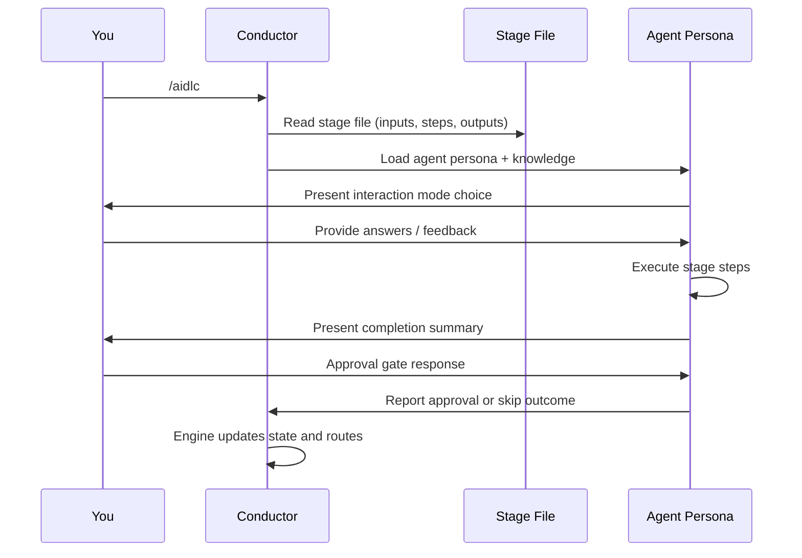
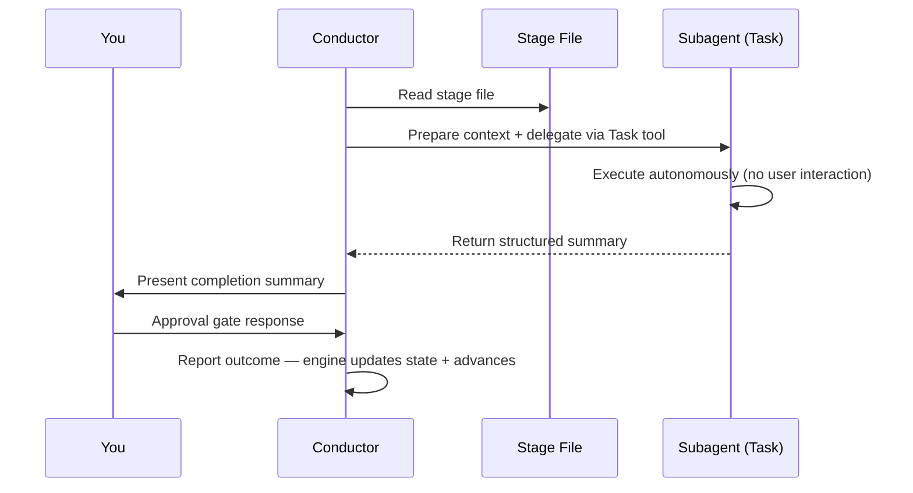

# Your First Workflow

この章では、AI-DLC の実行の各ステップで何が表示され、そこで何を決めるのかを説明します。
[はじめに](01-getting-started.md#5-your-first-run-in-claude-code) の実行例である
在庫管理用の REST API を題材にします。そのページでは最初の承認までの画面を示しています。
実行全体の流れは [実例集](16-worked-examples.md) で紹介しています。
Classic、Express、Feature などの選択肢の比較は
[ワークフロープロファイル](workflow-profiles.md) を参照してください。

> **注**: この章の実行記録は **Claude Code** のものです。Kiro CLI、
> Kiro IDE、Codex CLI、opencode でもワークフロー（ステージ、エージェント、ゲート、
> 成果物）は同じですが、Claude 専用のウェルカムバナーは表示されません。
> また、AI-DLC のステータスラインは Claude Code と Codex でのみ、有効にした後に表示されます。
> Kiro と opencode では `/aidlc --status` を使ってください。Codex では `$aidlc --status`
> と組み込みの `update_plan` による進捗表示を使います。
> 違いの一覧は、
> [他のハーネスでの実行](harnesses/README.md) にある各ハーネスの章に記載しています。

---

## Starting the Workflow

```
/aidlc Build a REST API for inventory management
```

プロジェクトで Claude Code を起動すると、AI-DLC のウェルカムメッセージが表示されます。
これは `.claude/settings.json` の `companyAnnouncements` エントリーです。AI-DLC の
見出しの下には "Run `/aidlc` to start or resume a workflow. Describe what to
build and AI-DLC proposes a plan for you to confirm."（/aidlc を実行してワークフローを開始または再開します。作るものを説明すると、AI-DLC が確認用の計画を提案します。）と表示され、続いて
フェーズ、ステージ、スコープ（既製の計画）と、それぞれが実行するステージが一覧表示されます。
`companyAnnouncements` は Claude
Code の設定であり、他のハーネスには相当するものがありません。他のハーネスではウェルカムは
表示されず、実行は下記の計画の質問から始まります。

### Starting from an existing document

既存のビジョンドキュメント、PRD、ブリーフの置き場所に決まりはありません。
テキストや Markdown をそのまま読ませるには、最初の依頼の中でファイル名を指定します。
たとえば `/aidlc Read ./vision.md and build what it describes` のようにします。相対パスは
プロジェクトのルートから解決されます。そのパスに何もない場合、ワークフローはその名前の
プロジェクトファイルを探します。1 つ見つかればそれを読み、どのファイルかを伝えます
（遅くともステージの承認を求める時点で）。複数見つかれば番号付きの選択肢を提示し、見つからなければ
パスを尋ねます。探すのはドキュメントファイル（Markdown、テキスト、PDF、Word など）だけで、
`.docker` や `.aws` のような隠しフォルダーや、入れ子になったリポジトリの中は対象外です。
git で無視されたファイル、シンボリックリンク、シークレットに見えるファイル
（`.env`、`*.pem`、`*.key`、`id_*`、または名前に
"secret"、"credential"、"password"、"token" を含むもの）は決して一覧に含めず、
プロジェクトの外を読むこともありません。すべてのファイルを一覧できない場合は、どれも選ばずに
パスを尋ねます。

ドキュメントの内容を依頼に直接貼り付けることもできます。その場合は
`<document>` と `</document>` で囲み、ワークフローがあなたの指示とドキュメントのデータを
区別できるようにします。指示はブロックの前でも後でも、その両方でもかまいません。

```text
/aidlc Build the product described below.
<document>
...vision document content...
</document>
Keep the first release read-only.
```

区切られた内容は信頼できないデータとして扱われ、指示とはみなされません。最初の
`<document>` から最後の `</document>` までのすべてがドキュメントになるため、貼り付けたテキスト内の
`</document>` によって残りの部分が指示に変わることはありません。閉じマーカーのない
`<document>` はメッセージの残りをドキュメントとし、開始マーカーのない `</document>` は
それより前のすべてをドキュメントとします。ワークフローは、メッセージをどう分割したかを 1 行で伝えます。
複数行の入力は、行単位の状態ファイルとは別に、コミットされる
`<record>/project-description.json` に 1 つの JSON 文字列として保存されます。その
`Project` フィールドは、ドキュメント外のあなたの指示を安全な 1 行のプレビューとして保持します。
そのため、ワークフローのフィールドに似た Markdown の行によって、選択されたスコープやライフサイクルの
状態が変わることはありません。ドキュメントだけで、その外に言葉がないメッセージは
"Build what the pasted document describes."（貼り付けたドキュメントに書かれたものを作る）として扱われ、
続く計画の質問でもその旨が示されます。

ドキュメントは、いつでも自分で追加することもできます。
`/aidlc knowledge onboard <path>` で、プロジェクト内の任意のファイルやフォルダーを指定します。
ナレッジフォルダーの外にあるものはフォルダー内にコピーされ、その場所が 1 行で示されます。

PDF や Word のファイルも同じように扱えます。たとえば
`/aidlc Build what ./brief.pdf describes` のように名前を指定します。ワークフローはそれを
`aidlc/spaces/<space>/knowledge/documents/` にコピーして
[ナレッジベース](08-knowledge.md) に追加し、コピー先とドキュメント ID を 1 行で伝え
（遅くともステージの承認を求める時点で）、そのテキストを読みます。コマンドを実行したり ID を
入力したりする必要はなく、そのフォルダーにすでにあるファイルを置き換えることもありません。
ファイルが git で無視されている場合（または git で判定できない場合）は、コピーがコミットされることになるため、
それでもコピーするかどうかを先に尋ねます。テキストを読み取れない場合
（その種類のファイルの抽出手段がない、またはスキャンされたドキュメントである場合）は、
その理由を伝え、テキストまたは Markdown 版を求めます。200,000 文字を超えるテキストは
直接は読まれず、ワークフローは対応している形式のファイルを求めます。
ドキュメントのパス、ファイル名、内容は常に信頼できないデータとして扱われ、
指示とはみなされません。

[ビジョンドキュメントの書き方](writing-inputs/vision-document-guide.md) では
何を書くべきかを、
[技術環境ドキュメントの書き方](writing-inputs/technical-environment-guide.md)
では技術スタックとそのルールを説明しています。これらは依頼ではなく、
スペースのチームナレッジに置きます。

---

## Choosing the Plan

エージェントは依頼を読み、計画を提案します。計画とは、この種の作業向けに用意された
既製のステージの組み合わせです。質問には、計画の名前、ステージと承認ゲートの数、
Construction でユニットごとに繰り返すステージの数が示されます。在庫 API の例では
エージェントは 19 ステージの `mvp` を提案しました。`feature` の計画は 33 ステージすべてを実行します。次のことができます。

- 提案された計画で進める
- 別の計画を使う: エージェントが他の既製の計画を長さとともに一覧表示するので、
  1 つを選ぶか名前を入力します
- この作業に合わせて計画を調整する: エージェントがあなたの言葉から独自のステージの
  組み合わせを提案します

各計画の説明は [ワークフロープロファイル](workflow-profiles.md) に、
後から深さやテスト戦略を変更する方法は
[スコープ、深さ、テスト戦略](05-scopes-and-depth.md) にあります。

---

## Initialization Phase (Automatic)

計画を選ぶと、3 つの Initialization ステージが 1 秒もかからずに実行されます。
操作は必要ありません。これらのステージは、アクティブなスペースにこの作業の記録を作成し、
準備を整えます。

### Stage 0.1: Workspace Scaffold

フレームワークは `aidlc/spaces/<space>/intents/<YYMMDD>-<label>/` に記録を作成します（名前付きスペースを使わない限り、`<space>` は `default` です）。計画で実際に実行するフェーズごとに 1 つのフォルダーを作成するため、記録には存在するすべてのフェーズではなく、計画の内容が表れます。在庫 API の `mvp` の計画には Operation のステージがないため、その記録には `operation/` フォルダーがありません（最初のステージの後のトップレベルの一覧）。

```text
aidlc/spaces/default/intents/261013-inventory-rest-api/
  aidlc-state.md
  audit/
  initialization/
  ideation/
  inception/
  construction/
  verification/
  project-description.json
```

`feature` の計画は 5 つのフェーズすべてを実行します。`bugfix` の計画は Ideation をスキップしますが
デプロイのステージは残すため、`ideation/` はなく、`operation/` があります。
チームナレッジ用の `aidlc/spaces/default/knowledge/` のようなスペースの共有フォルダーも、
同時に `intents/` と並べて作成されます。

ステージごとのフォルダーは事前には作成されません。ステージのフォルダー（たとえば
`inception/requirements-analysis/`）は、そのステージが最初に成果物を書き込んだときに
作られるため、記録には何かを生み出した作業だけが並びます。

### Stage 0.2: Workspace Detection

決定論的なルールベースのスキャナーが、プロジェクトのトップレベルのファイルと、既知のソースディレクトリ（`src/`、`app/`、`lib/`、`pages/`、`components/`、`tests/`）の 6 階層下までを調べます。ソースファイル、フレームワークの設定、パッケージマニフェストに基づいて、greenfield か brownfield かを分類します。トップレベルで手がかりが見つからない場合は、他のフォルダーの中も 3 階層下まで調べるため、ソースがコンテナー用のフォルダー（例: `wordbook/`、`backend/`）にあるプロジェクトも brownfield として検出されます。ハーネスのディレクトリや `aidlc/` などの AI-DLC 自身のファイルは、あなたのコードとしては数えられないため、空のフォルダーは greenfield のままです。

スキャンよりもあなたの言葉が優先されます。`/aidlc --project-type brownfield "<what to build>"`（または `greenfield`）で開始してどちらかを伝えるか、いつでも平易な言葉で伝えてください（「これは既存のコードで、フロントエンドは ui-repo にある」など）。AI-DLC はフォルダーを再スキャンし、種別をあなたの指定として記録します。既存のコードの場合は Reverse Engineering を実行し、元のステージに戻ります。完了したステージは完了したままで、返信にはコードが判明する前に完了したステージが示されるので、必要ならやり直せます。作業が空のフォルダーで新しいプロジェクトとして始まり、Construction の前にフォルダーにコードが追加された場合は、AI-DLC がどちらなのかを 1 回だけ尋ねます。この選択はその作業にのみ適用され、次の作業ではフォルダーが再びスキャンされます。

### Stage 0.3: State Initialization

オーケストレーターは、インテントの `aidlc-state.md`（その記録ディレクトリ内）に、選んだ計画に基づくステージ計画、その深さとテスト戦略、スキャナーの分類を書き込みます。空のフォルダーではスキャンでコードが見つからないため、計画から Reverse Engineering が除かれます。既存のコードに対する作業であれば、そう伝えると AI-DLC がそれを実行します。

---

## Ideation Phase (Interactive)

Initialization の後、ワークフローは Ideation に入ります。ここからの各ステージは、承認ゲート付きで対話的に実行されます。

### Stage 1.1: Intent Capture (aidlc-product-agent)

Claude Code では、セットアップ時に AI-DLC のステータスラインを選んだ場合（または `/aidlc --statusline on` で有効にした場合）、ターミナル下部のステータスラインが作業の進行を表示します（Kiro と opencode では `/aidlc --status` を、Codex では `$aidlc --status` と組み込みの `update_plan` による進捗表示を使います）。在庫 API の実行では、1 ステージ後に次のように表示されました（バーのブロック文字と区切りの点はプレーンテキストで示し、右側のモデルの部分は省略しています）。

```text
[AIDLC] inventory-rest-api - IDEATION [##--------] 1/4 > Feasibility -- Architect Agent
```

左から順に、作業（スペースが複数ある場合は先頭にスペース名）、現在のフェーズ、フェーズの進捗バーと比率（どちらもこのフェーズの完了したステージを数えます）、現在のステージ、それを率いるエージェントです。Construction では、バーの代わりに `Unit N of M` が表示されます。右側には Claude Code のモデル、続いてコンテキストウィンドウの使用率を示す `ctx:N%`（Claude Code が報告した場合に表示）、さらに Claude Code が使用量を報告した後は、アクティブなワークフローと現在のセッションの入出力トークン数とコストの見積もりが表示されます。使用量の追跡（とその表示部分）をオフにするには `AIDLC_DISABLE_USAGE_TRACKING=1` を設定します。

> コストは公開された定価から算出したローカルの見積もりであり、請求額ではありません。記録されたプロバイダーが Amazon Bedrock の場合、実際の請求額と一致しないことがあります。独自の料金で計算する方法や非表示にする方法は [トラブルシューティング](15-troubleshooting.md#statusline-shows-a-cost-segment-you-dont-want-or-usage-tracking-concerns) を参照してください。

aidlc-product-agent は、ステージの質問を記録内のファイルに書き出し、どのように回答するかを尋ねます。選択肢は **Guide me**、**I'll edit the file**、**Chat** です（[画面](01-getting-started.md#5-your-first-run-in-claude-code)）。

- **Guide me** は、チャットで質問を数問ずつ尋ねます。各質問には選べる選択肢と、自由に回答を入力できる欄があります
- **I'll edit the file** では、示された質問ファイルに回答を記入します。終わったらそのことを伝えてください
- **Chat** では自由に議論でき、エージェントが会話から決定事項を拾い上げます

各モードの詳細は [インタラクションモード](07-interaction-modes.md) を参照してください。ステージの途中でモードを切り替えることもできます。選択は 1 回だけです。後のステージではその選択が再利用され、その旨が 1 行で示されます。変更したいときはそう伝えてください。

すべての質問に回答すると、エージェントはステージのドキュメントを書く前に、回答を読み上げて 1 回確認を求めることがあります（サマリー確認。ほとんどの計画で有効です）。ドキュメントを書いた後、ステージが前提にせざるを得なかった点について、あなたに決めてもらうよう求めることがあります。その後、レビュアーエージェントが主要なドキュメントを確認し、承認前の最後の質問として、このステージから次回のために覚えておくべきことがあるかを尋ねます（学びの質問。ほとんどの計画で有効です）。

### Approval Gate

続いて、ステージが生み出したもの、レビューの結果、承認の質問が表示されます。在庫 API の実行から抜粋します。

```text
Intent Capture & Framing is ready for your review. It produced intent-statement.md,
stakeholder-map.md and intent-capture-questions.md (8 questions, all answered), in
aidlc/spaces/default/intents/261013-inventory-rest-api/ideation/intent-capture/.

Stage: Intent Capture & Framing
Review outcome: Concerns remain for your decision.

| ID   | Severity | Where                                      | Status |
|------|----------|--------------------------------------------|--------|
| R-01 | Minor    | intent-statement.md > Initial Scope Signal | New    |
| R-02 | Minor    | intent-statement.md > Initiative Trigger   | New    |
| R-03 | Minor    | intent-statement.md > Success Metrics      | New    |

> R-03 Finding: The table carries a single, binary success metric ...
> R-03 Required action: Human should confirm at the gate that a single integration-adoption
  metric is sufficient, or ask a follow-up to add a data-accuracy or reliability metric ...

Decision options:
- Approve - continue.
- Request Changes - return to the listed artifacts so the required actions can be addressed.

Approve accepts the open review findings R-01 (...), R-02 (...) and R-03 (The table carries a
single, binary success metric ("at least one real...) as risk; you can also approve and ask for
one to be fixed, or reject one as not applying, saying why.

 Approval
 Intent Capture & Framing complete. How would you like to proceed?
 > 1. Approve
   2. Request Changes
```

git で管理されていないプロジェクトでは、最初のゲートで 1 回だけ "This project
has no git, so AI-DLC can't undo the changes it makes to your files; to get an
undo, run `git init` and commit them."（このプロジェクトには git がないため、AI-DLC はファイルへの変更を元に戻せません。元に戻せるようにするには git init を実行してコミットしてください。）とも表示されます。コミットがなければ、
ビルドが変更したあなたのファイルを元に戻すことはできません。

各指摘には、ID、重大度、場所、解決方法が示されます。安定した指摘の一覧は
エンジンが管理します。以降のチェックでは変更点だけが報告され、
あなたの判断は下したとおりに保たれます。開いているすべての指摘をリスクとして受け入れて
続行するには **Approve** を選びます（質問のすぐ上の行にそれらが示されます）。一覧の成果物に戻るには
**Request Changes** を選びます。特定の指摘について別の判断をしたい場合は、自分の言葉で伝えてください。
承認しつつ R-03 の修正を求めると、修正を求めたことが記録され、次のチェックで
再確認されます。R-03 を該当しないとして却下すると、理由とともにそのように記録され、
他に何も変わっていないため、現在のレビュー結果のまま同じゲートが再表示されます。
開いている指摘を該当しないとして却下するときは、その ID と理由を伝えてください。
レビュアーが修正済みとした指摘に同意できない場合は、その ID を添えて変更を依頼し、
修正されていない理由を説明してください。エンジンは次のチェックに向けてその指摘を再度開きます。
通常の修正フィードバックでは、指摘に対する判断は変わりません。後方へのジャンプの後は、
Keep と Modify ではこの一覧とその判断が保持されます。Redo from
scratch では `R-01` から新しい一覧が始まります。ワークフローの途中でアップグレードしても、
以前の判断は ID ごとに保持されます。修正の流れの詳細は
[インタラクションモード](07-interaction-modes.md) を参照してください。

承認すると、進捗の行が表示されます。

```text
Progress: 1 of 19 stages done. Next: Feasibility & Constraints.
```

### Remaining Ideation Stages

`feature` の実行では、ワークフローは続いて Market Research、Feasibility & Constraints、Scope Definition、Team Formation、Rough Mockups、Approval & Handoff を進みます。小さな計画ではもっと少なくなります（在庫 API の `mvp` の計画では、Intent Capture から Feasibility & Constraints に進みました）。どのステージも同じパターンです。エージェントが作業し、あなたがレビューし、承認します。

一部のステージは **条件付き** で、スコープによってはスキップされます。ステージがスキップされると、オーケストレーターがその理由を示し、自動的に先へ進みます。

---

## Inception Phase

Inception では要件を詳細化し、解決策を設計します。ステージ 2.1（Reverse Engineering）は **brownfield** のプロジェクト（既存のコードベース）でのみ実行されるため、在庫 API の空のフォルダーではスキップされました。このステージはバックグラウンドで実行され、あなたへの質問はありません。コラボレーターがオフの場合（`enterprise` 以外のすべての計画での既定値）は、aidlc-developer-agent がコードをスキャンし、9 つのコードナレッジドキュメントを自ら書きます。コラボレーターがオンの場合は、developer がスキャンし、その後 aidlc-architect-agent がそれらを書きます。どちらの場合も、結果は承認ゲートでレビューします。

Requirements Analysis から Delivery Planning までの他の Inception ステージは、Intent Capture と同じようにチャットであなたと一緒に進めます。Practices Discovery と User Stories では、コラボレーターがオンの場合にサポートエージェントも参加します（[サブエージェントへの委任](#subagent-delegation) を参照）。

---

## Construction Phase

ユニット分割とソースを生成する Construction ステージを含む新しいソロワークフローでは、
既定値は **検証付きのユニットチェックポイントを伴う unit-major の直列実行** です。
1 つのユニットが、適用可能な設計ステージと Code
Generation を終えてから、次のユニットが始まります。[Bolt](glossary.md) は引き続き
2.9 で計画したデリバリーの単位です。実行時の順序は、`bolt-plan.md` のグループ分けではなく
`unit-of-work-dependency.md` に従います。

Delivery Planning の間に、コンダクターは `bun test`、`pytest`、`make check` などの
実際のプロジェクトのチェックを提案し、実際のコマンドとともに **Use this command to verify each
completed Unit?**（完了した各ユニットの検証にこのコマンドを使いますか？）と尋ね、**Approve** / **Request Changes** を提示します。
インテントの `Construction Verification Command` が設定される前に、あなたの承認が記録されます。
同じコマンドがすべてのユニット/バッチのチェックポイントで再利用されます。変更するには、
改めて人間による承認の記録が必要です。greenfield のプロジェクトにまだ実行可能なチェックがない場合は、
選択を後回しにできます。その場合、最初のチェックポイントで検証を実行する前に尋ねられます
（Kiro IDE と Kiro CLI v3 では、並列ビルドの計画が承認された後、ワーカーが開始する前に尋ねられます）。
コンダクターがコマンドを勝手に作ったり、自動承認したりすることはありません。

skeleton-on の場合、DAG の最初のユニットは、動作する最小の統合スライスです。
そのユニットは、あなたの Plan Approval と必須のサマリー確認を含め、設計とコードを完了します。
その後、記録された人間承認済みのプロジェクトのチェックでスライスがエンドツーエンドで動作することを
示し、スケルトンを承認して後続のユニットが始まる前に、承認の質問に **Verified
with `<verification_command>` (exit 0)** が表示されます。最初の設計ステージをレビューするだけでは、
動作するスケルトンを示したことにはなりません。

計画した作業をビルドから外すよう求めた場合（「残りのストーリーはスキップして」など）は、
それを除いてビルドが続き、承認の際に何が除外されたかが示されます。たとえば
"Left out of this build: AC2.1.1, AC2.1.2 and AC2.2.1."（このビルドから除外: AC2.1.1、AC2.1.2、AC2.2.1）のように表示されます。ユニットの
`traceability.json` には、それらの項目があなたの言葉とともに `Deferred` として残ります。

Code Generation には、作業開始前からあったファイルが伝えられ、それらを避けてビルドします。
ファイルを変更するのは、あなたが求めた場合か、それなしではビルドできない場合だけです。
作業開始前からあったファイルをビルドが変更または
削除した場合（README、LICENSE、ドキュメントや設定ファイル。既存のコードでは、削除されたすべてのファイルと、
AI-DLC が名前からコードやビルドファイルとして扱わない変更されたファイル。つまり
README や `.env` は対象ですが、`package.json`、`Dockerfile`、YAML の設定ファイルは対象外です）は、
承認の際に 1 回だけその旨が示されます。git にあなたのコピーがある場合は、
それぞれを元に戻すコマンドも示されます。たとえば "The
build changed README.md, a file you had before this work started. To put it
back, run `git checkout HEAD -- README.md`."（ビルドが、作業開始前からあったファイル README.md を変更しました。元に戻すには上記のコマンドを実行してください。）のようになります。コミット済みのコピーがない場合は、
元に戻せるコピーがないことが示されます。ユニットごとにビルドする場合は、各ユニットの承認で
そのユニットが変更したものが示され、そのユニットが着手した時点の状態に戻せます。
セットアップや後の `aidlc config` が書き込んだ AI-DLC 自身のファイルは対象外です。
また、AGENTS.md や `.gitignore` のようにあなたと共有するファイルのうち AI-DLC がマークした部分も、
git にあなたのコピーがある場合は対象外です。そのファイルのあなたの部分は対象です。

自律性の選択がまだ記録されていない場合、ワークフローは続いて、残りの作業をどのようにビルドするかを尋ねます。選択肢は **Continue automatically** と **Review each checkpoint** です。

skeleton-off の場合は、代わりに Construction の開始時にこの選択が提示されます。回答は
`Construction Autonomy Mode` として記録され、再開時にも尊重されます。明示的な
オンデマンドの依頼で後から変更できます。**Continue automatically** は通常の
完了の質問をスキップしますが、Plan Approval、有効なサマリー確認、
検証コマンドの選択、失敗には引き続きあなたの対応が必要です。
サマリー確認が適用されるのは
`directive.ceremony.summary_confirmation === "on"` の場合だけです。**Review each checkpoint** は、
ユニットが完了するたびにあなたの承認を待ちます。

実行方式は別の選択です。unit-major は直列のままです。明示的に
stage-major とスウォーム実行を選んだ場合は、対象となる Code Generation のユニットを並列に
実行でき、バッチのチェックポイントはガイド付きまたは自動になります。チェックポイントで
すでに承認されたインラインのユニットが、後のスウォームのバッチで再ビルドされることはありません。
そのバッチを準備する前に、インラインのスケルトンのソースを含め、承認済みのアプリケーションのソースを
明示的にコミットしてください。コンダクターが暗黙的にコミットすることはありません。
ツールは子を作成する前にバッチ全体を確認し、ソースがまだ再現可能でない場合は
コミットして再試行するステップを示します。

チェックポイントの設定を持たない既存のワークフローは、旧来の最初のステージでの
レビューとステージゲートの動作を維持します。設計のみのワークフローやユニットのないフローは
既存のステージ承認を維持し、チーム所有のユニットは独自のゲートのリズムを維持します。
明示的なイテレーションの選択は保持されます。適用可能なユニットの作業がすべて終わると、Build and
Test と CI Pipeline がソリューション全体に対して 1 回実行されます。

---

## Operation Phase

Operation では、ソリューションをデプロイして監視します。7 つのステージはすべて条件付きであり、`mvp` や `poc` のような小さなスコープでは、このフェーズ全体がスキップされることがあります。

最後のステージ（4.7 Feedback & Optimization）が終わると、ワークフローは完了です。

---

## How Execution Modes Work

ワークフロー全体を通じて、2 つの実行モードがあります。

### Inline Execution

ほとんどのステージはインラインで実行されます。コンダクターがエージェントのペルソナを読み込み、会話の中で直接ステージのステップを実行します。あなたはリアルタイムでエージェントとやり取りします。



<!-- Text fallback: You invoke /aidlc. The conductor reads the stage file and loads the agent persona with knowledge. The agent presents an interaction mode, you provide input, the agent executes steps and presents a completion summary. You respond at the approval gate, and the conductor reports the outcome so the engine advances state. -->

### Subagent Delegation

4 つのステージはバックグラウンドのサブエージェントに処理を委ねます。2.1 Reverse Engineering（パイプライン: developer がスキャンし、その後 architect が統合して書き出す）、2.2 Practices Discovery（サブエージェントのハブ・アンド・スポーク: リードが草案を作り、互いの結果を見ない 3 つのサポートレビューを経て、人間へのインタビュー、リードによる統合）、2.4 User Stories（モブ: コラボレーターが並列に貢献し、判断を要する意見の相違がステージの途中であなたに示されることがあります）、3.5 Code Generation（サブエージェント）です。Practices Discovery は、スポークと最終的な統合の間に意図的にあなたを加えます。User Stories のモブでも、ステージの途中で判断を要する事項が示されることがあります。これらのサポートエージェントが参加するのは、コラボレーターがオンの場合です（`collaborators` 設定。出荷時にオンなのは `enterprise` だけで、`/aidlc --collaborators on` で 1 つの作業についてオンにできます）。コラボレーターがオフの場合、これらの各ステージはリードだけで実行されます。developer がコードのスキャンとコードナレッジベースの作成の両方を行い、Practices Discovery はリードの草案から直接あなたへのインタビューに進み、User Stories にはモブのラウンドがありません。ワークスペースの検出（0.2）は、サブエージェントではなく `aidlc-utility intent-create` の中で決定論的に実行されます。



<!-- Text fallback: The conductor reads the stage file, prepares context, and delegates via the Task tool. The subagent executes autonomously without user interaction and returns a structured summary. The conductor presents the summary to you, you respond at the approval gate, and the conductor reports the outcome so the engine advances state. -->

---

## Artifacts Produced

`feature` スコープのワークフローが終わると、インテントの記録ディレクトリ（`aidlc/spaces/<space>/intents/<YYMMDD>-<label>/`）には次のものが含まれます。

```
aidlc/spaces/<space>/intents/<YYMMDD>-<label>/
  aidlc-state.md          # Where the work stands, stage by stage
  audit/                  # Full decision audit trail (per-clone shards, merged by timestamp)
  ideation/               # Intent, market research, scope, mockups
  inception/              # Requirements, stories, design, units
  construction/           # Per-unit code + test artifacts
  operation/              # Deployment, observability, incident plans
  verification/           # Phase boundary verification reports
```

（チームナレッジは 1 つ上の階層、スペースレベルの `aidlc/spaces/<space>/knowledge/`（`intents/` と同じ階層）にあるため、すべてのインテントにわたって蓄積されます。チームが確認したプラクティスと学びは、それと並んでアクティブなスペースのメモリ層 `aidlc/spaces/<active-space>/memory/` にあり、同様にインテントをまたいで保持されます。）

---

## Status Line

Claude Code では、ワークフロー全体を通じて、AI-DLC のステータスライン（有効にした後。セットアップ時に尋ねられるか、`/aidlc --statusline on` で有効にします）が現在の位置を表示します（Kiro と opencode では `/aidlc --status` と各ゲートでの進捗の行を、Codex では `$aidlc --status` と組み込みの `update_plan` による進捗表示を使います）。在庫 API の実行から、バーと区切りの点をプレーンテキストで示し、モデルの部分を省略したものです。

```text
[AIDLC] inventory-rest-api - IDEATION [##--------] 1/4 > Feasibility -- Architect Agent
```

| 部分 | 意味 |
|---------|---------|
| `inventory-rest-api` | 作業。スペースが複数ある場合は先頭にスペース名が付きます |
| `IDEATION` | 現在のフェーズ |
| `[##--------]` | フェーズの進捗バー（10 文字。比率と同じ数を示します） |
| `1/4` | フェーズ内で完了したステージ。Construction では、バーと比率の代わりに `Unit N of M` が表示されます |
| `> Feasibility` | 現在のステージ |
| `-- Architect Agent` | それを率いるエージェント |
| `ctx:N%` | コンテキストウィンドウの使用率（Claude Code が報告した場合に表示） |
| トークンとコスト | アクティブなワークフローと現在のセッションの入出力トークン数とコストの見積もり（Claude Code のみ。Claude Code が使用量を報告した後に表示。`AIDLC_DISABLE_USAGE_TRACKING=1` でオフ）。コストは定価に基づく見積もりであり、請求額ではありません |

作業が選択される前は `[AIDLC] ready` と表示されます。

---

## Next Steps

- [スペースとインテント](03-spaces-and-intents.md) — ワークスペースが複数の実行をどのように保持するか、またそれらの開始方法と切り替え方法
- [フェーズとステージ](04-phases-and-stages.md) — 5 つのフェーズと 33 のステージの詳細
- [インタラクションモード](07-interaction-modes.md) — Guide Me、Edit File、Chat の説明
- [セッション管理](11-session-management.md) — 再開、やり直し、ステージ間のジャンプ
- [用語集](glossary.md) — 用語のリファレンス
