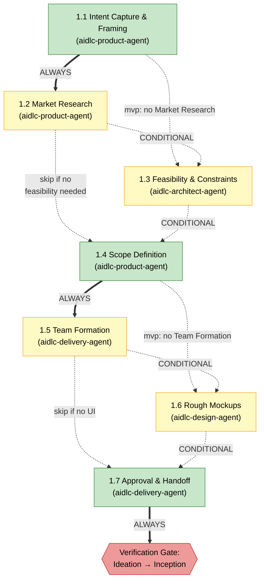
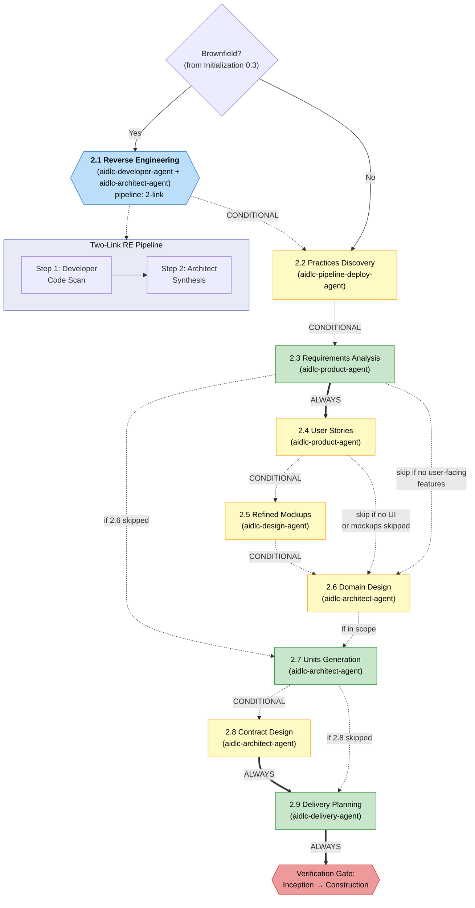
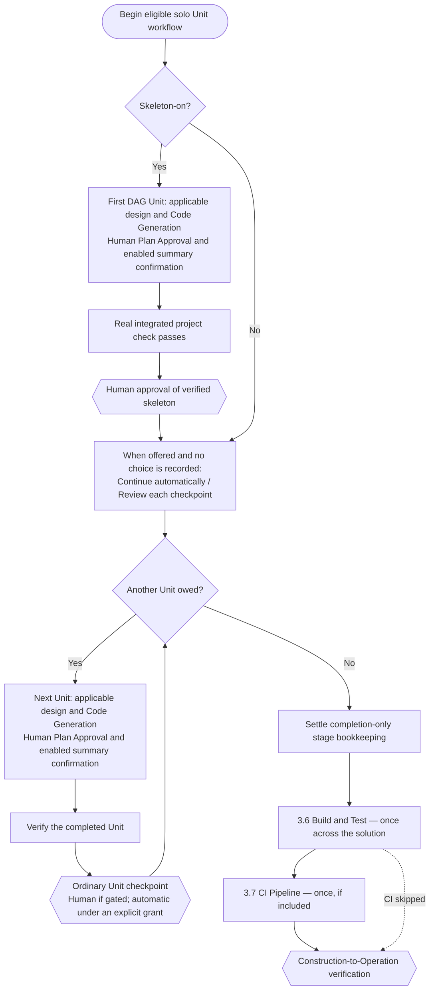
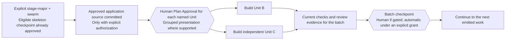
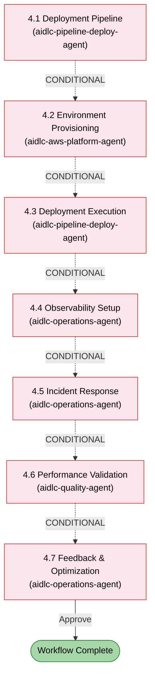

# Phases and Stages

AI-DLC のライフサイクルは、33 のステージを含む 5 つのフェーズで構成されています。この章では、各フェーズの説明、そのステージの一覧、そしてステージ同士のつながりを示します。

> **ハーネスに関する注記。** 方法論 — このガイドで説明するフェーズ、ステージ、
> エージェント、ゲート — はどのハーネスでも同じです。仕組みがハーネスによって異なる箇所
> （ゲートの表示方法、サブエージェントのディスパッチ方法、設定の保存場所）では、
> その違いを明記し、各ハーネスの章に表でまとめています:
> [他のハーネスでの実行](harnesses/README.md)。特に断りのない限り、ここでの例は
> Claude Code を使用しています。

---

## Lifecycle Overview

```mermaid
graph LR
    subgraph INITIALIZATION["INITIALIZATION (0.1-0.3)"]
        Z1["Workspace Scaffold"]
        Z4["State Init"]
        Z1 -.->|"3 stages"| Z4
    end

    subgraph IDEATION["IDEATION (1.1-1.7)"]
        I1["Intent Capture"]
        I7["Approval & Handoff"]
        I1 -.->|"7 stages"| I7
    end

    subgraph INCEPTION["INCEPTION (2.1-2.9)"]
        N1["Reverse Engineering"]
        N7["Delivery Planning"]
        N1 -.->|"9 stages"| N7
    end

    subgraph CONSTRUCTION["CONSTRUCTION (3.1-3.7)"]
        C1["Functional Design"]
        C7["CI Pipeline"]
        C1 -.->|"3.1–3.5 per Unit in the recorded order; 3.6–3.7 once after all Units"| C7
    end

    subgraph OPERATION["OPERATION (4.1-4.7)"]
        O1["Deployment Pipeline"]
        O7["Feedback & Optimization"]
        O1 -.->|"7 stages"| O7
    end

    Z4 -->|"auto-proceed"| I1
    I7 -->|"Verification Gate 1"| N1
    N7 -->|"Verification Gate 2"| C1
    C7 -->|"Verification Gate 3"| O1
    O7 -.->|"Feedback Loop"| I1

    style INITIALIZATION fill:#f3e5f5,stroke:#9c27b0,color:#000
    style IDEATION fill:#e8f5e9,stroke:#4caf50,color:#000
    style INCEPTION fill:#e3f2fd,stroke:#2196f3,color:#000
    style CONSTRUCTION fill:#fff3e0,stroke:#ff9800,color:#000
    style OPERATION fill:#fce4ec,stroke:#e91e63,color:#000
```

<!-- Text fallback: Linear flow: INITIALIZATION (0.1-0.3) auto-proceeds to IDEATION (1.1-1.7), which passes through Verification Gate 1 to INCEPTION (2.1-2.9), through Verification Gate 2 to CONSTRUCTION (3.1-3.7), through Verification Gate 3 to OPERATION (4.1-4.7). A feedback loop returns from 4.7 back to 1.1. -->

フェーズは順番に実行されます。各フェーズの境界（Initialization → Ideation を除く）では、**検証ゲート**が自動のトレーサビリティチェックを実行し、下流のステージがその上に構築を進める前に、リンクの欠落、孤立した成果物、不整合を検出します。

### What runs in order, and what runs in parallel

**ステージは 1 つずつ、順番に実行されます。** ステージが完了すると、エンジンはライフサイクルの順序で次のステージ、つまりスコープで実行対象となっていて、まだ完了もスキップもされていないステージへ進みます（Construction では、後述のとおりユニットごとにステージを繰り返します）。1 つのワークフロー内では、前のフェーズのステージが開いている間、後のフェーズは開始されません。

- それでも先に進みたい場合は、ジャンプします: `/aidlc --stage <name>` または `/aidlc --phase <name>`。飛ばしたステージはスキップ済み（`[S]`）としてマークされ、後から単独で実行されることはありません。前のステージに戻ると、そのステージと計画内のそれ以降のすべてのステージが再開されます。ファイルは残ります。再開したステージが以前のファイルを見つけると、それらを残すか、修正するか、ステージを最初からやり直すかを尋ねます。[ステージのスキップと移動](07-interaction-modes.md#skipping-and-navigating-stages) を参照してください。
- ワークフローを動かさずに 1 つのステージだけを実行するには、`/aidlc --stage <name> --single` を使います。そのステージの成果物を書き出し、ワークフローのゲートなしで停止します。ワークフローは元の位置のままです。作業内にそのステージのファイルがすでにある場合は、先にそれらのコピーを記録の `archive/` フォルダーに保存し、その場所を 1 行で知らせます。

**Construction はユニットごとにステージを繰り返します。** 進め方は次の 2 通りです:

- **Unit-major**（ユニットがあり、ソースを生成する新しい単独作業のデフォルト）: 1 つのユニットが設計ステージと Code Generation を通過し、その後、次のユニットが最初の設計ステージから再び始まります。各ユニットは検証済みのユニットチェックポイントで承認します。チームのブロッキングチェックはそのチェックポイントでそのユニット自身のファイルに対して実行されるため、失敗したチェックは次のユニットがその上に構築される前に、その場であなたに提示されます（修正するか、そのユニットについてオーバーライドします）。そのファイルとチェックの設定が変わらない限り、最後に再度チェックされることはありません。最後のユニットに続くステージゲートは、記録処理として記録されます。古いワークフローなど、ユニットチェックポイントのないワークフローでは、それらのステージ承認について代わりに 1 つの質問が出されます。1 回の Approve ですべてが承認され、変更依頼を出すとどれも承認されません。あるユニットのステージに対する変更（"in beta's NFR design, retry failed calls through a queue"（beta の NFR 設計で、失敗した呼び出しをキュー経由でリトライして））は、あなたの言葉に基づいて、そのユニットについてだけ、そのステージとそれ以降のステージをやり直します。他のユニットには何も尋ねられず、1 つの質問が一度だけ再提示されます。[Why Construction works the way it does](#why-construction-works-the-way-it-does) を参照してください。
- **Stage-major**: すべてのユニットが 1 つのステージを通過してから次のステージが始まり、そのステージのゲートは最後のユニットの後に一度だけ来ます。ウォーキングスケルトンが有効な場合でも、最初のユニットは他のユニットが始まる前に、Code Generation を含むすべてのステージを通過します。

**並列に実行できるもの**（ステージ内、または Construction のユニット間）:

- **Construction のユニット。** `Construction Execution: swarm` を指定した Stage-major の進め方では、依存関係が完了したユニットは 1 つのバッチとしてまとめてビルドされ、1 つのバッチチェックポイントを共有します。Unit-major は直列のままです。[Parallel Unit batches](#parallel-unit-batches) を参照してください。
- **ユニットごとの設計パス。** Stage-major の進め方では、設計ステージが互いに依存しないユニットのウェーブを提示することがあります。各ユニットの質問はまずチャットで、ユニットを 1 つずつ順に尋ねられます。その後、あなたの回答をもとにユニットが並行して設計されます。
- **チームモードでの人。** `Unit Ownership: team` では、各メンバーがユニットを 1 つ担当（claim）し、他のメンバーと同時に自分のチェックアウトでビルドします。各チェックアウトは独自の位置を保持するため、2 人が同時に異なる Construction ステージにいることもあります。そのユニットの依存関係と、必要なウォーキングスケルトンが完了するまで、担当の申請は拒否されます。
- **ステージ内のエージェント。** User Stories（2.4）はモブです。design、developer、quality の各エージェントが同時に貢献します。Practices Discovery（2.2）では、インスペクターがそれぞれ独立してドラフトを確認します。ハーネスが並列ディスパッチに対応している場合、エージェントと設計ウェーブは同時に実行されます。対応していないハーネスでは、同じ指示内容で 1 つずつ順に実行されます。[Stage Execution Modes Reference](#stage-execution-modes-reference) を参照してください。

**常に発生する停止点と、設定で変わるもの。**

- Initialization 以外で、スコープが実行するすべてのステージは承認ゲートで終わります。どのステージを実行するかはスコープが決め、スコープがスキップするステージにはゲートがありません。Construction では、上記の進め方によって、ユニットごとに承認するかステージごとに承認するかが決まります。チームモードでは、担当の申請時に選ぶゲートのリズム（`per-stage` または `unit-end`）が、代わりにレビューのポイントを決めます。[複数チームでの Construction](workshop-mode.md) を参照してください。
- Construction で **Continue automatically** を選ぶと、通常の完了チェックポイントが免除されます。それでも Plan Approval（その作業で計画の承認がオフになっていない限り）、有効になっている要約確認、検証コマンドの選択、スケルトンの承認、そしてすべての失敗は提示されます。
- セレモニースイッチが取り除くのは、その名前が示すものだけです: センサー、学び、要約確認、計画の承認、コラボレーター（ステージが呼び入れるサポートエージェント）。[セレモニーのスイッチ](13-customization.md#ceremony-switches) を参照してください。Guard Policy が変えるのはガードの強さであり、表示されるゲートではありません。
- あなたに提示されたゲートを承認するには、あなたからの実際のメッセージが必要です。スコープ、作業ごとの設定、Guard Policy のいずれもこれを緩めません。緩められるのは、マシン全体で設定するか `aidlc config flags --bypass` で記録する `AIDLC_SKIP_HUMAN_PRESENCE_GUARD=1` だけで、それがオフの間は AI-DLC がその旨を知らせます。自動実行を選んだチェックポイントは、あなたに尋ねずに記録されます。

**後のステージが前のステージにどう依存するか。** 各ステージは、読み込む成果物（`consumes`）と書き出す成果物（`produces`）を宣言します。エンジンは、ステージに必要なパスを渡します。必須の入力が欠けている場合、ステージには、それが想定内（それを作るステージがスコープに含まれていない）なのか、本当の欠落（たとえばジャンプでスキップしたステージ）なのかが伝えられます。想定内の欠落であれば、ステージはファイルを捏造せず、存在するものをもとに作業します。本当の欠落はあなたに提示されるため、そのファイルを作るステージを実行するか、自分でファイルを配置できます。各フェーズ境界の検証ゲートは、フェーズ間のリンクが保たれていることをチェックします。

---

## Phase 0: Initialization

**目的:** ワークスペースを立ち上げます。インテントの記録ディレクトリを作成し、ワークスペースを検出し、状態を初期化します。ウェルカムメッセージは、`settings.json` の `companyAnnouncements` エントリによってセッション開始時に表示されます（ステージではありません）。

Initialization のステージは、承認ゲートなしで**自動的に**実行されます。3 つすべてが、1 回の決定的なツール呼び出し（`aidlc-utility intent-create`）の中で実行され、1 秒もかからずに完了します。

| # | ステージ | リード | 主な成果物 | 条件 |
|---|-------|------|---------------|-----------|
| 0.1 | Workspace Scaffold | orchestrator | 最初のインテントの記録ディレクトリ（`aidlc/spaces/<space>/intents/<YYMMDD>-<label>/`） | ALWAYS |
| 0.2 | Workspace Detection | orchestrator | `aidlc-state.md`（ワークスペースの状態） | ALWAYS |
| 0.3 | State Initialization | orchestrator | `aidlc-state.md`、`audit/` シャード | ALWAYS |

**実行に関する注記:**
- 3 つのステージはすべて `aidlc-utility intent-create` の中でインライン実行されます - LLM サブエージェントへの委譲も、ステージごとのプロンプトもありません。
- ワークスペースの検出は、ルールベースのスキャナー（ファイル拡張子、既知の設定ファイル名、パッケージマニフェスト）です。
- このフェーズの間、ユーザーとの対話は必要ありません。

---

## Phase 1: Ideation

**目的:** イニシアチブを検証します — インテントを捉え、実現可能性を評価し、スコープを定義し、チームを編成し、先に進むための承認を得ます。

<!-- Text fallback: 1.1 Intent Capture (ALWAYS) flows to 1.2 Market Research (CONDITIONAL); mvp goes from 1.1 to 1.3. 1.2 flows to 1.3 Feasibility (CONDITIONAL) or to 1.4. 1.3 flows to 1.4 Scope Definition (ALWAYS). 1.4 flows to 1.5 Team Formation (CONDITIONAL); mvp goes from 1.4 to 1.6. 1.5 flows to 1.6 Rough Mockups (CONDITIONAL, skip if no UI) or to 1.7. 1.6 flows to 1.7 Approval & Handoff (ALWAYS), then Verification Gate 1. poc leaves Ideation after 1.1, mvp after 1.6, and the other plans except enterprise and feature skip Ideation. -->

| # | ステージ | リード | サポート | 主な成果物 | 条件 |
|---|-------|------|-----------|---------------|-----------|
| 1.1 | Intent Capture & Framing | aidlc-product-agent | aidlc-architect-agent | インテントステートメント、ステークホルダーマップ | ALWAYS |
| 1.2 | Market Research | aidlc-product-agent | — | 競合分析、build-vs-buy | CONDITIONAL |
| 1.3 | Feasibility & Constraints | aidlc-architect-agent | aidlc-aws-platform-agent, aidlc-compliance-agent | フィージビリティ評価、制約レジスター、RAID ログ | CONDITIONAL |
| 1.4 | Scope Definition | aidlc-product-agent | aidlc-delivery-agent | スコープ定義、インテントバックログ | ALWAYS |
| 1.5 | Team Formation | aidlc-delivery-agent | — | チーム評価、モブ編成計画 | CONDITIONAL |
| 1.6 | Rough Mockups | aidlc-design-agent | aidlc-product-agent | ワイヤーフレーム、ユーザーフロー | CONDITIONAL |
| 1.7 | Approval & Handoff | aidlc-delivery-agent | aidlc-product-agent | イニシアチブブリーフ、意思決定ログ | ALWAYS |

どのプランが Ideation に入るか: `enterprise` と `feature` は 7 つのステージすべてを実行し、`mvp` は Intent Capture、Feasibility & Constraints、Scope Definition、Rough Mockups を実行し、`poc` は Intent Capture だけを実行します。それ以外のプランはすべて Ideation をスキップします。

**ステージの色:** 緑 = ALWAYS（選択したスコープに含まれていれば常に実行）。黄 = CONDITIONAL（スコープ、プロジェクトの種類、プランによってスキップされることがある）。スコープごとの正確なステージ構成については、[スコープ別ステージ表](05-scopes-and-depth.md#stage-by-scope-matrix) を参照してください。

Intent Capture は、最初の説明、ワークフローで選択されたスコープ、使用された
メモリールールを質問ファイルに記録します。インテントステートメントと
ステークホルダーマップの主張にはインラインのソースタグが付き、どちらの成果物も
前提と未解決の質問を明示します。残された前提は、Product Lead のレビュアーと
承認ゲートが実行される前に、明示的な確認が必要です。

---

## Phase 2: Inception

**目的:** 要件を具体化します — コードベースを分析し、要件を引き出し、アーキテクチャを設計し、作業ユニットに分解し、デリバリーを計画します。

<!-- Text fallback: Brownfield check (from stage 0.3). If yes, 2.1 Reverse Engineering runs as a two-link pipeline (developer code scan then architect synthesis-and-write). Then 2.2 Practices Discovery runs as a hub-and-spoke on every included scope (lead draft, mutually blind quality/developer/devsecops spokes, human interview, lead integration) and promotes affirmed work to active-space memory. Next are 2.3 Requirements Analysis (ALWAYS), optional 2.4 User Stories mob, optional 2.5 Refined Mockups, optional 2.6 Domain Design, 2.7 Units Generation (ALWAYS), optional 2.8 Contract Design, and 2.9 Delivery Planning (ALWAYS), followed by Verification Gate 2. -->

サポートエージェントは、コラボレーターがオンのとき（`collaborators` 設定。出荷時にオンになっているのは `enterprise` だけで、`/aidlc --collaborators on` で 1 つの作業についてオンにできます）に参加します。それ以外の場合、各ステージはリードエージェントだけで実行されます。

| # | ステージ | リード | サポート | 主な成果物 | 条件 |
|---|-------|------|-----------|---------------|-----------|
| 2.1 | Reverse Engineering | aidlc-developer-agent | aidlc-architect-agent | 9 つの RE 成果物 | ブラウンフィールドのプロジェクト |
| 2.2 | Practices Discovery | aidlc-pipeline-deploy-agent | aidlc-quality-agent, aidlc-developer-agent, aidlc-devsecops-agent | `team-practices.md`、`discovered-rules.md`、`evidence.md`（承認時に `aidlc/spaces/<active-space>/memory/team.md` / `project.md` に昇格） | CONDITIONAL |
| 2.3 | Requirements Analysis | aidlc-product-agent | — | `requirements.md` | ALWAYS |
| 2.4 | User Stories | aidlc-product-agent | aidlc-design-agent, aidlc-developer-agent, aidlc-quality-agent | `stories.md`、`personas.md` | ユーザー向け機能 |
| 2.5 | Refined Mockups | aidlc-design-agent | aidlc-product-agent | 高忠実度モックアップ、インタラクション仕様 | UI プロジェクト |
| 2.6 | Domain Design | aidlc-architect-agent | aidlc-aws-platform-agent, aidlc-design-agent | `components.md`、`decisions.md`（ADR） | 実行計画による |
| 2.7 | Units Generation | aidlc-architect-agent | aidlc-delivery-agent | `unit-of-work.md`、`unit-of-work-dependency.md`（DAG）、`unit-of-work-story-map.md` | ALWAYS |
| 2.8 | Contract Design | aidlc-architect-agent | aidlc-aws-platform-agent | `contract-summary.md` | CONDITIONAL |
| 2.9 | Delivery Planning | aidlc-delivery-agent | aidlc-architect-agent | `bolt-plan.md`、`team-allocation.md`、`risk-and-sequencing-rationale.md`、`external-dependency-map.md` | ALWAYS |

**主な動作:** Stage 2.1 は**パイプライン**として実行されます。コラボレーターがオンの場合は 2 段のチェーン（まず aidlc-developer-agent がコードをスキャンし、次に aidlc-architect-agent が統合して成果物を書き出す）になり、オフの場合は developer が単独でスキャンと書き出しを行います。各戻り値は順序付きの永続的なレシートを作成し、複数リポジトリの作業では、承認前にリポジトリごとに完全なチェーンが 1 つ必要です。このステージはブラウンフィールドのプロジェクトでのみ実行されます。Stage 2.2 は、グリーンフィールドとブラウンフィールドのどちらでも**サブエージェントのハブ&スポーク**として実行されます。リードがドラフトを作り、quality/developer/devsecops がそれぞれ独立して確認し、人間へのインタビューでギャップを解消し、リードが統合します。Stage 2.4 は**モブ**として実行されます。リードがドラフトを作り、design、developer、quality の各エージェントが貢献ファイルを通じて並行して貢献します。

---

## Phase 3: Construction

**目的:** ソリューションを構築します — レビュー可能な単位で、設計、実装、テストを行います。

### Why Construction works the way it does

ユニット分解と、ソースを生成する Construction ステージを含む新しい単独ワークフローは、
デフォルトで**検証済みユニットチェックポイント付きの Unit-major・直列実行**になります。
各ユニットは、該当する設計ステージと Code Generation を完了してから次のユニットに
移ります。実行時の順序は `unit-of-work-dependency.md` に従います。
`bolt-plan.md` はデリバリーのグループ分けと根拠を記録しますが、その DAG を置き換えはしません。

skeleton-on では、DAG の最初のユニットが、最小限の動作する統合スライスになります。
そのコードは実際のエンドツーエンドのチェックを通過しなければならず、後のユニットが
始まる前に、検証済みのスケルトンをあなたが承認します。これは、明示的に Stage-major の
順序を選んだ場合でも行われます。最初の設計ステージのレビューだけでは、動作するスケルトンにはなりません。

このチェックは、インテントに記録され人間が認可した `Construction Verification
Command` であり、すべてのユニット／バッチのチェックポイントで再利用されます。Delivery Planning が
プロジェクトのスキャンからこれを提案し、承認を求めます。その質問に対するあなたの承認
（自分の言葉で答えるか **Approve** を選ぶ）によってこれが設定されます。質問したチャットでも、
それが最新の質問である間は新しいチャットでもかまいません。**Request
Changes** や別の質問への回答では設定されません。まだ実行可能なチェックがない場合は
先送りできます。その場合、最初のチェックポイントが検証の前に尋ねます（Kiro IDE と Kiro CLI v3 では、
並行ビルドは計画が承認された後、ワーカーが始まる前に一度尋ねます）。認可がない場合や、後でコマンドを変更する場合は、
必ず[記録済みコマンドのフロー](12-cli-commands.md#construction-verification-command-record-human-authorization)を
通す必要があり、検証時に選んだコマンドが使われることは決してありません。承認の質問には **Verified
with `<verification_command>` (exit 0)** と表示されます。
検証ツールは、証明ファイルとともにツール所有の `CHECKPOINT_VERIFICATION_RECORDED` レシートを
記録し、承認にはそのレシートが必要です。手書きの証明ファイルではユニットを検証できません。
証明ファイルがまったくないチェックアウト（新しいクローンや別のマシン）では、
証拠に変更のない承認済みユニットについてはそのレシートが証明の代わりとなるため、何も再実行されません。

ユニットまたはスケルトンのチェックポイントでは、**Approve** または **Request
Changes** を求められます。自分の言葉で答えても、選択肢を選んでもかまいません。そのチェックポイントの
質問への返答がそれを決定します。質問したチャットでも、それが最新の質問である間は
新しいチャットでもかまいません。選んだ選択肢がそのまま記録されます。
別の質問への返答はカウントされません。質問された後に作業が変わったチェックポイントは、再度質問されます。自動実行を
選んだチェックポイントは、質問なしで記録されます。

自律実行の提案は **Continue automatically** / **Review each checkpoint** です。
対象となるチェックポイントワークフローでは、skeleton-off の場合は Construction の開始時に、
skeleton-on の場合は実際のスケルトンのチェックポイントの後に提示されます。既存の選択が
あれば繰り返し尋ねられません。必要に応じて付与・取り消しを依頼することはいつでもできます。Plan Approval、
有効になっている要約確認、検証コマンドの選択、失敗は、どちらを選んでも
人間の対応が必要です。要約確認が適用されるのは
`directive.ceremony.summary_confirmation === "on"` の場合だけです。

新しいデフォルトは、既存のワークフロー、設計のみの作業、ユニットのないフローを
変換しません。それらの既存のステージ承認はそのまま残ります。チームが所有するユニットは、
独自のステージごと、またはユニット終了時のゲートのリズムを維持します。明示的な反復の選択は保持されます。

### Construction flow

この図は、ソースを生成する対象の単独ワークフローにおけるデフォルトの経路を示しています。
他のワークフローは、記録済みの実行ポリシーと承認ポリシーに従います。

<!-- Text fallback: An eligible solo source-producing workflow completes and verifies the first integrated Unit with human skeleton approval when skeleton-on. When offered, choose Continue automatically or Review each checkpoint unless a choice already exists. Complete remaining Units serially with human Plan Approval and any enabled summary confirmation, verify each, and approve ordinary checkpoints according to the recorded policy. Completion-only stage gates are bookkeeping; Build and Test and optional CI Pipeline run once across the solution. -->

### Parallel Unit batches

Unit-major は直列のままです。対象となるチェックポイントワークフローでスウォーム実行を使うには、
Stage-major と `Construction Execution: swarm` を明示的に選びます。
たとえば「ユニットを並列で実行して」のように自分の言葉で伝えると、AI-DLC が
必要な変更を行い、それぞれを 1 行で知らせます。
実行と承認は別々の選択です。バッチの完了はガイド付きにも自動にもできます。依存関係が
揃ったユニットはまとめて実行できます。チェックポイントですでに承認されたインラインのユニットは、
後のバッチで再ビルドされません。
最初の保護された prepare の前に、承認済みの親アプリケーションのソースが
コミットされ、再現可能でなければなりません。特に、並列ユニットを準備する前に、承認済みのインライン
スケルトンのソースをコミットしてください。これは明示的な操作であり、
ツールが自動的にコミットすることはなく、子を作成する前にすべてのユニットをチェックします。
[Swarm prepare](12-cli-commands.md#aidlc-engine-swarm-prepare-prepare-a-reproducible-batch) を参照してください。

ガイド付きのバッチは、バッチに対する 1 つの **Approve** / **Request Changes** の質問で
終わり、同じように扱われます。そのバッチの質問へのあなたの返答がそれを決定します。
自動のバッチ承認では何も尋ねられません。

<!-- Text fallback: After explicit stage-major/swarm selection and any required skeleton approval, ensure the approved application source is committed with explicit authorization, then obtain Plan Approval for the exact emitted Units. Build dependency-independent Units in parallel, collect current verification and review evidence, then resolve that batch's guided or automatic checkpoint before the next work. -->

設計ステージは、Stage-major の経路で、提示されたユニットごとのウェーブを使えます。
コンダクターは、Bolt プランのグループ分けから並列性を導くのではなく、提示されたユニットの集合に
従います。`BOLT_STARTED` / `BOLT_COMPLETED` はスウォーム／ワークツリーの経路に
適用されます。直列のインラインのユニット作業では、そのライフサイクルとチェックポイントのレシートが使われます。

### Halt-and-ask on failure

失敗は、自律モードであっても常に Construction を停止させます。Build-and-Test のループバックの第 4 段階でも人間のために停止します。必須の Plan Approval、要約確認、検証コマンドの選択は、引き続き個別の人間の判断です。

- 単独のユニットの Code Generation が失敗した場合、Construction は直ちに停止し、**retry**（そのユニットだけを再実行）、**skip**（`[S]` とマークして続行 — 依存するユニットもおそらく失敗します）、**abort** を提示します。
- 並列バッチ内の 1 つのユニットが失敗し、他が成功した場合、コンダクターはバッチ全体の完了を待ち、成功したユニットの成果物をディスク上に保持したうえで、失敗したユニットについてだけ同じ retry / skip / abort の選択肢を提示します。

### Stage reference

| # | ステージ | リード | サポート | 主な成果物 | 実行 |
|---|-------|------|-----------|---------------|------|
| 3.1 | Functional Design | aidlc-architect-agent | aidlc-developer-agent | `entities.md`、`rules.md`、`functional-spec.md` | ユニットごと（実行計画により CONDITIONAL） |
| 3.2 | NFR Requirements | aidlc-architect-agent | aidlc-devsecops-agent, aidlc-compliance-agent, aidlc-quality-agent | パフォーマンス、セキュリティ、スケーラビリティ、信頼性、オブザーバビリティの NFR | ユニットごと（CONDITIONAL） |
| 3.3 | NFR Design | aidlc-architect-agent | aidlc-aws-platform-agent | NFR 設計仕様 | ユニットごと（CONDITIONAL） |
| 3.4 | Infrastructure Design | aidlc-aws-platform-agent | aidlc-devsecops-agent, aidlc-compliance-agent | インフラ仕様、IaC 設計 | ユニットごと（CONDITIONAL） |
| 3.5 | Code Generation | aidlc-developer-agent | — | アプリケーションコード + コードのドキュメント | ユニットごと（ALWAYS） |
| 3.6 | Build and Test | aidlc-quality-agent | aidlc-devsecops-agent | テスト結果、品質レポート | ALWAYS、最後に一度 |
| 3.7 | CI Pipeline | aidlc-pipeline-deploy-agent | — | CI 設定、品質ゲート | CONDITIONAL、最後に一度 |

**主な動作:**

- 対象となる、ソースを生成する新しい単独のユニットワークフローは、デフォルトで Unit-major・直列実行になります。レガシー、設計のみ、ユニットなし、チーム所有のワークフローは、既存の経路を維持します。
- 実際のスケルトンは最初の完全な統合ユニットであり、後のユニットの前に検証され、人間に承認されます。レガシーの最初のステージのゲートは、単なるステージレビューです。
- 通常の完了は、記録された自律ポリシーに従います。`completion_only` のステージディレクティブは、本文、レビュアー、人間への完了の質問を繰り返さずに、既存の承認を確定させます。
- 自律実行への回答は、スウォームを選択したり反復順序を変えたりはしません。明示的な Stage-major/スウォームの選択は、ガイド付きまたは自動のバッチチェックポイントをサポートします。
- その作業で Plan Approval がオンの間は、各ユニットの計画が承認されます。提示をグループ化しても、個々の承認レシートがなくなることはありません。有効になっている要約確認、検証コマンドの選択、失敗には、引き続き人間が必要です。
- Build and Test はすべてのユニットのコードを読みます。一部のユニットで Code Generation が完了していない場合（たとえば先へのジャンプでスキップされた場合）、どのユニットかを 1 行で知らせます。これはゲートとともに、またはゲートが表示される前に承認した場合（いったん中断を依頼した場合も含む）はその承認とともに表示されます: "Code Generation has not finished for units beta and gamma, so their code may be missing from Build and Test."（ユニット beta と gamma の Code Generation が完了していないため、それらのコードが Build and Test に含まれていない可能性があります。）承認が止められることはありません。

---

## Phase 4: Operation

**目的:** デプロイと運用 — デプロイパイプラインを構築し、環境をプロビジョニングし、オブザーバビリティを設定し、フィードバックループを確立します。

<!-- Text fallback: All Operation stages are CONDITIONAL. 4.1 through 4.7 flow sequentially. On approval of Stage 4.7 the workflow is complete. -->

| # | ステージ | リード | サポート | 主な成果物 | 条件 |
|---|-------|------|-----------|---------------|-----------|
| 4.1 | Deployment Pipeline | aidlc-pipeline-deploy-agent | — | CD 設定、デプロイ戦略、ロールバック用ランブック | CONDITIONAL |
| 4.2 | Environment Provisioning | aidlc-aws-platform-agent | aidlc-devsecops-agent, aidlc-compliance-agent | 環境一覧、検証レポート | CONDITIONAL |
| 4.3 | Deployment Execution | aidlc-pipeline-deploy-agent | aidlc-developer-agent | デプロイログ、スモークテスト、ヘルスチェック | CONDITIONAL |
| 4.4 | Observability Setup | aidlc-operations-agent | — | ダッシュボード、アラーム、SLO 設定 | CONDITIONAL |
| 4.5 | Incident Response | aidlc-operations-agent | — | SSM ランブック、インシデント対応計画、エスカレーションマトリクス | CONDITIONAL |
| 4.6 | Performance Validation | aidlc-quality-agent | — | 負荷テスト結果、NFR 検証マトリクス | CONDITIONAL |
| 4.7 | Feedback & Optimization | aidlc-operations-agent | aidlc-aws-platform-agent | SLO レポート、コスト分析、フィードバックループのドキュメント | CONDITIONAL |

**主な動作:**
- 7 つのステージはすべて**条件付き**です — `mvp` と `poc` のスコープでは、フェーズ全体がスキップされることがあります
- Stage 4.7 は**最終ステージ**です — 承認されるとワークフローが完了します

---

## Phase Transitions and Verification Gates

各フェーズ境界（Ideation → Inception、Inception → Construction、Construction → Operation）で、フレームワークは**フェーズ境界の検証**を実行します。この自動チェックは次を検証します:

- 完了するフェーズで必要なすべての成果物が存在する
- 成果物間のトレーサビリティリンクが保たれている（例: すべての要件がストーリーに対応付けられている）
- 孤立した成果物や欠落した参照がない
- 関連する成果物間で整合性がとれている

検証に失敗した場合、コンダクターは問題を報告し、先に進むか、戻って修正するかを尋ねます。

---

## Stage Execution Modes Reference

| モード | ステージ | ユーザーとの対話 | 説明 |
|------|--------|-----------------|-------------|
| Inline (auto-proceed) | 0.1, 0.2, 0.3 | なし | `aidlc-utility intent-create` の中で決定的に実行され、承認ゲートはない |
| Inline | 26 ステージ | フル | エージェントが会話の中で作業し、最後に承認ゲートがある |
| Subagent | 2.2, 3.5 | 2.2 はプラクティスのインタビュー + 最終ゲート、3.5 は承認ゲート | ハブ&スポーク型の Practices Discovery、焦点を絞った Code Generation |
| Pipeline | 2.1 | 承認ゲートのみ | developer のスキャンの後、architect が統合と書き出しを行う（コラボレーターがオフの場合は developer が単独で行う） |
| Mob | 2.4 | ステージ途中の判断の質問 + 承認ゲート | リードがドラフトを作り、design/developer/quality が貢献ファイルを通じて並行して協働する |

33 のステージ全体で、トポロジーの内訳は **inline 29 / subagent 2 / pipeline 1 / mob 1** です。

---

## Next Steps

- [スコープ、深さ、テスト戦略](05-scopes-and-depth.md) — スコープがどのステージを実行するかをどのように制御するか。完全な [スコープ別ステージ表](05-scopes-and-depth.md#stage-by-scope-matrix) を含みます
- [エージェント](06-agents.md) — 14 のエージェントの一覧と、そのドメイン、レビュー、構成上の役割
- [最初のワークフロー](02-your-first-workflow.md) — 注釈付きのウォークスルー
- [用語集](glossary.md) — 用語のリファレンス
