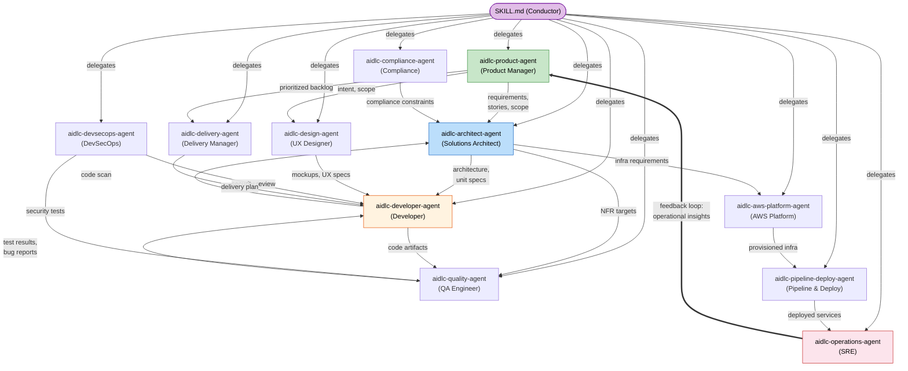

# Agents

AI-DLC には 14 のエージェントペルソナが付属しています: ステージの作業を実行する 11 のドメインエキスパート、2 つのレビュー専用エージェント、そして adaptive-workflows のコンポーザーです。この章では、まずドメインエージェント、続いてレビュアーとコンポーザーを取り上げ、全体の顔ぶれを説明します。

---

## Philosophy: Small Mob, Broad Agents

数十の細分化されたスペシャリスト（ウォーターフォール型の引き継ぎの連鎖を再現してしまう）ではなく、AI-DLC はそれぞれが複数のステージとフェーズにまたがって参加する **11 の幅広い能力を持つエージェント**を使います。

### Why 11, not 30?

人間のソフトウェアチームでは、3〜5 人のモブが要件からデプロイまで 1 つの機能全体を担当します。各メンバーは、いくつもの専門領域にまたがる幅広いスキルを持ち寄ります。AI-DLC はこのモデルを踏襲しています:

- **各エージェントが、多くのタスクにわたって 1 つのドメイン全体を担当します。** aidlc-architect-agent は、フィージビリティ、ドメイン設計、ユニット生成、コントラクト設計、機能設計、NFR 要件、NFR 設計を担当します — 3 つのフェーズにまたがる 7 つのステージです。細分化したスペシャリストのモデルでは、ほぼ同一のナレッジベースを持つ 7 つの別々のエージェントが必要になります。

- **エージェントが少なければ、引き継ぎも少なくなります。** エージェントの境界はすべて、情報が失われうるポイントです。同じ aidlc-architect-agent が Domain Design と Functional Design の両方をリードすれば、明示的な引き継ぎ成果物を必要とせず、自然にコンテキストを保持できます。

- **サポート役により、エージェントを増やさずに協働できます。** "security-reviewer-agent"、"compliance-reviewer-agent"、"cost-reviewer-agent" を作る代わりに、aidlc-devsecops-agent と aidlc-compliance-agent が、他のエージェントがリードするステージにサポートエージェントとして参加します。どのように参加するかはステージの `mode`、つまりその通信トポロジーで決まります。`inline` ステージでは、コンダクターが各サポートエージェントを自身のコンテキスト内でペルソナとして採用します。`subagent`（ハブ＆スポーク）と `mob`（メッシュ）のステージでは、各サポートエージェントが実在する独立した協力者としてディスパッチされ、リードが統合するための自身の貢献ファイルを書きます（全員が書き、最終成果物はリードが所有します。user-stories がモブのショーケースとして提供されています）。`pipeline`（チェーン）のステージでは、チェーンの各リンクが成果物を順番に直接進め、それぞれの戻りが順序付きの完了エビデンスとして記録されます（reverse-engineering が提供されているチェーンです）。どのトポロジーでも、委任はすべてコンダクターが行います — エージェント同士が互いを呼び出すことは決してありません。

- **ナレッジの読み込みはエージェントごとです。** 各エージェントは、方法論のナレッジを `.claude/knowledge/<agent-name>/` から、チームのナレッジをスペースレベルの `aidlc/spaces/<space>/knowledge/<agent-name>/` から（チームが作成している場合）読み込みます。エージェントが少なければ、管理すべきナレッジディレクトリも、矛盾するガイダンスが生じる機会も少なくなります。

---

## Agent Collaboration Map

次の図は、ワークフロー中にエージェントがどのように情報をやり取りするかを示しています。実線の矢印は主要な成果物の流れを示します。破線の矢印は助言やレビューの関係を示します。運用からプロダクトへのフィードバックループが、ライフサイクル全体を閉じます。

<!-- Text fallback: The SKILL.md conductor delegates to all 11 agents. Key flows: aidlc-product-agent sends requirements/stories to aidlc-architect-agent, who sends specs to aidlc-developer-agent. aidlc-developer-agent sends code to aidlc-quality-agent, who sends test results back. aidlc-aws-platform-agent provisions infrastructure for aidlc-pipeline-deploy-agent, who deploys for aidlc-operations-agent. The feedback loop: aidlc-operations-agent sends operational insights back to aidlc-product-agent, closing the cycle. -->

---

## The 11 Domain Agents

> **付属エージェントが持つ知識をカスタマイズしたい場合は？** `.claude/agents/*.md` にある 14 個の付属エージェントファイルは編集しないでください。これらはフレームワークのファイルであり、アップグレード時に上書きされます。代わりに、会社の標準をスペースレベルの `aidlc/spaces/<space>/knowledge/<agent-name>/` に追加してください。ワークフロー全体については[ナレッジ](08-knowledge.md)を参照してください。*新しい*エージェントが欲しいチームは、必要な frontmatter を付けたファイルを `.claude/agents/<slug>.md` に置けます。そのファイルはユーザーの所有です。[コントリビューション: エージェントの追加](../reference/11-contributing.md#adding-an-agent)を参照してください。ハーネス独自のサブエージェントも同じディレクトリに置けます。AI-DLC のペルソナキー（`display_name`、`examples`、`tier`、`plugin`）を 1 つも持たず、`aidlc-` プレフィックスもないファイルはハーネスに任され、`aidlc doctor --verbose` はそれを助言として一覧表示します。

以下の各エージェントには**詳細ページ**があります — その責務の全体、リードおよびサポートするステージ、読み込むナレッジです。[エージェント詳細ページの索引](agents/README.md)に 11 個すべてが載っています。エージェントごとのリンクは各見出しにあります。

### [aidlc-product-agent](agents/product-agent.md)

**ドメイン:** 要件、ユーザーストーリー、スコープ、市場調査

aidlc-product-agent は、プロダクトマネージャー兼ビジネスアナリストとして振る舞います。インテントを捉え、市場調査を行い、スコープを定義し、要件を引き出し、ユーザーストーリーを作成します。Ideation フェーズと Inception フェーズで最も活発なエージェントです。

- **リード:** intent-capture, market-research, scope-definition, requirements-analysis, user-stories
- **サポート:** rough-mockups, approval-handoff, refined-mockups
- **特別なツール:** WebSearch（市場調査用）

### [aidlc-design-agent](agents/design-agent.md)

**ドメイン:** UX/UI デザイン、ワイヤーフレーム、インタラクションデザイン、アクセシビリティ

aidlc-design-agent は、ワイヤーフレーム、モックアップ、インタラクション仕様を作成します。ユーザー向けの機能については aidlc-product-agent と、設計が実装可能であることを確かめるために aidlc-developer-agent と密接に協働します。

- **リード:** rough-mockups, refined-mockups
- **サポート:** user-stories, domain-design
- **特別なツール:** WebSearch（デザインリサーチ用）

### [aidlc-delivery-agent](agents/delivery-agent.md)

**ドメイン:** チーム編成、キャパシティプランニング、デリバリーの順序付け

aidlc-delivery-agent は、エンジニアリングマネージャーとして振る舞います。チームのキャパシティを評価し、モブの構成を決め、デリバリーの順序を計画し、フェーズ間の引き継ぎを管理します。

- **リード:** team-formation, approval-handoff, delivery-planning
- **サポート:** scope-definition, units-generation
- **特別なツール:** 共通セット以外はなし

### [aidlc-architect-agent](agents/architect-agent.md)

**ドメイン:** ドメイン設計、ドメインモデリング、NFR、コンポーネント分割

aidlc-architect-agent は、設計の中心的な権限を持ちます。関与するステージが最も多く（3 つのフェーズにまたがる 10 ステージ）、他の 7 つの高度な判断を要するエージェント（product、design、developer、quality、devsecops、compliance、aws-platform）と同様に `judgment` ティアに属します。モデルポリシーが記録されていない場合、judgment エージェントはセッションのモデルと effort を継承します。delivery、pipeline-deploy、operations は、出力の大部分が計画、CI/CD の YAML、ランブックの雛形であるため、`templated` ティアに属します。これらの付属の基準設定も継承です。レビュアーのティアは、Claude Code では Sonnet を medium effort で使います。Codex と opencode では、セッションのモデルを継承し、medium の推論 effort を適用します。ウィザードのデフォルトである `balanced` プリセットは 3 つのグループすべてに対する明示的な effort の上書きで、モデルを変えずにそれぞれを medium に設定します。Kiro CLI では、対話セッション全体に 1 つの effort を設定します。Kiro IDE、Cursor、Copilot はこれらのグループごとの effort の設定を表現できないため、ウィザードはそこではプリセットを記録しません。[モデルポリシー](18-install-and-lifecycle.md#model-policy)を参照してください。

- **リード:** feasibility, domain-design, units-generation, contract-design, functional-design, nfr-requirements, nfr-design
- **サポート:** intent-capture, reverse-engineering (synthesis), delivery-planning

### [aidlc-aws-platform-agent](agents/aws-platform-agent.md)

**ドメイン:** AWS インフラ、CDK/CloudFormation、コスト最適化

aidlc-aws-platform-agent は、インフラを設計し、環境をプロビジョニングし、コストを最適化します。AWS CLI と CDK のコマンドを実行するための Bash アクセスを持ちます。

- **リード:** infrastructure-design, environment-provisioning
- **サポート:** feasibility, domain-design, contract-design, nfr-design, feedback-optimization
- **特別なツール:** Bash（`aws`、`cdk` コマンド用）

### [aidlc-compliance-agent](agents/compliance-agent.md)

**ドメイン:** 規制のスキャン、データ分類、リスク評価

aidlc-compliance-agent は、純粋に助言の立場で動作します — リードするステージはありません。他のエージェント、特に aidlc-architect-agent と aidlc-devsecops-agent がリードするステージに、規制上の制約を提供します。

- **リード:** なし（サポートのみ）
- **サポート:** feasibility, nfr-requirements, infrastructure-design, environment-provisioning
- **特別なツール:** WebSearch（規制の調査用）

### [aidlc-devsecops-agent](agents/devsecops-agent.md)

**ドメイン:** 脅威モデリング、セキュリティスキャン、DevSecOps パイプライン

aidlc-devsecops-agent は、セキュリティの観点から設計をレビューし、セキュリティ要件を定義し、CI/CD パイプラインにセキュリティを組み込みます。aidlc-compliance-agent と同様に、サポート役として動作します。

- **リード:** なし（サポートのみ）
- **サポート:** practices-discovery, nfr-requirements, infrastructure-design, build-and-test, environment-provisioning
- **特別なツール:** Bash（セキュリティスキャン用）

### [aidlc-developer-agent](agents/developer-agent.md)

**ドメイン:** コードの実装、コード分析、データモデリング

aidlc-developer-agent は 3 つのフェーズにまたがります — Inception のリバースエンジニアリングから、Operation のデプロイ支援までです。既存のコードベースのコードスキャンを実行し、実装コードを生成します。

- **リード:** reverse-engineering (code scan), code-generation
- **サポート:** practices-discovery, user-stories, functional-design, deployment-execution

ワークスペースの検出（workspace-detection）は、以前は aidlc-developer-agent のサブエージェントでしたが、現在はルールベースのファイルおよびマニフェスト検出を用いて `aidlc-utility intent-create` の内部で決定論的に実行されます。
- **特別なツール:** Bash（ビルドと実行のコマンド用）

### [aidlc-quality-agent](agents/quality-agent.md)

**ドメイン:** テスト戦略、テスト生成、パフォーマンス検証

aidlc-quality-agent は、テスト戦略を定義し、テストスイートを生成し、品質ゲートを検証し、パフォーマンステストを実行します。

- **リード:** build-and-test, performance-validation
- **サポート:** practices-discovery, user-stories, nfr-requirements
- **特別なツール:** Bash（テスト実行用）

### [aidlc-pipeline-deploy-agent](agents/pipeline-deploy-agent.md)

**ドメイン:** CI/CD パイプライン、デプロイ戦略、リリースの実行

aidlc-pipeline-deploy-agent は、CI/CD パイプラインを構成し、デプロイ戦略を計画し、ロールバック機能を備えたリリースを実行します。

- **リード:** practices-discovery, ci-pipeline, deployment-pipeline, deployment-execution
- **サポート:** なし
- **特別なツール:** Bash（パイプラインとデプロイのコマンド用）

### [aidlc-operations-agent](agents/operations-agent.md)

**ドメイン:** オブザーバビリティ、インシデント対応、SLO の追跡、フィードバックループ

aidlc-operations-agent は、監視を設定し、インシデント対応手順を定義し、運用上の知見を次のイテレーションのために aidlc-product-agent へフィードバックすることで、ライフサイクルのループを閉じます。

- **リード:** observability-setup, incident-response, feedback-optimization
- **サポート:** なし
- **特別なツール:** Bash（オブザーバビリティと監視のコマンド用）

---

## Phase Participation

この表は、どのエージェントがどのフェーズで活動し、リード（L）とサポート（S）のどちらを務めるかを示します。

| エージェント | Phase 0 | Phase 1 | Phase 2 | Phase 3 | Phase 4 |
|-------|---------|---------|---------|---------|---------|
| aidlc-product-agent | — | L (intent-capture, market-research, scope-definition), S (rough-mockups, approval-handoff) | L (requirements-analysis, user-stories), S (refined-mockups) | — | — |
| aidlc-design-agent | — | L (rough-mockups) | L (refined-mockups), S (user-stories, domain-design) | — | — |
| aidlc-delivery-agent | — | L (team-formation, approval-handoff), S (scope-definition) | L (delivery-planning), S (units-generation) | — | — |
| aidlc-architect-agent | — | L (feasibility), S (intent-capture) | L (domain-design, units-generation, contract-design), S (reverse-engineering, delivery-planning) | L (functional-design, nfr-requirements, nfr-design) | — |
| aidlc-aws-platform-agent | — | S (feasibility) | S (domain-design, contract-design) | L (infrastructure-design), S (nfr-design) | L (environment-provisioning), S (feedback-optimization) |
| aidlc-compliance-agent | — | S (feasibility) | — | S (nfr-requirements, infrastructure-design) | S (environment-provisioning) |
| aidlc-devsecops-agent | — | — | S (practices-discovery) | S (nfr-requirements, infrastructure-design, build-and-test) | S (environment-provisioning) |
| aidlc-developer-agent | — | — | L (reverse-engineering), S (practices-discovery, user-stories) | L (code-generation), S (functional-design) | S (deployment-execution) |
| aidlc-quality-agent | — | — | S (practices-discovery, user-stories) | L (build-and-test), S (nfr-requirements) | L (performance-validation) |
| aidlc-pipeline-deploy-agent | — | — | L (practices-discovery) | L (ci-pipeline) | L (deployment-pipeline, deployment-execution) |
| aidlc-operations-agent | — | — | — | — | L (observability-setup, incident-response, feedback-optimization) |

### Observations

- **aidlc-architect-agent** は関与の範囲が最も広いエージェントです（3 つのフェーズにまたがる 10 ステージ）。他の 7 つの高度な判断を要するエージェントと同様に `judgment` ティアに属します（セッションのモデルと effort を継承します）。`templated` ティアに属するのは **aidlc-delivery-agent**、**aidlc-pipeline-deploy-agent**、**aidlc-operations-agent** だけです
- **aidlc-developer-agent** は Inception、Construction、Operation の 3 つのフェーズにまたがります
- **aidlc-compliance-agent** と **aidlc-devsecops-agent** は純粋にサポート役として動作し、他のエージェントがリードするステージに参加します
- **aidlc-operations-agent** は、知見を aidlc-product-agent にフィードバックすることでライフサイクルのループを閉じます

---

## Agent Tool Access

Claude Code では、すべてのエージェントが**セッションのツールセット全体**とプロビジョニングされた MCP ツールを継承し、`disallowedTools: Task` によって入れ子の委任がブロックされます。他のハーネスは、同じ境界をネイティブのツールポリシーで実現します。Kiro の delegate の許可リストには `subagent` が含まれず、投影されたエージェントの Markdown にはサポートされない Claude のキーは含まれません。以下の表は、各ペルソナが作業で使うことが*想定される*ツールを記録したもので、エージェントごとの付与ではありません。

| ツール | 使用が想定されるエージェント |
|------|-------------|
| Read, Edit, Write, Glob, Grep, AskUserQuestion | 14 エージェントすべて |
| Bash | aidlc-aws-platform-agent, aidlc-devsecops-agent, aidlc-developer-agent, aidlc-quality-agent, aidlc-pipeline-deploy-agent, aidlc-operations-agent |
| WebSearch | aidlc-product-agent, aidlc-design-agent, aidlc-compliance-agent |
| Task / ネイティブの委任ツール | なし（各ハーネスが投影するエージェントポリシーによりブロック） |

Claude のペルソナの範囲を絞るには、その frontmatter に任意の `tools:` 許可リストを追加します — ただしそうすると、完全修飾の `mcp__<server>__<tool>` ID も列挙しない限り、継承された MCP へのアクセスが失われます。他のハーネスはネイティブのエージェント設定を使います。

### MCP servers are shared, not per-agent

上の表は、各ペルソナが使うことが想定される組み込みツールを示していますが、実際にはすべてのエージェントがそれらすべてを継承します。MCP サーバーも同じくすべてを継承するモデルに従います。この実装では、プロジェクトルート（`.claude/` の隣）の `.mcp.json` で一度だけ宣言し、Claude Code がそれらをセッションにプロビジョニングし、すべてのエージェントがそれらすべてを継承します — エージェントごとの付与はありません。14 のエージェントはそれぞれ、追加の設定なしに宣言されたすべてのサーバー（`context7` と 4 つの AWS サーバー）にアクセスでき、認証情報を持っていないサーバーは単に利用できないだけで、妨げにはなりません。特定のエージェントがあるサーバーにアクセスできないようにするには、そのエージェントの `tools:` 許可リストを、保持すべき完全修飾の `mcp__<server>__<tool>` ID（たとえば `mcp__context7__<tool>`）に絞ります。現在、この実装にはそのような制限は付属していません。

サーバーのレジストリと認証情報については[はじめに](01-getting-started.md)を、MCP が Claude Code のネイティブなツールモデルにどう対応するかについては[ハーネスのプリミティブの対応](../reference/14-claude-features.md#mcp-servers)を参照してください。

---

## Reviewer Agents

11 のドメインエキスパートエージェントに加えて、AI-DLC には **2 つの品質ゲート用レビュアー
エージェント**が付属しています。これらは成果物を作成しません — ビルダーが作成したものをレビューして
異議を唱え、ゲートにおいて顧客（またはレビュー委員会）を代表します。

| レビュアー | レビュー対象 | ティア |
|----------|---------|------|
| `aidlc-product-lead-agent` | 要件、ユーザーストーリー、UX/モックアップの成果物 — 完全性、ビジネスとの整合、テスト容易性 | balanced |
| `aidlc-architecture-reviewer-agent` | 技術設計の成果物 — 妥当性、実装可能性、壊れた相互参照、達成不可能な NFR 目標 | balanced |

## The Composer Agent

もう 1 つのエージェントは、どちらのグループにも属しません: adaptive-workflows のコンポーザーである `aidlc-composer-agent` です。コンダクターは compose のリクエスト（`/aidlc compose`、コールドスタート時の compose の提案、`--report`、または `--new-scope`）があるとこれをディスパッチします。このエージェントはタスクの実装エントロピー（5 つの要素: インテントの曖昧さ、構造の不確実性、検証のエントロピー、リスク、未解決の前提 — 構成されていれば CodeKB MCP の分析に、そうでなければワークスペースのスキャンに基づく）を推定し、スコアの内訳とステージごとの根拠を添えて、最小限で実行可能な EXECUTE/SKIP のグリッドを提案します。そして、ゲートで承認された後にのみ、その作業の計画が作成される（front/report の場合。コンポーザーはスコープファイルを書かず、エンジンは依頼された場合にのみ計画をスコープとして保存します）か、保留中のステージの切り替えが決定論的な `recompose` 動詞によって適用されます（進行中の場合）。そのペルソナは、各ステージを含めることと含めないことの両方をエントロピーのプロファイルに照らして正当化します: すべての EXECUTE は低減する要素を、すべての SKIP はすでにそれをカバーしているものを示し、背骨（コア、検証、要となる発見ステージ）を削ることは危険な失敗として扱われます。[スコープと深さ - 適応型コンポーザー](05-scopes-and-depth.md#the-adaptive-composer)を参照してください。

レビュアーは、ステージが `reviewer:` フィールドを宣言している場合にのみ起動します。現在、プロダクト
リードは `intent-capture`、`rough-mockups`、`refined-mockups`、
`requirements-analysis`、`user-stories` をレビューし、アーキテクチャレビュアーは
`domain-design`、`units-generation`、`contract-design`、`functional-design`、
`nfr-requirements`、`nfr-design`、`infrastructure-design`、`code-generation` をレビューします。

**レビュアーのステップ。** ステージ本体が成果物を作成した後、
学びの儀式と承認ゲートの前に、コンダクターは指定されたレビュアーを
**別のサブエージェント**として呼び出します。レビュアーはステージ定義、Q&A、
成果物を読み（ビルダーの `memory.md` や計画は決して読みません — 独立した
判断を下すためです）、その後レビュー（**READY** または **NOT-READY** の判定と、
変更点のレポート: 再確認した以前の指摘と新しい指摘）を、
コンダクターが指定するレビューファイルに書き込みます。指摘の一覧はエンジンが保持します: エンジンは
ID を割り当て、あなたの決定をあなたが下したとおりに保持し、
レビュアーに決定を書かせることは決してありません。レビュアーは
レビュー対象の成果物を決して編集しません。エンジンはレビューを、インテントの `.aidlc-engine/reviews/` ディレクトリ配下に
フレームワーク所有の記録として保存し、そのレビュー時点の完全な指摘一覧を含む人間向けの読みやすいコピーを
レビュー対象の成果物の隣の `<stage dir>/reviews/review-NN.md` に書き込み、
成果物が変更された判定は拒否します。判定の扱いは、ステージのレビュークラスによって異なります:

- **Advisory**（人間がゲートを担う ideation/inception の散文ステージ）: 判定にかかわらず、
  通常フローでのレビューは 1 回です。エンジンの指摘一覧は、判断材料として
  承認ゲートで表示されます: あなたがそれをトリアージし、
  ゲートでの Request Changes によって指摘が修正につながります。後の
  出力の書き込みによって最終の受領記録が無効になった場合は、上限付きの回復リクエストが 1 回
  次の連番で実行されます。
- **Adversarial**（Construction の設計/ビルドのステージ）: NOT-READY の場合、
  ビルダーが指摘に対処するために再実行し、レビュアーが再確認します。このループは
  最大 `reviewer_max_iterations` 回（デフォルトは 2、エンジンが強制）繰り返されます。
  上限に達しても指摘が残っている場合、ワークフローは未解決の指摘を記録したうえで
  承認ゲートに進みます。

ステージのレビュー回数を使い切った後、最後のレビュー以降にレビュー対象の作業が
変更された場合（たとえば作業が別のアプローチを取った場合）、承認時に
一度だけ "Do you want me to have the new approach checked before you
decide?"（判断の前に、新しいアプローチを確認させますか？）と尋ねます。はいと答えると、上限を超えてレビューが再度実行され、その後に
承認を求められます。承認すると、そのままの状態で承認されます。

レビュアーは厳格なターン予算のもとでも実行されます — `maxTurns: 60` で、
ペルソナの frontmatter に記述され、Claude Code ではネイティブに強制され、
opencode ではエージェントごとの `steps: 60` に投影されます。それ以外の環境ではペルソナの散文として提供されます。
レビューが使用可能な判定なしに戻ってきた場合 — レビューファイルがない、または
正規の READY / NOT-READY の行が 1 つだけ存在しない場合（上限に達した、クラッシュした、途中で打ち切られたレビュアー）— 
コンダクターは同じレビューを一度だけ再ディスパッチし、2 回目も不完全だった場合は
NOT-READY として記録され、ゲートには "The review did not
finish, so there is no review result to rely on."（レビューが完了しなかったため、頼れるレビュー結果がありません）という指摘が表示されます（レビュアーの返答に理由があれば、その後に続きます）。
これにより、気づかれない打ち切りは、判定の欠落ではなく
ゲートで目に見える指摘になります。その結果はどのレビュアーのものでもありません: レビューが
完了しなかったことが伝えられ、あなたの承認もそのように記録されます。あなたが自分でレビューを
止めて望むことを伝えた場合、コンダクターは自分から再試行しません: 
まず次のステップを確認し、あなたが求めたことを行います。リクエストのたびに
新しいレビュー枠が開かれるため、修正前の古いレビューが新しい作業を
カバーしていると誤って解釈されることはありません。以前のリリースで成果物内の `## Review` セクションとして
記録されたレビューは、次のレビューで置き換えられるまで
ゲートで読むことができます。

スコープはクラスの上限を定められます（`bugfix`、`poc`、`classic`、`workshop` は
すべてのステージを advisory に制限し、`express` はレビューをなしに制限します）。また
`/aidlc --review <class>` で実行ごとに上限を定められます。明示的な自律モードでは、マージ前の
1 回のレビューが維持され、スコープの上限や実行ごとの上書きの対象外になります。いずれの場合も、レビュアーが作業をブロックすることはありません —
最終的な決定権は常に人間にあります。

（重要: エージェント名は示したとおりバッククォートで囲んだプレーンな名前を使うこと — Markdown のリンクにしてはならない。エージェントごとのレビュアーのドキュメントページはまだ存在しない。）

---

## Next Steps

- [フェーズとステージ](04-phases-and-stages.md) — ステージフロー全体の文脈でエージェントを見る
- [ナレッジ](08-knowledge.md) — エージェントが方法論とチームのナレッジをどう読み込むか
- [ルールと学習ループ](09-rules-and-the-learning-loop.md) — エージェントの振る舞いを制約する行動ルール
- [用語集](glossary.md) — 用語のリファレンス
