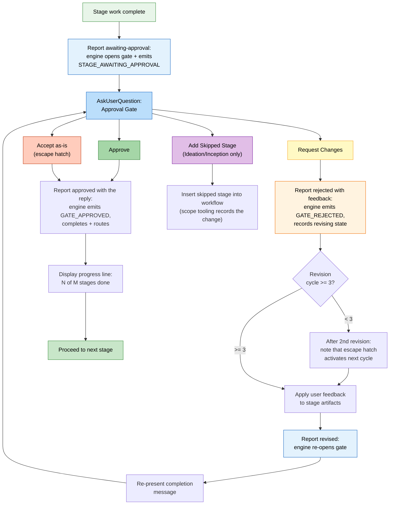

# Interaction Modes

AI-DLC では、ステージ中にエージェントとやり取りする 3 つの方法と、あらゆる意思決定ポイントであなたが主導権を握り続けるための承認ゲートが用意されています。

> **ハーネスに関する注記。** ゲートと質問の表示方法はハーネスごとに異なります。Claude
> Code はネイティブの質問ピッカーを使い、Codex は有効化されていればピッカーを使います。
> Kiro、opencode、GitHub Copilot は番号付きの文章で選択肢を表示します（Copilot の
> ピッカーの結果は、信頼された人間の在席イベントを発生させません）。質問ファイルは
> 引き続き信頼できる唯一の情報源です。*セマンティクス* — いつゲートが発生し、何を
> 尋ね、あなたが主導権を握り続けること — はエンジンに実装されているため同一です。
> [他のハーネスでの実行](harnesses/README.md) を参照してください。

---

## Tri-Mode Question Flow

ステージがあなたの入力を集めるとき、エージェントは質問をファイルに書き出し、3 つのインタラクションモードを提示します。自分に合ったものを選んでください。後続のステージはその選択を再利用します（[一度だけ尋ね、以降は再利用](#asked-once-then-reused) を参照）。[はじめに](01-getting-started.md) の実行例から:

```text
 Answer mode
 I've created 8 questions at
 aidlc/spaces/default/intents/261013-inventory-rest-api/ideation/intent-capture/intent-capture-questions.md.
 How would you like to answer them?
 > 1. Guide me
      Walk through each question interactively here
   2. I'll edit the file
      Fill in the answers in the file directly
   3. Chat
      Discuss freely; I'll extract the decisions from the conversation
   4. Type something.
   5. Chat about this
```

エージェントが作成する質問ファイルでは、通常の質問ごとに、ふつう誰が回答するか
（`[Product owner]` や `[Developer]` など）が示されます。同じ人向けの質問はまとめて配置されます。
ただし、そのうちの 1 つが別の人の回答を待つ必要がある場合は例外です。チームではこの方法で
質問を分担でき、1 人で作業する場合も、どれがプロダクトが何をするかについての質問で、
どれがどう構築するかについての質問かを見分けられます。それでも、誰がどの質問に回答しても
構いません。エージェントがチャットや質問ピッカーでこれらの質問の 1 つを尋ねるときも、
そのラベルが質問文の前に付きます。後から追加された質問は、独自のラベルを付けて末尾に置かれます。
確認、変更リクエスト、承認のセクションにはラベルが付きません。すでに存在していたファイルは、
質問がそのまま維持されます。ただし、ステージを最初からやり直すよう依頼した場合は、
新しいファイルに置き換えられます。

### Guide Me

エージェントが構造化されたプロンプトを使って、各質問を対話的に案内します。エージェントに会話を主導してもらい、漏れがないようにしたい場合に最適です。

- エージェントが質問を 1 つずつ（またはまとめて）提示します
- あなたは各質問に直接回答します
- 回答はトレーサビリティのためにステージの質問ファイルに記録されます

### Edit File

エージェントが質問ファイルを作成（またはオープン）し、あなたがそれを直接編集します。何をしたいかがすでに明確で、質問に答えるより書き出したい場合に最適です。

- 質問ファイルは、回答欄が空の状態でインテントの記録ディレクトリに作成されます
- あなたは自分のペースで回答を記入します
- エージェントは記入済みのファイルを読み込んで先に進みます

### Chat

エージェントとの自由形式の会話です。アイデアを探りたいときや、要件がまだ明確でないときに最適です。

- あなたはエージェントと自由に議論します
- エージェントが会話から意思決定を抽出します
- 抽出された意思決定は、信頼できる唯一の情報源として質問ファイルに書き戻されます

### Switching Modes Mid-Stage

ステージ中はいつでもモードを切り替えられます。3 つのモードはいずれも、意思決定の正式な記録である質問ファイルに集約されます。切り替えても進捗は失われません — すでに記録された回答はファイルに残ります。

### Asked Once, Then Reused

モードは作業ごとに一度だけ選びます。質問のある最初のステージで尋ねられ、
後続のステージはもう一度尋ねずにその選択を再利用します。それらの各ステージでは、
どのモードを使っているかが 1 行で伝えられます:

```
Answering the way you chose earlier: Guide me. Say if you'd rather edit the file or chat.
```

（訳: 先ほど選んだ方法で回答します: Guide me。ファイルを編集したい、またはチャットしたい場合はお知らせください。）

変更したい場合は、そう伝えるだけです（「今回はファイルを編集させて」など）。エージェントが切り替え、
後続のステージは新しい選択を使います。どのような言い方で回答しても、エージェントは
あなたが意図したモードを記録するため、言い回しのせいで再度尋ねられることはありません。

---

## Approval Gates

すべてのステージ（3 つの Initialization ステージを除く）は承認ゲートで終わります。これは、ワークフローが先に進む前にエージェントの作業をレビューするためのチェックポイントです。Construction では、ゲートがユニットごとに発生することもあり、自動実行を許可したゲートは質問なしで記録されます（[フェーズとステージ](04-phases-and-stages.md#what-runs-in-order-and-what-runs-in-parallel) を参照）。

### Standard Gate

デフォルトの承認ゲートは 2 つの選択肢を提示します。同じ実行例から:

```text
 Approval
 Intent Capture & Framing complete. How would you like to proceed?
 > 1. Approve
      Continue to Feasibility & Constraints
   2. Request Changes
      Provide revision feedback
   3. Type something.
   4. Chat about this
```

Approve の行には、ワークフローが実際に次に実行するステージの名前（例: "Continue to NFR Requirements"）、または最終ステージでは "Complete workflow" が表示されます。これはエンジンが算出するため、推測ではなく常に正確です。

- **Approve** は結果を報告します。エンジンがステージを完了済みにし、
  `aidlc-state.md` を更新し、進捗行を表示して、次のステージに進みます
- **Request Changes** では具体的なフィードバックを伝えられます。エージェントが作業を修正し、承認ゲートを再提示します

同僚に答えるように、自分の言葉で回答してください。主導するのはあなたです。
エージェントはあなたの返答を読み、あなたが言ったとおりに動作します。これはすべての質問（このゲート、
サマリー確認、検証コマンド、Construction のチェックポイント、Plan
Approval、復旧の質問）に当てはまります。選択肢のラベルを打ち直したり、同じことを
2 回言ったりする必要はありません:

- `1`、`a`（選択肢がアルファベットの場合）、`approved`、`looks good`、
  `aprove` はいずれも承認になります。
- 変更の依頼は Request Changes となり、あなたの言葉がフィードバックになります:
  `rename the handler`、`no, split the tests`。
- 指示付きの承認はその両方です: `looks fine but rename the handler`
  は承認となり、エージェントは名前を変更してそのことを 1 行で伝え（"Renamed
  processOrder to handleOrder in 3 files"）、作業が続行されます。
- いったん止めることも求める承認は、承認してワークフローを中断状態にします:
  `Approve, but let's stop there for today`。後で `/aidlc --resume` で再開できます。
- 質問には回答が返され、次のあなたの返答で決まります。
- 本当に不明瞭な返答（`hmm`、`not sure`）に対してだけ、短い質問が 1 つ
  返されます。

AI-DLC は、ゲート、Plan Approval、チェックポイント、検証コマンド、
Construction の設定変更を、あなたの言葉を添えて記録します（監査証跡の `Person Reply`）。
言葉はハーネスが渡したものをトリミングして記録します。ステージゲートでは、
直前の意思決定以降かつステージ開始以降のすべてのメッセージが対象です。ただし、他の質問への回答として
すでに記録されたメッセージは、それが最新のものでない限り除外されます。それらのうち
1 つでも 8000 文字を超えるか、記録に残っていない場合は、どれも添付されず、
行には代わりに最新のメッセージが示されます。変更リクエストではエージェントの
`--reason` が記録されます。Plan Approval では、直近 8 件の
返答をそれぞれ 8000 文字に切り詰めて記録します。チェックポイントや検証コマンドの
質問では、返答を順に連結し、末尾の 8000 文字を残します。
変更を依頼した Construction の設定については、その依頼メッセージを記録します。サマリー確認では、
エージェントが読み取った選択と、変更リクエストの場合は変更を求めた内容を記録します。
意思決定には、質問が表示された後のあなたからの返答が必要です（ステージゲートでは、
ステージ開始以降のもので、エージェントがあなたの回答として指名したものも有効です。
たとえば、ステージの出力が最後に書き込まれた後に学びの質問で伝えた承認などです）。
エージェントがあなたの代わりに回答することはできません。

ステージゲートで変更を依頼すると、監査証跡には修正フィードバックとして、
直前の意思決定以降のチャットについてハーネスが human-turn フックに渡した言葉が、
届いたとおりそのまま記録されます（他の質問への回答としてすでに記録されたメッセージは、
それが最新のものでない限り除く）。エージェントはあなたが求めた内容に基づいて修正します。
Request Changes を選んだ後に "What should change?"（何を変更すべきですか？）に回答した場合は、その両方がフィードバックになります。
エージェント自身による依頼内容の要約があなたの言葉と異なる場合は、
`Conductor Summary` としてあなたの言葉の横に保持されます。これには、
入力したプロンプトとチャットセッションを human-turn フックに渡すハーネスが必要です。
そうでないハーネスでは、従来どおりエージェントが報告した内容がフィードバックになります。
human turn そのものと同様に、これはプロンプトの接点が受け取った内容を記録するものであり、
誰が入力したかを記録するものではありません。

ゲートには、観測された人間とのインタラクションの接点が必要です。プロンプトを入力するか、ネイティブの質問ピッカーに回答すると、監査台帳に human turn（`HUMAN_TURN` イベント）が記録されます。承認（および確認のための質問への回答）は、直前のゲート解決以降に human turn が記録されていなければ拒否されます。また、ステージゲートの承認や変更リクエストには、ステージ開始以降かつゲート表示後に送られたもの、またはエージェントがあなたの回答として指名したメッセージが必要です（承認の場合は、ステージの出力が最後に書き込まれた後に送ったもの。それより前のものは、承認する内容を見ていません）。これが証明するのは在席と順序であり、後から呼び出し元が渡す意思決定テキストの作成者ではありません。信頼できるプロンプトやウィジェットの内容を公開しないハーネスもあります。ピッカーが human turn を記録しないハーネスでは、記録が残るように一度短いメッセージ（例: "approve"）を入力してください。

human-turn フックは、ディスパッチャーのフックルートを通じてのみ有効化されます。
ディスパッチャーを誰が起動したかは認証しません。フックとツール呼び出しは
同じユーザーとして実行され、同一ユーザーのプロセスがコピーできないアイデンティティをフックに与える
ハーネスはありません。ランタイム整合性チェックは、多層防御として、フックとその記録に向かう
既知のツール呼び出しルートを拒否します。ハーネスの権限モデルと、
エージェントが実行する内容に対するあなたのレビューが、外側の境界になります。

人が不在のままプロンプトを送信する自動化では、駆動するプロセスで
`AIDLC_UNATTENDED=1` を設定しなければなりません。プロンプトが無人かどうかを知っているのは
駆動側だけなので、この宣言はオプトインです。設定しない場合、プロンプト送信
イベントは対話的な振る舞いを維持します。設定すると、すべてのハーネスが権限を伴う
`HUMAN_TURN` を出さないため、承認ゲートとインタビューゲートは待機し続けます。
人が引き継ぐときは、`AIDLC_UNATTENDED` の設定を解除して新たに
応答を送信してください。在席に関する拒否メッセージは、フラグがまだ設定されている場合にそれを名指しします。

### Approval Gate Flow



<!-- Text fallback: Stage work completes, report awaiting-approval opens the gate (the engine records STAGE_AWAITING_APPROVAL), and AskUserQuestion presents the approval gate. Approve: report approved with the exact choice so the engine records GATE_APPROVED, completes, and routes; show progress; proceed. Request Changes: report rejected with the exact Request Changes choice and separate feedback (the engine records GATE_REJECTED), check revision count (if <3, note escape hatch coming, revise, report revised to re-open the gate, and re-present; if >=3, Accept-as-is becomes available). Accept as-is: report approved with that exact label. Add Skipped Stage (Ideation/Inception only): recompose the plan. The report calls own the gate's audit trail; no separate log entries are added for the gate prompt or choice. -->

---

## The 3-Strike Revision Escape Hatch

同じステージで 3 回以上変更を依頼すると、3 つ目の選択肢が表示されます:

同じステージで **Request Changes** を 3 回繰り返すと、質問に何回目の修正サイクルかが示され、3 つ目の選択肢 **Accept as-is**（説明は "Approve it as it is and move on"、つまり「現状のまま承認して先に進む」）が追加されます。

**Accept as-is** は、ドキュメントを現状のままにしてステージを承認し、ワークフローを進めます。完璧を求めるあまり良いものが進まなくなる場合に、修正の無限ループを防ぎます。

### How It Activates

| 修正サイクル | 何が起こるか |
|----------------|-------------|
| 1 回目 | 標準の 2 択ゲート |
| 2 回目 | 標準の 2 択ゲートに加え、注記: "After one more revision, an 'Accept as-is' option will become available."（あと 1 回修正すると、'Accept as-is' の選択肢が利用可能になります。） |
| 3 回目以降 | Accept as-is を含む 3 択ゲート |

修正回数は次のステージに移るとリセットされます。AI-DLC はこれをチャットではなく作業の記録に保持するため、中断して再開した場合や、新しいチャットで続けた場合も維持されます。

---

## Add Skipped Stage Option

**Ideation** と **Inception** フェーズでは、承認ゲートに、以前スキップしたステージをワークフローに戻すための条件付きの選択肢が含まれることがあります:

```
▸ How would you like to proceed?
  (1) Approve — Continue to Scope Definition
  (2) Request Changes — Provide revision feedback
  (3) Add Market Research — Include Market Research which was skipped
```

この選択肢が表示されるのは、次の場合だけです:
- 現在のステージが Ideation または Inception にある
- スコープのルーティング中に、先にあるステージがスキップされた
- スキップされたステージが現在のコンテキストに関連している

この選択肢を選ぶと、スキップされたステージがワークフロー計画に挿入されます。ワークフローは追加されたステージを経由して通常どおり続行します。

---

## Skipping and Navigating Stages

承認ゲート以外にも、次のナビゲーション手段があります:

| コマンド | 効果 |
|---------|--------|
| `/aidlc --stage <name>` | 特定のステージにジャンプする（間のステージは `[S]` とマークされる） |
| `/aidlc --phase <name>` | フェーズの先頭にジャンプする |

詳細は [セッション管理](11-session-management.md) と [CLI コマンド](12-cli-commands.md) を参照してください。

---

## Editing Files Yourself

どの成果物も手作業で編集できます。その後どうなるかは、どこにいるかによって異なります:

| 編集するとき | あなたがすること | 表示される内容 |
|---|---|---|
| ステージの質問への回答 | **I'll edit the file** を選び、`[Answer]:` 行を記入してから、完了したことをエージェントに伝える | エージェントが回答を読み込み、それに基づいて続行する。サマリー確認が有効な場合は、先にサマリーを確認する |
| 承認待ちのコード計画 | **I'll edit the files** を選び、計画またはテスト手順を変更して（または `code-generation-questions.md` に回答を書いて）から、完了したことをエージェントに伝える | 編集した計画がそのままの状態で承認され、ビルドが始まる。編集中、エージェントはそれらのファイルに書き込めない。編集によって計画の Testing Contract ブロックが壊れた場合は、エージェントが修復し、ビルドしてよいか一度だけ確認する |
| 現在のステージでレビュー済みの成果物（ゲートの前） | ファイルを編集して続行する | Guard Policy が `relaxed` または `off`（ほとんどのスコープ）の場合、ファイルが変更されたことを伝える 1 行が表示され、編集は監査証跡に `CHANGE_ACCEPTED` として一度記録され、実行が続く。`strict` の場合、以前のレビューは編集後のファイルをカバーしなくなるため、ゲートの前に現在の状態でもう一度レビューされる。この追加レビューは一度だけ行われる。その後さらにファイルを編集すると、エージェントは停止してそれを伝えるので、**Request Changes** を選んでレビューをやり直す |
| すでに完了したステージの成果物 | ファイルを編集して続行する | 自動的に再実行されるものはなく、後続のステージは編集後のファイルを読み込む。[ステージ完了後](#after-a-stage-is-finished) を参照 |
| セッションとセッションの間 | ファイルを編集してから `/aidlc` で再開する | 次にファイルがチェックされるときに同じルールが適用される |

ファイルが変更されたことが伝えられ、実行が続いている場合は、それで記録は完結しています。手作業で記録すべきものはありません。`strict`、`relaxed`、`off` の動作については [Guard Policy](13-customization.md#guard-policy) を、計画での停止そのものについては [計画の承認](13-customization.md#plan-approval) を参照してください。

### After a stage is finished

完了したステージのファイルを編集しても、あなたが求めない限り、再びレビューや承認が行われることはありません:

- **警告されるもの。** Guard Policy が `strict` の場合、完了したステージについて AIDLC が追跡しているステージドキュメントの 1 つを編集すると、次のステップで、どの完了済みステージが遅れた状態になったか、またやり直すには何と言えばよいかが一度だけ伝えられます。`relaxed` と `off`（ほとんどの計画でのデフォルト）では、編集はあなたの意図によるものとして扱われます。次のステップではどのステージも遅れているとは示されず、編集したファイルがレビュー済みのドキュメントか確認済みの質問ファイルだった場合にのみ、一度だけ伝えられます。追跡対象のドキュメントが見つからなくなった場合は、どのポリシーでも示されます。`/aidlc --status` は、下流で影響を受けるステージを一覧表示します。プロジェクトフォルダーの移動、名前変更、コピーはそれらのドキュメントを一切変更しないため、警告は出ません（それでも警告が出る場合については [成果物リファレンス](14-artifacts-reference.md) を参照）。警告は助言であり、停止ではありません。検証記録なしで完了したステージ（たとえば古い AIDLC リリースによるもの）には警告が出ず、`/aidlc --status` にも表示されません。
- **警告されないもの。** アプリケーションコードはこの方法では追跡されないため、Code Generation の後に変更しても警告は出ません。
- **再チェックを受けるには。** `/aidlc --stage <name>` で、影響を受ける最も早いステージ（アプリケーションコードの場合は Code Generation）に戻ります。そのステージと、計画内のそれ以降のすべてのステージが再オープンされます。ファイルは残るため、以前のファイルを見つけた各再オープンステージでは、それらを **Keep**、**Modify**、**Redo from scratch** のどれにするか尋ねられます。Keep で省略されるのはファイルの再生成であり、チェックではありません。ステージに必要なレビューや承認は引き続き行われます。変更を後続に反映させたい場合は Modify か Redo を選んでください。Code Generation のレビューは、ユニットのソースマニフェストに記載されたアプリケーションファイルだけを対象とするため、手作業で追加・移動したファイルは、そこに記載されるまでレビューされません。Modify を選ぶときは、追加・移動したファイルと、それが属するユニットを指定してください。ユニットを使わない作業（たとえば bugfix や refactor のスコープ）にはソースマニフェストがないため、承認する前に、アプリケーションコードへの手作業の編集を自分で確認してください。自動実行に設定した Construction のチェックポイントは、自動のまま維持されます。

---

## Progress Tracking

別のステージに進む承認の後、進捗行が表示されます。同じ実行例から:

```text
Progress: 1 of 19 stages done. Next: Feasibility & Constraints.
```

これには次の内容が表示されます:
- 計画が Initialization の後に実行するステージ全体での進捗（作業開始時に
  示された数）
- 次のステージの名前

より短い計画では、その計画自体の数が表示されます。

---

## Next Steps

- [最初のワークフロー](02-your-first-workflow.md) — 実際の流れの中でインタラクションモードを確認する
- [状態と監査](10-state-and-audit.md) — 意思決定がどのように追跡されるか
- [セッション管理](11-session-management.md) — 再開、やり直し、ジャンプ
- [用語集](glossary.md) — 用語のリファレンス
