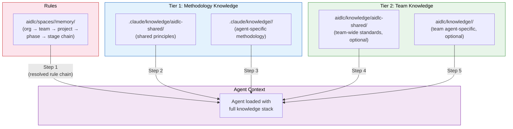
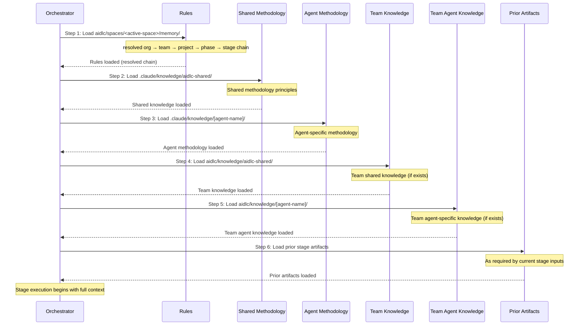

# Knowledge

AI-DLC は 2 層のナレッジシステムを使います。これにより、エージェントはメソドロジーの専門知識（フレームワークに同梱）と、チーム固有の標準（利用者が管理）の両方を活用できます。

---

## Two-Tier Knowledge Architecture



<!-- Text fallback: The resolved rule chain loads first, then Tier 1 methodology knowledge (shared, then agent-specific), then Tier 2 team knowledge (shared, then agent-specific). All feed into the agent context for stage execution. -->

### Tier 1: Methodology Knowledge

**場所:** `.claude/knowledge/`

フレームワークに同梱されています。AI-DLC のステージの実行方法を定める共有の原則と、エージェントごとのメソドロジーの参照資料が含まれます。フレームワークをアップグレードすると更新されます。

```
.claude/knowledge/
+-- aidlc-shared/                       # Methodology loaded by every agent, plus format references
|   +-- ai-dlc-principles.md        # Core methodology principles
|   +-- audit-format.md             # 134-event audit taxonomy
|   +-- brownfield.md               # Brownfield safeguards and reverse-engineering guidance
|   +-- knowledge-readme-template.md # Optional README template a team can copy into Tier 2
|   +-- memory-template.md          # The per-stage diary template
|   +-- rules-reading.md            # How an agent reads the space's rule files
|   +-- state-template.md           # State file contract
|   +-- verification.md             # Phase boundary verification rules
|   `-- worktree-info-schema.md     # Worktree output contract (Construction)
+-- aidlc-architect-agent/                 # Loaded when aidlc-architect-agent is active
+-- aidlc-developer-agent/                 # Loaded when aidlc-developer-agent is active
+-- aidlc-product-agent/                   # Loaded when aidlc-product-agent is active
`-- ...                              # One directory per agent
```

`aidlc-shared/` にある形式の参照資料（監査の分類と、状態・メモリ・ワークツリー・README の各テンプレート）は、エージェントが読み込む対象から外されています。これはインラインの場合も、単独でディスパッチされる場合（レビュアー、またはサブエージェントとして実行されるステージ）も同じです。それらが必要なステップがその資料を名指しし、エージェントはその時点で読み込みます。

> **チームのナレッジを注入するために Tier 1 のファイルを編集しないでください。** `.claude/knowledge/` と `.claude/agents/*.md` はフレームワークのファイルです。アップグレードのたびに上書きされ、加えた変更は消えてしまいます。社内標準、アーキテクチャ上の方針、ドメインのコンテキストを追加したい場合は、**Tier 2**（後述）に追加してください。エージェントの振る舞いを制約したい場合は、**ルール**を追加してください（[ルールと学習ループ](09-rules-and-the-learning-loop.md) を参照）。

### Tier 2: Team Knowledge

**場所:** アクティブなスペース — `aidlc/knowledge/`（`aidlc/spaces/<space>/knowledge/` の略記）

利用者が管理します。社内固有の標準、ポリシー、規約を格納します。1 つのスペースに属します。スペースやプロジェクトの間で [何が引き継がれるか](03-spaces-and-intents.md#what-carries-over-and-what-doesnt) は「スペースとインテント」に記載しています。これはスペースの `memory/`、`codekb/`、`intents/` と同じ階層にあります。そのため、チームのナレッジは個々のインテントの記録の中ではなく、スペース内のすべてのインテントにまたがって蓄積されます。ブートストラップ時点では**自由形式で空です**。エンジンは最初の `/aidlc` で空の `aidlc/knowledge/` ディレクトリを作成するだけです。決まったファイル構成も、必須の構造もありません。以下の規約（`aidlc-shared/` ディレクトリとエージェントごとのディレクトリ）は、エージェントのペルソナが探す場所です。必要に応じてサブディレクトリを作成してください。

```
aidlc/knowledge/                  # empty at bootstrap; create the subdirs you need
├── aidlc-shared/                 # if present, loaded by every agent
│   ├── company-coding-standards.md
│   └── company-architecture-principles.md
├── aidlc-architect-agent/           # if present, loaded when aidlc-architect-agent is active
│   └── company-architecture-patterns.md
├── aidlc-developer-agent/           # if present, loaded when aidlc-developer-agent is active
│   └── company-coding-conventions.md
├── aidlc-devsecops-agent/           # if present, loaded when aidlc-devsecops-agent is active
│   └── company-security-policy.md
├── aidlc-quality-agent/             # if present, loaded when aidlc-quality-agent is active
│   └── company-testing-standards.md
└── ...                        # add a directory per agent only if you have content for it
```

## Document Knowledge (DocumentKB)

チームのナレッジファイルは、整理・厳選された参照資料です。DocumentKB は、チームがすでに持っている
ドキュメントのための対となるカタログです。対象は、ビジョンドキュメント、PRD、
要件の概要書、ポリシー、契約書、PDF、Word や Excel のファイル、Markdown、
CSV、プレーンテキストです。AI-DLC は Word と Excel のファイルを自ら読み込みます（ワークブックは
すべてのシートを表として読みます）。PDF は、`pdftotext` がインストールされていればそれで、
インストールされていなければ独自のリーダーで読み込みます（後述の「PDF の読み込み」を参照）。
ドキュメントをワークフローの入力として使う方法は
[既存のドキュメントから始める](02-your-first-workflow.md#starting-from-an-existing-document)
を参照してください。

所有の分担は意図的なものです:

| ディレクトリ | 所有者 | 目的 |
|---|---|---|
| `aidlc/spaces/<space>/knowledge/documents/` | あなたのチーム | 元のドキュメント。整理も削除も利用者が行います |
| `aidlc/spaces/<space>/knowledge/documentkb/` | AI-DLC | 派生したインデックス、メタデータ、抽出したテキスト |

ドキュメントを 1 つ追加したり、フォルダー全体を取り込んだりするには `/aidlc knowledge onboard [path]` を使います。
たとえば Claude Code のチャットで `/aidlc knowledge onboard docs/inventory-vision.md` を実行すると、
最後に AI-DLC から次の行が出力され、エージェントがそれを伝えます:

```text
Copied inventory-vision.md into AI-DLC's documents as
aidlc/spaces/default/knowledge/documents/inventory-vision.md and added it. The
knowledge base reads that copy from now on, not your own inventory-vision.md.
```

プロジェクト内のどこにあるファイルやフォルダーでも指定できます。まだ
`documents/` 配下にないものは、名前とフォルダーの構成を保ったままコピーされ、
結果にコピー先が示されます。それ以降、ナレッジベースはそのコピーを読むので、
`documents/` 配下のコピーを編集し、`sync` を実行して変更を取り込んでください。
指定したフォルダー内で git が無視しているファイルはその場に残され、
その数が出力行に示されます（そのうちの 1 つを直接指定すれば、名前で指定したものとして
追加されます）。git がフォルダー全体を無視している場合、そのフォルダーを指定すると
丸ごとコピーされ、コピーは無視対象ではないと出力行に示されます。そのため、コピー先でも
git から除外しない限りコミットされます。バッチの上限を超えるドキュメントを含むフォルダーや、
ドキュメントごとの上限を超えるドキュメントは、何もコピーされる前に拒否されるため、
重複の原因となるものは何も残りません。プロジェクト外のパスは拒否されます。
フォルダーが存在しない場合は作成されるため、空のスペースを取り込んでも何も追加されず、
何もないことが示されます。
ファイルを追加・編集・移動・削除した後は `sync` を使います。`list` はカタログのすべての
行とその状態を表示し、`show <id>` は引用可能な 1 件のレコードと、利用可能な場合は現在の
抽出テキストを返します。`/aidlc-knowledge` スキルでも同じ
ワークフローを案内します。

Inception のステージはこれらのドキュメントを読み込みます。チャット内で作業される各 Inception
ステージの読み込みリストには、ナレッジベース内のテキストを持つドキュメントが含まれます
（まずこの作業のためのもの、次にスペース全体のもの）。それぞれに要約、またはテキストの
冒頭が付きます。エージェントは質問する前に、その質問をこれらのドキュメントと照らし合わせます。
ドキュメントがすでに答えている質問は最初の 1 つの質問にまとめられ、
それぞれの回答とその出典ドキュメントが示されるので、利用者が確認または
変更します。どのドキュメントにも書かれていないことや、2 つのドキュメントで食い違っていることは、
引き続き質問されます。作業の開始時に指定したドキュメントは、その作業に紐付けて登録されます。
`knowledge dissociate <id> --intent` を使うと、スペース全体のものに戻せます。

`documents/` 内のファイルのうち、まだナレッジベースにないもの、またはナレッジベースにあっても
読み取れるテキストがないもの（古い `.xls` やスライドデッキのようにリーダーのない形式、
スキャンしたページなど）は、作業の開始時や継続時に AI-DLC が 1 行で名前を挙げ、
種類ごとの対処方法を示します。対処方法は、`sync` で追加するか、同じ名前のテキストの
コピー（`.md`、`.txt`、`.csv`）を隣に保存してから `sync` を実行するかです。各
ファイルの名前が挙がるのは 1 つの作業につき 1 回だけで、作業は続行されます。そのファイルなしで
続けるかどうかは利用者の判断です。`aidlc doctor` は、実行するたびに同じファイルを
警告として一覧表示します。

ドキュメントには短い**要約とタグ**を付けることもできます。これにより、エージェントはファイル全体を
読み直さずに要旨を引用できます。要約はエージェント自身が書き、
`summarize <id>` で、その要約が説明するリビジョンに紐付けて保存します。元の
ドキュメントを編集した後に `sync` を実行すると、要約は `invalidated` と報告され、
古い内容のまま提供されることはなく、保留されます。これは抽出テキストに適用される
リビジョン紐付けのルールと同じです。タグはこの無効化の後も残ります。`--tags` を渡すとタグの集合が置き換わり、
省略すると既存のタグはそのまま残ります。タグは顧客のコンテンツから LLM が作成する場合が
あるため、`list` と `show` はタグを信頼できないラベルとして扱い、決して
指示としては扱いません。

**PDF の読み込み。** PDF は、インストールされていれば `pdftotext`（Poppler）で読み込まれます。
インストールされていない場合（Windows や macOS の初期状態など）は、AI-DLC が
何もインストールせずに自ら PDF を読み込みます（`show --json` はそのリーダーを
`builtin-pdf` と表示します）。後から pdftotext をインストールすると、次の `sync` でそれらの PDF が
pdftotext で読み直されます。AI-DLC 独自のリーダーには、pdftotext のほうが優れている既知の制約があります。
タイ語、ヒンディー語など、文字が結合する文字体系の単語は、途中に
スペースが入ることがあります。また、AES-256 で暗号化された PDF や、テキストが
LZW 方式または RunLength 方式で圧縮された古い PDF は開けません（`extraction_failed` と
その理由が示されます）。どちらのリーダーも、スキャンした PDF（
OCR はありません）や、開くのにパスワードが必要な PDF からはテキストを取得できません。

復旧は意図的に限定されています。`documentkb/index.json` だけが失われた場合は、
`sync` が、残っているドキュメントごとの `metadata.json` レコード（
tombstone を含む）から再構築します。`documentkb/` ツリー全体を削除すると、それらの
レコードも削除されるため、ドキュメント ID、tombstone、インテントとの紐付けは失われます。
残っている元のドキュメントは、新しいドキュメントとしてインデックスされます。

すべての動詞とフラグについては [CLI コマンド](12-cli-commands.md) を、
スキルについては [スキルとランナーコマンド](17-skills.md) を参照してください。

---

## Adding Company Standards

社内固有のファイルを、適切な `aidlc/knowledge/` ディレクトリに配置してください。エージェントが有効になると自動的に読み込まれます。設定の変更は不要です。

### Team-wide standards (loaded by all agents)

`aidlc/knowledge/aidlc-shared/` に追加します:

```
aidlc/knowledge/aidlc-shared/company-coding-standards.md
aidlc/knowledge/aidlc-shared/company-architecture-principles.md
aidlc/knowledge/aidlc-shared/naming-conventions.md
```

### Agent-specific standards (loaded only when that agent is active)

`aidlc/knowledge/<agent-name>/` に追加します:

| ディレクトリ | ファイルの例 |
|-----------|--------------|
| `knowledge/aidlc-architect-agent/` | アーキテクチャパターン、ADR テンプレート、設計原則 |
| `knowledge/aidlc-developer-agent/` | コーディング規約、フレームワークのガイド、API パターン |
| `knowledge/aidlc-devsecops-agent/` | セキュリティポリシー、脅威モデルのテンプレート、スキャンのルール |
| `knowledge/aidlc-quality-agent/` | テスト標準、カバレッジのしきい値、パフォーマンス基準 |
| `knowledge/aidlc-aws-platform-agent/` | AWS アカウント構成、CDK の規約、タグ付けポリシー |
| `knowledge/aidlc-compliance-agent/` | 規制要件、データ分類、監査基準 |
| `knowledge/aidlc-operations-agent/` | SLO の定義、インシデント対応手順、監視の標準 |
| `knowledge/aidlc-product-agent/` | プロダクト戦略、ペルソナの定義、優先順位付けのフレームワーク |
| `knowledge/aidlc-design-agent/` | デザインシステム、アクセシビリティ標準、UX ガイドライン |
| `knowledge/aidlc-delivery-agent/` | スプリントのテンプレート、キャパシティモデル、見積もりのガイドライン |
| `knowledge/aidlc-pipeline-deploy-agent/` | CI/CD パターン、デプロイのチェックリスト、ロールバック手順 |

### Where the directories come from

ディレクトリはチームが作成します。最初の `/aidlc` で、エンジンはスペースレベルの空の `aidlc/knowledge/` ディレクトリを作成しますが、その中には何も作りません。スキャフォールドのコマンドも、あらかじめ用意されたエージェントごとのサブディレクトリも、ガイダンスの README もありません。`aidlc-shared/` とエージェントごとのサブディレクトリは、エージェントのペルソナが探す場所の規約です。内容があるものだけ作成してください。エージェントの slug と正確に一致させてください（`architect/` ではなく `aidlc-architect-agent/`）。ディレクトリ名に誤字があると、何も通知されずに無視されます。

---

## Worked Example: Adding Your First Knowledge File

たとえば、チームで Amazon API Gateway を特定のパターンで使っているとします。すべてのルートの前に Lambda オーソライザーを置き、リクエスト検証用の JSON スキーマと標準のレスポンスエンベロープを使うパターンです。aidlc-architect-agent が新しい API を設計するときは、常にこのパターンを既定にしてほしいとします。

**ステップ 1 - 必要なナレッジディレクトリを作成します。** 最初の `/aidlc` で、エンジンは空の `aidlc/spaces/default/knowledge/` ディレクトリを作成します（デフォルトのスペースを使うプロジェクトの場合）。エージェントごとのスキャフォールドも、あらかじめ用意された README もないので、エージェントのサブディレクトリは自分で作成します。ここでは `aidlc/spaces/default/knowledge/aidlc-architect-agent/` です。エージェントの slug と正確に一致させてください。

**ステップ 2 — 適切なエージェントのディレクトリに、トピックを絞ったナレッジファイルを作成します:**

```
aidlc/spaces/default/knowledge/aidlc-architect-agent/api-gateway-standards.md
```

ファイル名のルール:
- 小文字、ハイフン区切りで、内容がわかる名前にする
- 1 ファイルに 1 トピック — `architecture.md` ではなく `api-gateway-standards.md`
- ディレクトリ内の `.md` ファイルはすべて読み込まれます。命名規則は必須ではありませんが、内容がわかる名前は週次レビューの際に役立ちます

**ステップ 3 — 内容を簡潔な参照資料として書きます。** エージェントはファイルをそのまま読み込むので、簡潔にまとめてください:

```markdown
# API Gateway Standards

All new HTTP APIs use Amazon API Gateway REST APIs (not HTTP APIs) with:

## Authorization
- Lambda authorizer in front of every route
- Token source: `Authorization` header, Bearer scheme
- Authorizer result cached for 300 seconds

## Request validation
- Every request body validated against a JSON schema attached to the method
- Reject at the gateway layer — do not validate in handlers

## Response envelope
All successful responses follow:
  { "data": <payload>, "requestId": "<uuid>", "timestamp": "<iso-8601>" }

Error responses follow:
  { "error": { "code": "<short-code>", "message": "<human-readable>" }, "requestId": "<uuid>" }
```

**ステップ 4 — ワークフローを実行します。** 次に `/aidlc` を呼び出すと、aidlc-architect-agent はステージの開始時にこのファイルを自動的に読み込みます（後述の読み込み順序のステップ 5）。設定も、CLI フラグも、登録も不要です。ファイルが存在すること自体が登録になります。

**避けるべきよくある間違い:**

| 誤り | 正しい方法 |
|-------|-------|
| `.claude/agents/aidlc-architect-agent.md` を編集する | `aidlc/knowledge/aidlc-architect-agent/` 配下にファイルを追加する |
| `.claude/knowledge/aidlc-architect-agent/architecture-guide.md` を編集する | `aidlc/knowledge/aidlc-architect-agent/` 配下にファイルを追加する |
| すべてを `knowledge/aidlc-shared/` に入れる | 標準が 14 のエージェントすべてに本当に当てはまる場合を除き、エージェント別のディレクトリを使う |
| API、認証、データ、ログをまとめて扱う大きな `company-standards.md` を 1 つ作る | `api-gateway-standards.md`、`auth-standards.md` などに分割する |

---

## Verifying Knowledge Is Loaded

チームにナレッジを展開する前に、エージェントが実際にそのファイルを参照していることを確認してください。

**方法 1 — 承認ゲートでエージェントに尋ねます。** ワークフロー中の任意のゲートで、次のように返信します:

```
What team knowledge are you using for this stage?
```

エージェントは、読み込んだ Tier 2 のファイルを一覧表示します。Claude Code で実行し、Intent Capture のゲートで `aidlc/spaces/default/knowledge/aidlc-product-agent/` 配下にファイルが 1 つある場合、回答は次のように始まりました（抜粋）:

```text
For this stage I used one team knowledge file:
aidlc/spaces/default/knowledge/aidlc-product-agent/inventory-terms.md. It has two rules:
- A stock item is a SKU. Say "SKU", never "product".
- A SKU is retired, never deleted. Retired SKUs keep their history.
I followed the first one throughout the documents.
```

質問している間も、承認の質問は開いたままです。ファイルが見当たらない場合は、ファイルの拡張子が `.md` であること、ディレクトリ名がエージェント名と正確に一致していること（例: `architect/` ではなく `aidlc-architect-agent/`）を確認してください。

**方法 2 — 監査証跡でエージェントを確認します。** ステージが開始されるたびに、ステージとそのリードエージェントを記録する `STAGE_STARTED` 監査イベントが出力されます。ステージを実行した後、次を確認します:

```
<record>/audit/        # per-clone shards; glob and merge by timestamp
```

対象のステージについて最新の `STAGE_STARTED` エントリを探し、**Agent** フィールドが、ファイルを置いたナレッジディレクトリのエージェントであることを確認します。これにより、正しいペルソナが有効になり、その `aidlc/knowledge/<agent>-agent/` ディレクトリが対象範囲に入っていたことがわかります。監査証跡に記録されるのは実行されたエージェントであり、読み込んだ個々のファイルではありません。特定のファイルが読み込まれたことを確認するには、方法 1 を使ってください。

**方法 3 — 短いワークフローを実行してスモークテストします。** 軽量なエンドツーエンドの確認には、対象のエージェントが動く小さなスコープを使います:

```
/aidlc-mvp Prototype a new inventory API
```

aidlc-architect-agent は、mvp の計画の 2 番目のステージである Feasibility と、その後の Domain Design を主導します。読み込まれた Tier 2 のファイルは、その出力に目に見える形で影響します（この例では、設計で Lambda オーソライザー付きの API Gateway に言及されるはずです）。そのエージェントが主導するステージを含まない計画では、そのフォルダーは読み込まれません。たとえば `poc` には architect のステージがありません。

---

## Managing Knowledge Over Time

ナレッジファイルは作って終わりではありません。標準が変わっていくにつれ、チームのナレッジの蓄積もコードと同じように整理やリファクタリングが必要になります。

### Updating an existing file

ファイルをその場で編集します。ナレッジはステージの開始のたびに再読み込みされるため、次の `/aidlc` の呼び出しで変更が反映されます。再起動も、キャッシュも、登録も不要です。

### Removing outdated knowledge

ファイルを削除します。更新すべきレジストリも、整理すべき設定もありません。削除した標準にエージェントが依存していた場合、以降の実行ではその標準が適用されなくなるだけです。

### Splitting a file that has grown too large

1 つのファイルが複数のトピックを扱うようになった場合（よくある肥大化です）、分割します:

```
api-standards.md          →   api-gateway-standards.md
                              api-versioning-standards.md
                              api-error-handling-standards.md
```

トピックを絞った小さなファイルのほうが、更新しやすく、レビューしやすく、矛盾も含みにくくなります。

### Promoting agent-specific to shared

もともと 1 つのエージェント向けに書いた標準がチーム全体に当てはまるとわかった場合は、上の階層に移します:

```
aidlc/knowledge/aidlc-architect-agent/naming-conventions.md
  →  aidlc/knowledge/aidlc-shared/naming-conventions.md
```

`aidlc-shared/` ディレクトリはすべてのエージェントが読み込みます（読み込み順序のステップ 4）。

### Review cadence

四半期ごとの整理を予定に組み込んでください。進行中のプロジェクトにはどれも古いナレッジがたまっていきます。古いファイルや矛盾するファイルは、そのまま同じ重みで読み込まれるため、エージェントを積極的に混乱させます。振り返りの際に週次やスプリントごとに短くレビューするだけで十分なことも多くあります。各ファイルを開き、現状を反映しているか確認し、そうでないものは削除または更新してください。

---

## Knowledge vs Rules: Which to Use

ナレッジファイルとルールはどちらもエージェントの振る舞いをカスタマイズしますが、互いに置き換えられるものではありません。次の表を使って判断してください:

| ナレッジを使う場合... | ルールを使う場合... |
|-----------------------|--------------------|
| エージェントが参照すべき**参照資料**を提供する | エージェントが従わなければならない**振る舞いのルール**を定める |
| 「私たちはこのパターンを使っています」 | 「X は決してしない」/「常に Y をする」 |
| 内容が情報提供的で、文脈に依存する | 内容が規範的で、交渉の余地がない |
| 特定のドメインやエージェントに適用される | ステージやエージェントをまたいで適用される |
| 長文の散文、図、表でもよい | 短く命令形で、1 項目 1 行にする |
| 例: API Gateway の標準、コーディング規約、ドメインの用語集 | 例: 「PII を決してログに出力しない」「すべてのデータアクセスはリポジトリ層を経由しなければならない」「DynamoDB で scan 操作を使う設計はすべて却下する」 |

便利な目安: **ルールに違反したときに人間のレビュアーがステージの出力を却下するなら、それはスペースのメモリ層（`aidlc/spaces/<active-space>/memory/`）に置くべきものです。** レビュー時の背景情報として使うものであれば、それはナレッジです。

ルールとナレッジは異なる平面にあり、そのため読み込みの振る舞いも異なります。ナレッジファイルは、エージェントがステージ中に考慮する参照資料です。ルールは、厳密に追加のみのチェーン（org、team、project、phase、stage の順）を通じて解決され、フレームワークがワークフローの前にコンパイルします。適用されるすべてのルールがエージェントに届き、何も黙って捨てられることはありません。保持された学びについては、決定論的な書き込み処理が実行される前に、ゲートのプロトコルがオーケストレーターに org ポリシーとの潜在的な矛盾を確認するよう求めます。書き込み処理自体はその LLM による確認を独自に強制せず、実行時にステージの途中で矛盾が調整されることもありません。

ルールのモデル全体（ファイルの場所、5 層のチェーン、学習ループ、受け入れ時の矛盾チェック）については、[ルールと学習ループ](09-rules-and-the-learning-loop.md) を参照してください。

---

## Knowledge Loading Order

エージェントがステージのためにディスパッチされる場合（レビュアー、またはサブエージェントとして実行されるステージ）、ナレッジは次の 6 ステップの順序で読み込まれます。インラインのステージとモブステージのリードでは、以下の要点に記載のとおり、チームのナレッジ（ステップ 4-5）が同梱のメソドロジー（ステップ 2-3）より先に読み込まれます:



<!-- Text fallback: Six steps: 1. Rules (the resolved org → team → project → phase → stage chain), 2. Shared methodology knowledge, 3. Agent-specific methodology knowledge, 4. Team shared knowledge (if exists), 5. Team agent-specific knowledge (if exists), 6. Prior stage artifacts. -->

| ステップ | ソース | 読み込まれる内容 | 優先度 |
|------|--------|-----------|----------|
| 1 | `aidlc/spaces/<active-space>/memory/` | 解決済みの org → team → project → phase → stage のルールチェーン | 振る舞いのルール — 適用されるすべてのルールが読み込まれる（厳密に追加のみ） |
| 2 | `.claude/knowledge/aidlc-shared/` | 共有のメソドロジー原則 | フレームワークレベルの既定 |
| 3 | `.claude/knowledge/<agent>/` | エージェント固有のメソドロジー | エージェントの専門知識 |
| 4 | `aidlc/knowledge/aidlc-shared/` | チーム全体の標準 | 自社の既定 |
| 5 | `aidlc/knowledge/<agent>/` | チームのエージェント固有の標準 | 自社とエージェントの専門知識 |
| 6 | 前のステージの成果物 | 前のステージの出力 | 実行時のコンテキスト |

**要点:**
- ステップ 1-5 はディスク上のファイルから読み込まれます
- ステップ 6 は、現在のステージが宣言した入力に基づいて、オーケストレーターが実行時に追加するコンテキストです
- ステップ 4-5 は、ディレクトリが存在し、ファイルを含む場合にのみ読み込まれます
- インラインのステージとモブステージのリードでは、エージェントはペルソナの直後、同梱のメソドロジー（ステップ 2-3）の前に、チームのナレッジ（ステップ 4-5）を読み込みます
- [ルール](09-rules-and-the-learning-loop.md) は振る舞いの制約であり、参照資料ではありません。解決済みのチェーンが最初に読み込まれ、適用されるすべてのルールがエージェントに届きます

---

## Best Practices

### Keep knowledge files focused

各ファイルは 1 つのトピックを扱うようにしてください。大きなファイル 1 つより小さなファイルを多数にするほうが、古くなった標準の更新や削除がしやすくなります。

### Use the shared directory for cross-cutting concerns

すべてのエージェントに当てはまる標準（命名規則、コーディングスタイル、コミットメッセージの形式）は `knowledge/aidlc-shared/` に置きます。特定のドメインに固有の標準（アーキテクチャパターン、セキュリティポリシー）は、エージェントのディレクトリに置きます。

### Review knowledge before workflows

ナレッジファイルはステージの開始のたびに読み込まれます。古いナレッジや矛盾するナレッジはエージェントを混乱させます。ナレッジのディレクトリを定期的に見直し、整理してください。

### Don't duplicate Tier 1 content

エージェントがメソドロジーの原則をどう適用するかを**制約**したい場合は、Tier 1 のファイルを複製するのではなく、ルールを追加してください。[ルールと学習ループ](09-rules-and-the-learning-loop.md) を参照してください。

### Don't edit agent files to inject team context

`.claude/agents/*.md` は投影されたペルソナとツールのアクセス権を定義し、
パッケージャーがそこに必須の委譲ナレッジのプリフライトを追加します。チームのナレッジを
加えるためにこの生成ファイルを編集するのはよくある間違いです。変更は
フレームワークのアップグレード時に上書きされます。必ず代わりに `aidlc/knowledge/<agent>/`
を使ってください。

### Name the directories to match the agent slug

スペースレベルの `aidlc/knowledge/` ディレクトリはブートストラップ時点では空です。標準がたまってきたら、`aidlc-shared/` とエージェントごとのサブディレクトリを自分で作成します。ディレクトリ名はエージェントの slug と正確に一致していなければなりません（例: `architect/` ではなく `aidlc-architect-agent/`）。ローダーはエージェント自身のディレクトリを名前で探し、何も見つけられないため、名前に誤字があると何も通知されずに無視されます。

---

## Next Steps

- [ルールと学習ループ](09-rules-and-the-learning-loop.md) — 厳密に追加のみのルールチェーンと、フレームワークがワークフローをまたいで新しいルールを学習する仕組み
- [はじめに](01-getting-started.md) — ワークスペースの構成と、ナレッジディレクトリが作られる場所
- [カスタマイズ](13-customization.md) — カスタマイズの完全なガイド
- [用語集](glossary.md) — 用語の参照
