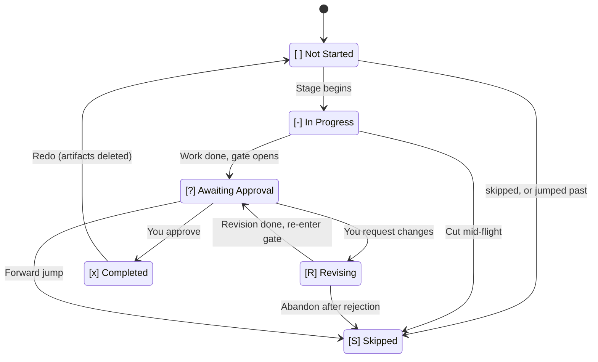
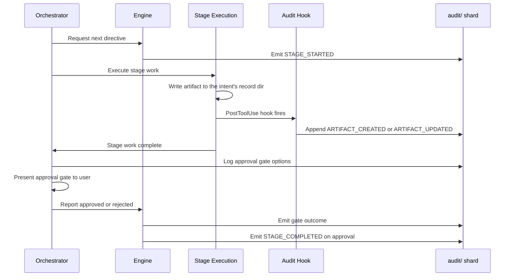

# State Tracking and Audit Trail

各作業は、インテントから本番環境までの完全なトレーサビリティを共に提供する 2 つのコミット済みの記録を保持します。**state file** はワークフローの現在位置を追跡し、**audit trail**（ファイルのフォルダー）は、その過程でのすべての判断、アクション、イベントを記録します。

---

## State File (`aidlc-state.md`)

各インテントは、`aidlc/spaces/<space>/intents/<YYMMDD>-<label>/aidlc-state.md`（インテントの記録ディレクトリ配下）に独自の状態ファイルを持ちます。これは、そのインテントのワークフロー進捗についての唯一の正です。エンジンはセッション開始のたびにアクティブなインテントの状態ファイルを読み込み、何が完了し、何が進行中で、次に何が来るかを判断します。

最初の説明は、その隣の
`project-description.json` に 1 つの JSON 文字列として保存されます。入力したとおりにそのまま保存されますが、
キー、トークン、パスワードのような形のものはマスクされます（
[入力したキーとパスワード](#keys-and-passwords-you-type) を参照）。`aidlc-state.md` は、
そのコミット済みのソースを指し、安全な 1 行の
`Project` プレビューだけを保持します。そのため、複数行のユーザー入力によって追加の状態
フィールドが入り込むことはありません。ソースマーカーのない 2.6.115 より前の記録は、引き続き
既存の `Project` フィールドを説明として使います。マーカー付きの新しい記録でファイルが
欠けているか不正な場合は、黙って劣化するのではなく、ソースの検証に失敗します。
JSON のデコードにより、Git がサイドカーの最終行の改行を正規化しても、
元の説明は保持されます。

### What it contains

| セクション | 目的 |
|---------|---------|
| **Project Information** | プロジェクトの説明、種別（greenfield/brownfield）とそれを設定した主体（`Project Type Source`: `workspace scan` または `you`）、スコープ、開始日、アクティブなエージェント |
| **Scope Configuration** | 実行するステージ、スキップするステージ（理由付き）、深さレベル、テスト戦略、`Review Override`、およびインテントごとの設定: `Guard Policy`、`Guards Off`（この作業で下げたフェンス）、`Guards On`（ポリシーの語を超えて強制的にオンにしたフェンス）、`Sensors`、`Learnings`、`Summary Confirmation`、`Plan Approval`、`Collaborators`。フェンスの行は使われた場合にのみ現れ、人間の関与は決して含みません。人間の関与には作業ごとのスイッチがないためです。 |
| **Workspace State** | プロジェクトルート、検出された言語、フレームワーク、ビルドシステム |
| **Execution Plan Summary** | ステージの総数、完了数、進行中のステージ |
| **Runtime State** | 修正回数、Construction のチェックポイント、反復と実行の設定、受領記録に結び付いた Construction Verification Command、および任意のユニット所有権とユニットのゲートのリズム |
| **Phase Progress** | 各フェーズを `Pending`、`Active`、`Verified`、`Skipped` のいずれかで示す |
| **Stage Progress** | 完了状況を追跡するステージごとのチェックボックス |
| **Unit Progress** | チームモードのみ: 導出されたユニットごとの Construction のステージとゲートのセル。`next` が書き直し、正となる情報ではない |
| **Current Status** | ライフサイクルフェーズ、現在/次のステージ、ステータス、最終更新のタイムスタンプ |
| **Session Resume Point** | 最後に完了したステージ、次のアクション、保留中の成果物 |

以下は、Claude Code で `mvp` プランを実行し、Intent Capture が承認された直後の状態ファイルの一部です（短縮しています。ファイルでは各ステージとその `EXECUTE` または `SKIP` の間に長いダッシュが入りますが、ここでは `-` で示しています）:

```text
## Scope Configuration
- **Depth**: Standard
- **Test Strategy**: Minimal
- **Review Override**:
- **Guard Policy**: off (from scope mvp)
- **Sensors**: on (from scope mvp)
- **Learnings**: on (from scope mvp)
- **Summary Confirmation**: on (from scope mvp)
- **Plan Approval**: on (from scope mvp)
- **Collaborators**: off (from scope mvp)

## Phase Progress
- **Initialization**: Verified
- **Ideation**: Active
- **Inception**: Pending
- **Construction**: Pending
- **Operation**: Skipped

## Stage Progress
### IDEATION PHASE
- [x] intent-capture - EXECUTE
- [ ] market-research - SKIP
- [-] feasibility - EXECUTE
- [ ] scope-definition - EXECUTE
...

## Current Status
- **Lifecycle Phase**: IDEATION
- **Current Stage**: feasibility
- **Next Stage**: scope-definition
- **Status**: Running
- **Last Updated**: 2026-10-13T10:43:59Z
```

`Guard Policy` と、廃止された `Change Control` の両方が異なる
ポリシーの語で現れる場合、ステータスは次の
`next` まで `strict (from conflicting state lines)` と表示します。その時点で一方が残され、唯一の行として書き込まれます。残されるのは、監査証跡上で最後に設定されたもの、それがなければあなたが設定したもの、それもなければスコープ自身のもの、それもなければより厳しいものです
（`Source: command` と `Settled` フィールドを持つ `GUARD_POLICY_SET` の行がそれを記録します）。
あなた自身の最後の選択を残した場合は何も言わず、それ以外の場合は一度だけ、たとえば次のように伝えます:

> This work had two settings for how closely AI-DLC checks changes, and they disagreed. The record does not say which was set last, so AI-DLC keeps the stricter one: it checks everything. You can change it any time.
>
> （訳: この作業には、AI-DLC が変更をどれだけ厳密にチェックするかについて 2 つの設定があり、食い違っていました。記録からはどちらが最後に設定されたかわからないため、AI-DLC はより厳しいほうを維持します。つまり、すべてをチェックします。これはいつでも変更できます。）

メモリーで保持された strict は引き続き優先され、両方の行をそのまま残します。
両方が一致している場合は、`Guard Policy` の行が使われます。ポリシーの行を書き込むと、
廃止された行は削除され、設定は 1 つになります。

`Construction Verification Command` は、すべてのユニット/バッチの
チェックポイントで再利用されるプロジェクトのチェックを記録します。`state set-construction-verification-command` がこのフィールドを書き込む前に、
対応する現在のワークフローでの人間の承認の受領記録が必要です。
フィールドだけでは実行は決して許可されず、汎用の `state set` はこれを拒否します。
人間の **Approve** / **Request Changes** の返信は、質問したチャットでも、
それが最新の質問である間の新しいチャットでも有効です。受領記録を許可するのは
**Approve** だけです。無関係な返信、**Request Changes**、または
別の質問への返信は許可しません。
[記録済みコマンドのフロー](12-cli-commands.md#construction-verification-command-record-human-authorization) を参照してください。

### Six-state checkboxes

ステージの進捗には、6 状態のチェックボックス表記を使います:

| チェックボックス | 意味 |
|----------|---------|
| `[ ]` | 未開始 |
| `[-]` | 進行中 |
| `[?]` | あなたの承認待ち（ゲートが開いている） |
| `[R]` | 修正中（あなたがゲートで却下し、ステージを修正中） |
| `[x]` | 完了 |
| `[S]` | 作業の実行中にスキップされた（`skip` で削除された、または `--stage`/`--phase` のジャンプで飛ばされた） |

プランに含まれていないステージのボックスは決して変わりません。上の `market-research` のように、名前の後に `SKIP` が付いたまま `[ ]` にとどまります。

ステージは、正常系では `[ ]` → `[-]` → `[?]` → `[x]` と遷移します。ゲートで却下すると、ステージは修正中に `[R]` へ移り、準備ができると `[?]` に戻り、承認で最終的に `[x]` になります。`/aidlc --status` はチェックボックスを読み、誰が進行を止めているかを伝えます。`[?]` では "Awaiting your approval on \<stage\>"（\<stage\> のあなたの承認待ち）、`[R]` では "Revising \<stage\> (revision N of 3)"（\<stage\> を修正中、3 回中 N 回目）と表示します。

正規の状態機械のリファレンス（遷移表、監査イベントの発行元）については、[開発者リファレンス: 状態機械](../reference/12-state-machine.md) を参照してください。

### State transitions



<!-- Text fallback: [ ] Not Started transitions to [-] In Progress when a stage begins. [-] In Progress transitions to [?] Awaiting Approval when stage work is done and the gate opens. [?] Awaiting Approval transitions to [x] Completed when you approve, or to [R] Revising when you request changes. [R] Revising transitions back to [?] Awaiting Approval when revision is complete. [ ] Not Started, [-] In Progress, [?] Awaiting Approval, and [R] Revising can each transition to [S] Skipped via a skip, a jump, or abandonment. [x] Completed transitions back to [ ] Not Started on redo (artifacts deleted). -->

### Normal, revision, skip, redo, and jump flows

- **通常のフロー**: `[ ]` -> `[-]` -> `[?]` -> `[x]`（ステージが始まり、作業が完了し、ゲートが開き、あなたが承認する）
- **修正のフロー**: `[?]` -> `[R]` -> `[?]` -> `[x]`（あなたが却下し、ステージが修正され、ゲートが再び開き、あなたが承認する）
- **スコープによるスキップのフロー**: なし。プランにないステージは `[ ]` のままで、作業の作成時に `SKIP` と記される
- **やり直しのフロー**: `[x]` または `[-]` -> `[ ]` -> `[-]`（あなたがやり直しを求め、成果物が削除され、ステージが再実行される）
- **ジャンプのフロー**: ステージ A で `[-]`、あなたがステージ B へのジャンプを求め、間のステージが `[S]` と記される

---

## Audit Trail (`audit/`)

監査証跡は、後のステージと復旧のために、アクティブなインテントの判断とイベントを
記録します。書き込むのは AIDLC のツールとフックで、読み取りはどの
手段でも自由です。書き込みガードはガードレールであり、セキュリティ境界ではありません。
担当するコマンドと読み取り専用のクエリ契約については、[監査証跡のルール](../reference/04-stage-protocol.md#audit-trail-rules) を
参照してください。

### 134-event taxonomy

イベントは 27 のカテゴリに分類されています:

| カテゴリ | 数 | イベント |
|----------|------:|--------|
| **Workflow Lifecycle** | 9 | `WORKFLOW_STARTED`, `WORKFLOW_COMPLETED`, `WORKFLOW_PARKED`, `WORKFLOW_UNPARKED`, `WORKFLOW_ARCHIVED`, `WORKFLOW_UNARCHIVED`, `STATE_UPGRADED`（古い AI-DLC が記録した作業を、エンジンが最初に読んだときにこのバージョンに合わせたもの）, `INTENT_REPOS_CHANGED`, `INTENT_CHECKOUTS_CHANGED` |
| **Phase Lifecycle** | 4 | `PHASE_STARTED`, `PHASE_COMPLETED`, `PHASE_VERIFIED`, `PHASE_SKIPPED` |
| **Stage Lifecycle** | 9 | `STAGE_STARTED`, `STAGE_AWAITING_APPROVAL`, `STAGE_REVISING`, `STAGE_COMPLETED`, `STAGE_SKIPPED`, `STAGE_JUMPED`, `STAGE_DEFINITION_CHANGED`, `STAGE_OUTPUT_AMENDED`（ステージ自身のドキュメントが、あなたの承認後、次のメッセージの前に変更された）, `SOURCE_WORK_NOT_FOUND`（Code Generation が探した場所に新しいコードが見つからなかったことと、その対応: エージェントに伝えた、あなたに質問した、または Guard Policy off の下で退いた） |
| **Session** | 6 | `SESSION_STARTED`, `SESSION_RESUMED`, `SESSION_COMPACTED`, `SESSION_ENDED`, `HUMAN_TURN`（フックが発行）, `HOST_TURN`（ホストがエージェントのために作ったプロンプトで、決して人のターンではない。Claude Code では、Message Id を指定するものが、最初に人のターンとして記録されたターン（スケジュールされた起動など）を取り消す） |
| **Initialization** | 3 | `WORKSPACE_SCAFFOLDED`, `WORKSPACE_SCANNED`, `WORKSPACE_INITIALISED` |
| **Navigation** | 9 | `SCOPE_CHANGED`, `SCOPE_DETECTED`, `DEPTH_CHANGED`, `TEST_STRATEGY_CHANGED`, `REVIEW_CLASS_CHANGED`, `RECOMPOSED`, `WORKSPACE_RECLASSIFIED`, `SCOPE_SAVED`, `PLUGIN_SELECTION_CHANGED` |
| **Guard Policy** | 5 | `GUARD_POLICY_SET`, `CHANGE_CONTROL_SET`（廃止された名前。引き続き読み込まれる）, `CHANGE_ACCEPTED`, `GUARD_RESTORED`, `GUARD_STOOD_ASIDE` |
| **Ceremony** | 1 | `CEREMONY_SET`。`aidlc-utility.ts config-change` が発行する（共有の `scope-change` アプライヤー経由でも発行される）。フィールド: `Key`（`sensors`, `learnings`, `summary_confirmation`, `plan_approval`, `collaborators`）、`Old`、`New`、`Source`（明示的な設定では `you`、継承された既定値では `scope <name>`）。`Old` は以前に保存された値（不正な場合は生のテキスト、ない場合はスコープの既定値）であり、環境上の実効値ではない。実際に保存されたフィールド/ソースの変更ごとに 1 行。何も変えないコマンドは何も発行しない。 |
| **Interaction** | 19 | `DECISION_RECORDED`, `GATE_APPROVED`, `GATE_REJECTED`, `QUESTION_ANSWERED`, `QUESTION_REPLIED`, `QUESTION_UNANSWERED`, `QUESTION_ASKED`, `QUESTION_SHOWN`, `REQUEST_ROUTED`, `SUMMARY_CONFIRMATION_RECORDED`, `VERIFICATION_COMMAND_RECORDED`, `CONSTRUCTION_POLICY_RECORDED`, `CHECKPOINT_VERIFICATION_RECORDED`, `PLAN_APPROVAL_RECORDED`, `PLAN_APPROVAL_SKIPPED`, `PLAN_APPROVAL_OVERRIDDEN`, `REVIEW_REQUESTED`, `REVIEW_COMPLETED`, `PIPELINE_LINK_COMPLETED` |
| **Unit Configuration and Lifecycle** | 9 | `UNIT_OWNERSHIP_SET`, `UNIT_GATE_RHYTHM_SET`, `CONSTRUCTION_POLICY_SET`, `UNIT_STARTED`, `UNIT_PAUSED`, `UNIT_RESUMED`, `UNIT_COMPLETED`, `UNIT_SKIPPED`, `UNIT_MERGED` |
| **Artifact** | 3 | `ARTIFACT_CREATED`, `ARTIFACT_UPDATED` (write-audit-log hook), `ARTIFACT_REUSED` |
| **Subagent** | 4 | `SUBAGENT_DISPATCHED`（deliver-stage-rules フック、または Cursor と Kiro IDE では log-subagent）, `SUBAGENT_COMPLETED`（log-subagent フック）, `SUBAGENT_PROMPT_UNMATCHED`（Copilot アダプター、参考情報）, `REVIEW_VERDICT_DICTATED`（現在は書き込まれない。以前のリリースの plan-approval-guard フックによるもの。レビュアー自身の `**Verdict Dictated:**` 行は現在 `REVIEW_COMPLETED` に含まれる） |
| **Reviewer Enforcement** | 2 | `REVIEWER_SCOPE_BLOCKED`（reviewer-scope フック）, `REVIEW_FREEZE_BLOCKED`（review-freeze フック） |
| **Plan Approval** | 2 | `PLAN_APPROVAL_BLOCKED`, `GUARD_DISABLED`（plan-approval-guard フック、またはこの作業であなたがオフにしたフェンス） |
| **Guard Refusals** | 2 | `STATE_TRANSITION_BLOCKED`（state-transition ガードが、委譲されたエージェントのライフサイクルまたはルーティングのコマンドを拒否した）, `STAGE_RULES_BLOCKED`（サイズのためにステージルールが拒否された、または必須のルールファイルを読み込めなかった）。それぞれが `Guard`、`Reason`、および拒否した `Target`/`Session` を持ち、拒否ごとに 1 行 |
| **System Install** | 3 | `SYSTEM_INSTALL_BLOCKED`（`sudo apt-get install` のような、あなたが求めておらず承認済みのプランにも記載のないシステムパッケージのインストール。あなたが許可するまで保留される）, `SYSTEM_INSTALL_ALLOWED`（あなたのメッセージによって通されたもの。あなたの言葉を含む）, `SYSTEM_INSTALL_REQUESTED`（それを求めたあなたのメッセージ。同じメッセージでのあなたの承認がそれを使った場合にエージェントが指定する） |
| **Documents** | 3 | `DOCUMENT_INDEXED`, `DOCUMENT_UPDATED`, `DOCUMENT_REMOVED` — インテントのスコープであってもスペースレベルのシャード |
| **Utility** | 1 | `HEALTH_CHECKED` |
| **Error/Recovery** | 3 | `ERROR_LOGGED`, `RECOVERY_COMPLETED`, `COORDINATION_STOOD_ASIDE` |
| **Construction Bolt** | 4 | `BOLT_STARTED`, `BOLT_COMPLETED`, `BOLT_FAILED`, `AUTONOMY_MODE_SET` |
| **Worktree** | 7 | `WORKTREE_CREATED`, `WORKTREE_MERGED`, `WORKTREE_DISCARDED`, `STATE_FORKED`, `STATE_MERGED`, `AUDIT_FORKED`, `AUDIT_MERGED` |
| **Practices** | 4 | `PRACTICES_DISCOVERED`, `PRACTICES_AFFIRMED`, `PRACTICES_OVERRIDE`, `PRACTICES_SECTION_EMPTY` |
| **Merge Dispatch** | 3 | `MERGE_DISPATCH_INVOKED`, `MERGE_DISPATCH_RETURNED`, `MERGE_DISPATCH_FALLBACK` |
| **Sensors** | 6 | `SENSOR_FIRED`, `SENSOR_PASSED`, `SENSOR_FAILED`, `SENSOR_COULD_NOT_RUN`, `SENSOR_BUDGET_OVERRIDE`, `GUARDRAIL_LOADED` |
| **Learning Loop** | 3 | `MEMORY_EMPTY`, `RULE_LEARNED`, `SENSOR_PROPOSED` |
| **Swarm** | 9 | `SWARM_STARTED`, `SWARM_UNIT_CONVERGED`, `SWARM_SOURCE_MERGED`, `SWARM_UNIT_FAILED`, `SWARM_BATON_RETURNED`, `SWARM_COMPLETED`, `SWARM_DEGRADED`, `MAIN_CHECKOUT_CHANGE_ALLOWED`, `SWARM_TAKEN_OVER` |
| **Commit Provenance** | 1 | `SOURCE_COMMITTED`（`aidlc attest anchor`、またはオプトインのセッション開始時のスイープ。情報の付加のみで、`resolve` はこれを決して読まない） |

### What gets logged and when

- **すべてのステージの開始と完了** は、`STAGE_STARTED` と `STAGE_COMPLETED` のイベントで記録されます
- インテントの記録ディレクトリまたはスペースの `codekb/`（`audit/` シャード自体を除く）で、**エージェントがファイルツールで書き込みまたは編集したすべてのファイル** は、write-audit-log フックによって記録されます。シェルコマンドで書き込まれたファイルは記録されません
- **すべての承認ゲートの判断**（承認、変更の依頼、現状のまま受け入れ）が記録されます
- あなたが提供した **すべての質問の回答** が記録されます
- **すべてのサブエージェントの完了** は log-subagent フックによって記録され、送られたすべてのヘルパーは送信時に記録されます
- **すべてのエラーと復旧** が記録されます

### How to read the audit log

各シャードはプレーンな Markdown で、イベントごとに 1 ブロックです。以下は、上の実行の Intent Capture
ステージからの 2 つです:

```text
## Stage Start
**Timestamp**: 2026-10-13T10:27:19Z
**Event**: STAGE_STARTED
**Stage**: intent-capture
**Agent**: aidlc-product-agent

---

## Question Answered
**Timestamp**: 2026-10-13T10:34:07Z
**Event**: QUESTION_ANSWERED
**Stage**: intent-capture
**Details**: Q9: One total per SKU
**Person Reply**: One total per SKU
```

イベントのタイムラインを JSON で得るには `aidlc engine audit history` を実行します。1 つのステージを確認するには
`--stage <slug>` を追加します。各イベントは、タイムスタンプ、種別、
名前付きフィールドを持ちます。結果は古い順です。`unordered: true` は、書き込み元をまたいだ順序が不明な
同時刻のエントリを示します。自由形式のメモは、見出しと本文を持つ `NOTE`
エントリとして現れます。`--event NOTE` はメモを選択し、
`--stage` はメモを除外します。

`Human Turn` のエントリは、あなたが操作したことを記録するだけで、あなたの言葉は決して記録しません。各ターンで
送った内容を読むには、`aidlc engine audit turns` を実行します。これは、各ターンを
このマシンが 1 日保持するメッセージ記録と結び付け、ターンの言葉がここにない場合は
そう伝えます。

対になった過去の質問と回答を見るには、`aidlc engine log answers --stage <slug>` を実行します（ユニットの場合は `--unit <unit>` を追加）。
1 つの返信は、それが答えたメニューについて記録されたすべての質問と対になります。
未回答の質問と、まれにあるあいまいな回答（前に質問がない、または書き込み元が 1 秒単位で同時刻）は別に報告されます。
どちらのコマンドもファイルを変更せず、ロックも取りません。

エージェントが質問の選択肢の 1 つに "(Recommended)" と印を付けると、記録は
その選択肢を `Recommended` として保持します。記録された選択肢にその印がある場合は質問の `Decision Recorded`
エントリに、Claude Code や Codex の質問ボックスで回答した場合は `Question Replied`
エントリに、ボックスの `Options` とあなたの `Reply` と並べて保持されるため、それに従ったかどうかを確認できます。
`log answers` は、記録された質問の `Recommended` を、その `options` とあなたの回答と並べて
`recommended` として一覧表示します。これより前に書かれたエントリには
`Recommended` がなく、従来どおりに読まれます。

### Keys and passwords you type

状態ファイル、`project-description.json`、監査シャードはあなたの作業とともにコミットされるため、
AI-DLC はそれらを書き込む前に、キー、トークン、パスワードのような形のものをマスクします。
対象は、ベンダーのトークン（GitHub、GitLab、Slack、Stripe、OpenAI、
Anthropic、Google、npm、Hugging Face、AWS のアクセスキー）、秘密鍵のブロック、
JWT または `Bearer` トークン、アドレス内のパスワード
（`postgres://app:[masked]@db`）、そしてシークレットの名前の後に設定された値
（`password=`、`DB_PASSWORD=`、`GITHUB_TOKEN:`）で、その値に英字と
数字または記号が含まれる場合です（パスワードの名前の後では、`-`、`.`、
`_` で連結された単語も対象になります）。`$DB_PASSWORD` のような参照はそのまま残り、
`your-api-key-here` のようなプレースホルダーも残ります。それ以外の言葉は入力したとおりに残ります。
たとえば `**Person Reply**: Approve, the deploy key is [masked]` のようになります。メッセージ全体は
`aidlc/.aidlc-sessions/` にのみ残り、AI-DLC の `.gitignore`
ブロックによってコミットから除外されます。メッセージにそうしたものが含まれていた場合、AI-DLC はチャットで一度だけ
その旨を伝えます。チャット自体はそれを受け取っているため、本物であれば
発行元でキーを変更してください。マスクは形だけで判断するため、別の形で書かれたシークレット
（`my password is hunter2`）は入力したとおりに保持されます。doctor バンドルは
同じ形とそれ以上のものをマスクします。

### Who decided

ステージを承認する、変更を求める、ステージをスキップする、ステージにジャンプする、
チェックをオフまたはオンにする、変更された入力を通す、といった操作をすると、監査の行には
あなたの git の名前も記録されます。たとえば `**Git Name**: Jane Doe` です。これは、
このプロジェクトで `git config user.name` が返す名前（リポジトリ自身の設定、なければ
グローバルの設定）で、ユニットボードに表示されるのと同じ名前です。そのため、チームのクローンでは各
人の行にその人の名前が記録されます。AI-DLC はそれを読むだけで、設定したり、
尋ねたり、メールアドレスを記録したりすることは決してなく、git に名前がなければ何も
記録しません。これは git が報告するとおりに誰がキーボードの前にいたかを示すものであり、署名や
本人確認の証明ではありません。`/aidlc --status` は、最後に完了した
ステージを誰が承認したかを示します。たとえば `Last Completed: Requirements Analysis (approved by Jane
Doe)` です。どの行がそれを持つかは、ハーネスフォルダー内の
`knowledge/aidlc-shared/audit-format.md` の "Git Name" に記載されています。

### Audit event flow

ステージが実行されて成果物を生成すると、監査証跡は一連の流れ全体を記録します:



<!-- Text fallback: The orchestrator requests the next directive and the engine emits STAGE_STARTED. Stage execution writes artifacts; the PostToolUse hook appends ARTIFACT_CREATED or ARTIFACT_UPDATED. After the stage work and approval gate, the orchestrator reports the outcome. The engine emits the gate result and, on approval, STAGE_COMPLETED while updating state and routing. -->

---

### Source-bound review receipts

Code Generation はインテントの記録の外にアプリケーションのソースを書き込むため、その
ユニットごとの最終的なレビューの受領記録は、Markdown の成果物以上のものに結び付きます。
レビューされたユニットの厳格な `source-manifest.json` は、作成、変更、削除された
ソースのパスを列挙し、`Unit Source Fingerprint` がそれらの主張とマニフェストのバイト列を結び付けます。
完了時、エンジンは各ユニットを新しい順に検証し（より新しいレビュー済みの
主張は、意図的な共有ファイルの統合を所有できます）、次に新しい主張の和集合を
ステージ開始時のソースのベースラインと比較します。Guard Policy が
strict の場合、カバーされていない変更や古くなったユニットは 4 つの完了経路すべてをブロックし、
そのユニットについて範囲を限定した古い受領記録の復旧を 1 回提示します。Git が無視し、
どのユニットも主張できないファイル（追跡されておらず、
`.aidlc-source-paths.json` にも登録されていないもの。ビルド出力やテスト実行の記録など）は、
カバーされていない変更ではありません。そのファイルの `exclude` リストが走査から除外するパスも、
その行がステージ開始後に書かれたものであっても同様です（プロジェクトが無視していない
ツールのキャッシュ、このプロジェクトのコードではない入れ子のリポジトリなど）。
レジストリファイル自体は AI-DLC 自身のものなので、どのユニットもそれを主張しません。strict の
拒否は 3 つの抜け道を示します。変更を行ったユニットがそのパスを列挙して
もう一度レビューを受ける、誰も意図していない変更を元に戻す、またはソースではない
パスをそこで除外する、のいずれかです。relaxed または
off の場合、カバーされていない変更は維持されます。完了時にそれを一度
`CHANGE_ACCEPTED` として記録し、ファイルを 1 行で示します（"These files changed outside
any unit's work in Code Generation: ... Kept them."）。このマシンにステージ開始時のベースラインが
ない場合（新しいクローン）は、どの Guard Policy でも 1 行を示してチェックをスキップします。ベースラインが
存在して一致しない場合は、strict の下では引き続き完了をブロックします。

ワークスペース全体の `Source Fingerprint` は、通常、レビュー後の変更に対する外側の
境界です。1 つの限定的な調整によって、文書化されている「元に戻す（revert）」
復旧が実際に機能します。主張されていないベースラインの変更（追加、変更、
削除）が完全に元に戻された後、完了を続行できるのは、
ステージのベースラインが存在して有効であり、該当するすべてのユニットがなお
新しい最新形式の結び付きを持ち、ベースラインから現在までの差分に主張されていないパスが
1 つもない場合だけです。通常のレビュー後の編集、古いまたはレガシーのユニットの証跡、
残っている主張されていないパスは、引き続き拒否されます。アップグレード前のフィールドのない受領記録や
ベースラインは、文書化された移行時の fail-open の振る舞いを維持します。最新形式の証跡が欠けているか
破損している場合は fail-closed になります。`AIDLC_SKIP_SOURCE_FRESHNESS=1` は
決定的な緊急用のオフスイッチであり、バイパスの印が付いた受領記録を消費するときにも
再び設定されている必要があります。

レビュー後の AI-DLC の更新は AI-DLC 自身のファイルだけを変更するため、
受領記録の `Source Listing` がこのマシンにあれば、レビューは最新のまま保たれます。それがない
受領記録は、上記のとおり `Source Fingerprint` で比較されます。

---

## How State and Audit Work Together

状態ファイルと監査証跡は、互いを補完する目的を果たします:

| 観点 | 状態ファイル | 監査証跡 |
|---------|-----------|-------------|
| **目的** | 現在の位置と進捗を追跡する | イベントの完全な履歴を記録する |
| **読み手** | オーケストレーター（ルーティングと再開のため） | ユーザーと監査担当者（トレーサビリティのため） |
| **更新パターン** | 状態が変わるたびに上書きされる | 追記のみ（決して変更されない） |
| **セッションの再開** | どこから続けるかを判断する主要な情報源 | 元のプロジェクトの説明と判断のコンテキストを提供する |
| **Git のポリシー** | バージョン管理にコミットする | コミットする（`audit/` 配下のクローンごとのシャード。マージの競合なし） |

オーケストレーターは、`aidlc-state.md` を永続的なカーソルとして使います。チームが所有する
Construction では、さらにアクティブなインテントの監査シャードから、ユニットのセル、受領記録の下限、ゲート、マージ済みの
行を導出します。ソロのルーティングでは、状態ファイルのみのカーソルの振る舞いを維持します。監査証跡によって、インテントから
本番環境までのすべての判断を追跡することもできます。

状態ファイルが破損した場合は、`STAGE_STARTED` と `STAGE_COMPLETED` のイベントを確認することで、監査証跡から再構築できます。修復手順については [トラブルシューティング](15-troubleshooting.md) を参照してください。

---

## Next Steps

- [セッション管理](11-session-management.md) — セッションの再開に状態がどう使われるか
- [成果物リファレンス](14-artifacts-reference.md) — インテントの記録ディレクトリに何が保存されるか
- [トラブルシューティング](15-troubleshooting.md) — 状態の破損の修復
- [用語集](glossary.md) — 状態ファイル、監査証跡、チェックポイント、コンパクションの定義
