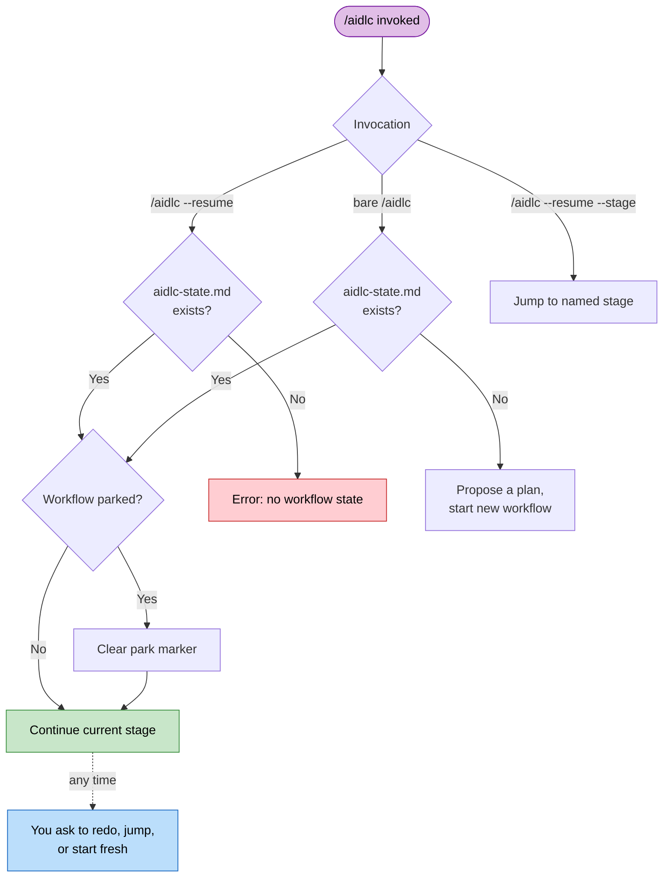

# Session Management

1つのワークフローは複数のハーネスセッションにまたがることがあります。AI-DLC はすべての進捗をディスクに保存するため、いつでも再開、やり直し、ジャンプ、最初からのやり直しができます。

> **ハーネスに関する注意。** セッションの再開はすべてのハーネスで機能します（状態はハーネスではなく、
> インテントの記録ディレクトリにあります）。セッションの *ライフサイクルイベント* は異なります: Claude Code は
> `SESSION_STARTED/RESUMED/ENDED` と `SESSION_COMPACTED` を出力します。Kiro CLI は
> `SESSION_STARTED` のみを出力します。Kiro IDE は `SESSION_STARTED` を出力し、プロンプトが以前のチャットに戻ったときに
> `SESSION_RESUMED` を出力します。Codex は `SESSION_ENDED` を推定し、その後
> compact-source の `SessionStart` を通じてミッションを再注入します。[他のハーネスでの実行](harnesses/README.md) を参照してください。

---

## Resume Flow

新しいセッションで引数なしの `/aidlc` を実行し、アクティブなインテントの `aidlc-state.md` が存在する場合、AI-DLC は `/aidlc --resume` と同様に作業が止まったところから続行し、どこから再開したかを伝えます。以前のチャットで尋ねられて答えなかった質問は、尋ねられたときと同じ形で再び尋ねられます。別のことをしたい場合は、そう伝えてください: 現在のステージのやり直し、ステージへのジャンプ、最初からのやり直しができます。



<!-- Text fallback: bare /aidlc with state carries on like /aidlc --resume; you can ask to redo, jump, or start fresh at any time; without state it starts with a plan proposal. /aidlc --resume with state clears a park marker if needed and continues directly; without state it errors. /aidlc --resume --stage jumps to the named stage. -->

コマンドから park するには `/aidlc park` を使います。エンジンが park コマンドを指定し、コンダクターがどこで止まったかを報告します。`/aidlc --resume` で再開できます。

### Redo, jump, or start fresh

引数なしの `/aidlc` は最後のチェックポイントから再開します。それ以外の操作は、いつでも自分の言葉で依頼できます。

| 選択肢 | 何が起きるか | 保持されるもの | 失われるもの |
|--------|-------------|-------------------|-------------|
| **Resume from last checkpoint**（最後のチェックポイントから再開） | 進行中または次の保留中のステージから続行します。セッションにタスクツールがある場合、タスクサイドバーは状態ファイルから再構築されます。 | すべての成果物、状態、監査証跡 | 前のセッションのメモリ上の会話コンテキスト |
| **Redo current stage**（現在のステージをやり直す） | 現在のステージのチェックボックスを（`aidlc-jump.ts execute --direction redo` によって）リセットし、最初から再実行します。Construction が Unit を1つずつ実行していて、作業を終えた Unit がある場合、Redo は代わりにアクティブな Unit のステップだけを最初からやり直します。その Unit が一時停止中の場合や、サマリー確認またはチェックポイントの承認を待っている場合も同様です。Code Generation ではプランも含まれるため、プランが承認のために戻ってきます（プラン承認がオフの場合を除く）。 | その他すべての成果物と状態（Unit を1つずつ進める場合は、他の Unit の完了済みの作業も） | 現在のステージの完了状態と途中の作業（Unit を1つずつ進める場合は、その Unit のステップ） |
| **Jump to stage**（ステージへジャンプ） | 特定のステージへ（`next --stage <slug>` によって）移動します。前方へのジャンプの後、AI-DLC はどのステージをスキップしたかと戻り方を1行で伝えます。 | 既存のすべての成果物 | 現在位置と移動先の間のステージは `[S]`（スキップ）としてマークされます |
| **Start fresh**（最初からやり直す） | 既存のインテントと並行して新しいインテントを（スコープと説明を確認した後、`next --new-intent` によって）開始します。 | 既存のワークフローの成果物、状態、監査証跡（そのまま残ります） | なし - 以前のインテントは引き続き再開可能です |

`/aidlc --resume --stage <slug>` は明示されたステージを移動先として扱い、通常のジャンプ経路をたどります。

ディスパッチされたアンサンブル作業は、ディスク上の証拠から再開します。Practices
Discovery では、コンダクターはリードのドラフトと既存のすべての
コントリビューションファイルを保持し、欠けている quality/developer/devsecops の
スポークだけをディスパッチしてから、人間へのインタビューとリードによる統合に進みます。
完了済みのスポークは繰り返しません。

Code Generation はプランのチェックから再開します。developer エージェントは
`code-generation-plan.md` の各ステップを終えるたびにチェックを付けます。ビルドが途中で
止まった場合（モデルやプロバイダーのエラー、エディターを閉じたなど）、同じプランの
次の実行は最初の未チェックのステップから再開し、
"Picking up unit-2's code at step 5 of 9 (1-4 done)."（unit-2 のコードを9ステップ中のステップ5から再開します（1〜4は完了））のような1行が表示されます。何もチェックされていなくても、
最初のステップが指定するファイルが書かれている場合は、代わりにその後から再開します
（"(1-4 wrote their files)"）。コードは書かれているが、どのステップが完了したかを示すものが
何もない場合は、"Picking up unit-2's code: the plan marks none of its 9
steps done, checking what is built."（unit-2 のコードを再開します: プランでは9ステップのいずれも完了になっていないため、何がビルド済みかを確認します）と表示され、developer が終えたステップに
チェックを付けます。developer は完了した各ステップが指定するファイルを確認し、
作られているはずのファイルがない場合にだけそのステップをやり直します。
Redo、Request Changes、およびプランの再承認では、ステップを最初からやり直します: 新しいビルドが
始まるとプランのチェックはクリアされ、そのビルドもまた中断された場合は、そのビルドが付けたチェックだけが
有効になります。ビルド開始後にプランを編集した場合も最初からやり直しになります。ビルド前に編集したプランは、他のプランと同じように再開します。

---

## Context Compaction

Claude Code は、コンテキストウィンドウがいっぱいになると、以前の会話コンテキストを自動的に要約します。これを **コンパクション** と呼びます。この実装には、コンパクションをまたいでワークフローの状態を保持するための安全策があります。

### What is preserved vs. lost

| 保持されるもの | 失われるもの |
|-----------|------|
| 記録ディレクトリのすべての成果物（ディスク上のファイル） | メモリ上の会話コンテキスト（以前の議論） |
| `aidlc-state.md`（ステージの進捗、スコープ、プロジェクト情報） | まだファイルに書き込まれていない途中の作業 |
| `audit/` シャード（判断と操作の完全な履歴） | タスク ID（再開時に状態ファイルから再構築） |
| | エージェントのペルソナのコンテキスト（エージェントファイルから再読み込み） |

### How to recover after compaction

1. `/aidlc` を実行します。AI-DLC は状態ファイルを読み、作業が止まったところから続行します
2. 進行中だったステージをもう一度行わせたい場合は、やり直しを依頼します。Construction が Unit を1つずつ実行している場合、再開時のコンテキストはアクティブな Unit がいるステップを示し（たとえば `Current Step: code-generation for unit beta`）、Redo はその Unit のステップだけをやり直します。他の Unit の完了済みの作業は承認されたままです

コンパクションは長いセッションでは普通に起きることです。ディスク上の状態ファイルと成果物によって、完了した作業が失われることはありません。

---

## Changing Model Mid-Workflow

実行中のチャットの中で別のモデルに切り替えると、遅くなり、多くのトークンを消費します:
新しいモデルは、答える前に会話全体を読み直すからです。Claude
モデルでは、プロバイダーの会話キャッシュは1つのモデルに属するため、何も
引き継がれません。また、同じチャットで effort レベルを変更すると、通常はキャッシュも
破棄されます。

AI-DLC は必要なものをすべてディスクに保存しているため、新しいチャットで切り替えるほうが低コストです:

1. ステージの境界で止めます: 同じ返信の中でステージを承認し、止めるよう依頼します。
   たとえば `Approved. Stop here for today.` のようにします。ワークフローは次のステージが始まる前に park されます
   （[対話モード](07-interaction-modes.md) を参照）。`/aidlc park` でも、その時点の位置で
   park できます。
2. 新しいチャットまたはセッションを開き、そこで新しいモデルと effort を選びます。
   Kiro IDE では、チャットパネルのエージェントピッカーで **aidlc** エージェントも選んでください。
   新しいチャットは Kiro の Default エージェントで始まるためです（
   [Kiro IDE のチャットで AI-DLC を開始する](harnesses/kiro.md#start-ai-dlc-in-a-kiro-ide-chat) を参照）。
3. `/aidlc --resume` を実行します。新しいチャットは、古い会話ではなくディスクから保存済みの状態、成果物、
   監査証跡を読み込み、ワークフローが止まったところから続行します。

古いチャットで話し合ったがファイルに書かなかった内容は引き継がれません。
そのため、ステージの終わりが最適なタイミングです。Codex CLI では、`/aidlc` の代わりに
`$aidlc` と入力します。どのモデルと effort を選ぶかについては、
[モデルと effort の選び方](18-install-and-lifecycle.md#choosing-a-model-and-effort) を参照してください。

---

## Stage Jumps

ユーティリティコマンドを使って、ワークフロー内を前方にも後方にもジャンプできます。

### Jump to a specific stage

```
/aidlc --stage code-generation
/aidlc --stage 3.5
```

前方へジャンプすると、現在位置と移動先の間のステージは `[S]`（スキップ）としてマークされ、AI-DLC はどのステージをスキップしたかと、戻れることを1行で伝えます。たとえば "Moved to Code Generation; skipped User Stories. You can go back to Requirements Analysis any time." のように表示されます。後のステージは、スキップしたステージが書くはずだったファイルを前提にしていることがあります。

Construction が Unit を1つずつ実行する場合（unit-major。新しい作業の既定）、ジャンプは依頼すればそのまま行われます。アクティブな Unit がいるステップへのジャンプは、単にそのまま続行します。アクティブな Unit がすでに終えたステップへ戻るジャンプ（たとえば unit beta が Code Generation にいるときの `/aidlc --stage nfr-design`）は、その Unit についてだけ、そのステップとそれ以降のステップを再び開きます（再び開かれた各ステップは、以前のファイルを見つけると Keep、Modify、Redo を提示します）。アシスタントはそれを1行で伝えます: "Reopened NFR Design for unit beta. alpha keeps its finished work. You can redo it for alpha too." 全 Unit を指定するか、Unit を名指しすると、代わりにそれらの Unit について再び開きます。これはステージの承認が後の Unit ごとのステップに進んだ後や、すべての Unit がビルドされた後でも同様です: Build and Test で "go back to Code Generation for Unit 2 only" と言うと、その Unit だけ Code Generation を再び開き、他の Unit は承認を保ったまま何も尋ねられず、その後 Build and Test が再実行されます。"go back to Code Generation" のようにステージ全体へ戻るジャンプは、すべての Unit についてそのステージとそれ以降のステージをやり直し、それより前のステージは保持します。beta がステップの途中にあるときに別の Unit を指定すると、まず beta のステップが一時停止され、アシスタントは次のように伝えます: "Paused unit beta at Code Generation and reopened NFR Design for unit alpha. You can pick beta up again any time." 何も失われません: alpha がステップをやり直し、その後 beta が止まったところから（または beta に戻るよう依頼した場合はそれより前から）再開します。すべての Unit を自分で進めるチームのメインチェックアウト（まだどのチームも Unit を引き受けていない状態）でも、Unit を指定したジャンプは同じように扱われます。Unit の指定が適用できない場合（Unit ごとに行わないステップや、Construction のチェックポイントがオフで、すべての Unit についてすでに承認済みのステップ）は、その旨がはっきり伝えられ、何も変わらず、アシスタントは代わりにすべての Unit について再び開くかを尋ねます。yes と答えるとそのとおりになります。後のステップへ先にジャンプする場合（たとえば unit beta が NFR Requirements にいるときの `/aidlc --stage code-generation`（"stop the design, build it"））は、beta だけが先へ進みます: beta の Code Generation までのステップは beta についてスキップされ（ファイルは残ります）、他のすべての Unit は完了済みの作業と承認を保持し、まだ始まっていない Unit はそこに到達したときに自分のステップを行います。これは、どの Unit もまだ作業を終えていない最初の Unit についても、すべての Unit を自分で進めるチームのメインチェックアウトでも同様です。`/aidlc --stage <skipped step> --unit beta` は beta についてスキップされたものを再び開きます。さらに先へジャンプする場合（たとえば Build and Test へ、または Construction を早めに抜ける `/aidlc --phase operation`）は、Unit が終えていないステップをスキップし（ファイルは残ります）、Unit を自分でビルドしている場合、AI-DLC はそれらを Unit ごとに1行で示します。たとえば "Moved to Build and Test. Skipped for unit beta: Code Generation. Their files stay. You can go back to Code Generation any time." のように表示されます。`/aidlc --stage <earliest skipped step>` はスキップされたものを再び開きます。

後方へジャンプすると、移動先のステージとプラン内のそれ以降のすべてのステージが `[ ]`（未開始）にリセットされ、順番に再び実行されます。AI-DLC は戻れることを1行で伝えます。たとえば "Moved back to Requirements Analysis. You can return to Code Generation any time." のように表示されます。ジャンプでリセットされるのは進捗のマークであってファイルではありません: 成果物はディスクに残り、再び開かれた各ステージは以前のファイルを見つけると、それを保持するか、修正するか、やり直すかを尋ねます。

### Jump to the start of a phase

```
/aidlc --phase construction
/aidlc --phase 3
```

指定したフェーズの最初のステージへジャンプします。ステージへのジャンプと同様に、AI-DLC はどのステージをスキップしたかと戻り方を伝えます。

### Combining jumps with scope

`--stage` または `--phase` を `--scope` と組み合わせることができます:

```
/aidlc --stage code-generation --scope bugfix
```

まだワークフローがない場合は、指定したスコープで新しいワークフローを作成し、移動先のステージへ直接ジャンプします。実行中の作業では、AI-DLC はまずスコープを変更してから、新しいスコープでジャンプします。一緒に入力した `--depth`、`--test-strategy`、`--guard-policy` の設定は、その変更とともに適用されます。`--review` や `--sensors` などのセレモニーのスイッチは、ジャンプの前に単独で設定してください。

---

## Session Skills

現在のワークフローを変更せずに報告する読み取り専用のスキルが3つあります。いずれもコマンドのように入力でき、`/` のスキルピッカーに表示されます:

| スキル | 機能 | 出力 |
|-------|--------------|--------|
| `/aidlc-session-cost` | 決定的なコストビューを出力します — 所要時間、ステージの結果、メモリエントリ、センサーの発火、記録された学び | ターミナルのみ |
| `/aidlc-replay` | その場にいなかったステークホルダー向けに、読みやすいセッションの経緯を描きます — 何がなぜ決まったか | ターミナルのみ |
| `/aidlc-outcomes-pack` | ワークフローを再実行しなくてもチームがシステムを引き継いで続けられるよう、引き継ぎドキュメントを生成します | `OUTCOMES.md` を書き込みます |

**これらは読み取り専用です。** いずれもワークフローのステージポインタを進めず、監査イベントも出力しないため、ステージの途中を含め、いつ実行しても安全です。`/aidlc-session-cost` と `/aidlc-replay` はターミナルに出力するだけで何も書き込みません。ファイルを書き込むのは `/aidlc-outcomes-pack` だけです（ワークスペースのルートの `OUTCOMES.md`）。

**報告される数値はすべてデータプレーンから直接得られます。** 各スキルは `aidlc engine runtime summary --json`（`runtime-graph.json` に対するマテリアライズドビュー）から数値を読みます。スキルが推定や数え直しをすることはありません。数値の周囲の散文（経緯や判断の根拠）だけが、監査証跡と成果物から合成されます。トークンの推定は意図的に含めていません — 以前のファイルサイズからトークン数を求めるヒューリスティックは当て推量だったため、削除されました。

```
/aidlc-session-cost      # quick "where are we" snapshot, any time
/aidlc-replay            # narrate the session for async review
/aidlc-outcomes-pack     # at workflow close - write the handover doc
```

たとえば、`mvp` プランで Intent Capture を終えたばかりの Claude Code の実行で `/aidlc-session-cost` を実行した場合（抜粋）:

```text
  Scope:      mvp
  Duration:   17 min
  Stages
    Total:      5
    Approved:   4
    Failed:     0
    Pending:    1
  By phase
    initialization    3/3 approved
    ideation          1/2 approved, 1 pending
  Memory entries
    Total:            2
    Interpretations:  1
    Deviations:       1
    Trade-offs:       0
    Open questions:   0
  Sensors
    Fired:            9
    Passed:           9
    Failed:           0
    Could not run:    0
    Budget-override:  0
    Incomplete:       0
  Learnings captured
    From orchestrator:    1
    From user additions:  1
```

エージェントはその後に1〜2文を添えます。この例では、9つのチェックがすべて通ったことと、合計はこれまでに開始したステージだけを対象にしていることを伝えています。

各スキルは、読み込むためにコンパイル済みの `runtime-graph.json` を必要とします。ワークフローが最初のステージを開始する前に実行すると、短い "no session data yet" という注記を出力して停止します。

**ハーネスがスラッシュコマンドを公開していない場合。** `/aidlc-session-cost`、`/aidlc-replay`、`/aidlc-outcomes-pack` はスキルです — `/` ピッカーにスキルを表示するハーネス（Claude Code、Kiro、Cursor など）でのみ、入力可能なコマンドとして表示されます。表示しないハーネスでは、`/aidlc-session-cost` と入力すると無効なコマンドとして報告されます。それでもコストビューは使えます: 基盤となるコマンドを直接実行してください。これはスキルが実行するものそのものであり、すべての数値の出どころです:

```bash
aidlc engine runtime summary          # human-readable cost view
aidlc engine runtime summary --json   # machine-readable, same numbers
```

これは読み取り専用で、ワークフローのどの時点で実行しても安全です。スキルと同様に、コンパイル済みの `runtime-graph.json` が必要です。最初のステージ遷移の前には、"run a workflow first" という注記を出して 0 以外の終了コードで終了します。

---

## Next Steps

- [状態の追跡と監査証跡](10-state-and-audit.md) — 状態ファイルの構造とチェックポイントの表記
- [スキルとランナーコマンド](17-skills.md) — 読み取り専用のセッションビュー（`/aidlc-session-cost`、`/aidlc-replay`、`/aidlc-outcomes-pack`）とランナーファミリー
- [CLI コマンド](12-cli-commands.md) — `--stage`、`--phase`、その他のフラグの完全なリファレンス
- [トラブルシューティング](15-troubleshooting.md) — コンパクションからの回復と状態の破損
- [用語集](glossary.md): compaction、session の定義
