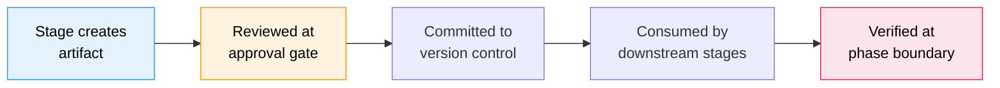

# Artifacts Reference

すべての AI-DLC ワークフローは、その **インテント記録ディレクトリ**
`aidlc/spaces/<space>/intents/<YYMMDD>-<label>/` の下に成果物を生成します（`<space>` は、
既定以外のスペースを使っていない限り `default` で、`<YYMMDD>-<label>` がインテントディレクトリです。
以下では `<record>/` と表記します）。この章は、
ディレクトリ構造、成果物ごとの説明、ライフサイクル、git ポリシーの完全なリファレンスです。

---

## Directory Tree

これは成果物が置かれうる場所の完全な一覧であり、作成直後の記録が
どう見えるかを示すものではありません。インテントの作成時には、スコープが実行するフェーズごとに 1 つのフォルダー（と
`verification/`）が作られます。それ以外は作業の進行に応じて現れ、ステージごとのフォルダーは
そのステージが最初に書き込んだときに作成されます。

フレームワークのファイルは、人間向けの成果物の隣にある 1 つの `.aidlc-engine/` ディレクトリを共有します。
アップグレード後も、既存の監査行は記録されたパスでレビューを引き続き検証します。
センサーの指摘とサマリーの承認は、対応する新しいディレクトリが存在しない間に限り、
古いディレクトリを使います。新しい書き込みは
`.aidlc-engine/` を使い、その他の一時ファイルや派生ファイルはそこに再作成されます。

```
aidlc/spaces/<space>/intents/<YYMMDD>-<label>/   # one record dir per intent
  aidlc-state.md                    # Workflow state (commit)
  project-description.json          # Your first request, exactly as given (commit)
  audit/                            # Audit trail — per-clone shards (commit)
    <host>-<clone>.md               # this clone's shard; readers glob + merge by timestamp
  .aidlc-engine/                    # Framework state (gitignore)
    sensors/                       # Advisory findings and type-check cache
    reviews/                       # Digest-bound review records and drafts
    summary-authorization/         # Active summary confirmations
    source-review/                 # Local reviewed-source snapshots
    hooks-health/                  # Hook heartbeats and drop counters
    plan.json                      # Derived scope plan
    state-writes.json              # Recent state writes, for doctor
    stop-hook/                     # No-progress guard counters
    human-turn                     # Last human prompt marker
    engine-touch                   # Last engine advance marker
    turn-end                       # Last step that ended the turn, until the person replies
    reviewer-dispatch.json         # Active per-unit reviewer scope
    document-input-path            # Document input handoff
    active-directive.json           # Transient execution cursor
    active-directive.lock/          # Cursor coordination
    guard-refusals/                 # Repeated refusal counters
    steering-token-key             # Local continuation signing key
    codekb-stage-<repo>/            # Temporary CodeKB candidates
  runtime-graph.json                # Execution telemetry view (gitignore)

  verification/                     # Phase boundary checks (commit)
    phase-check-ideation.md         # written by Approval and Handoff
    phase-check-inception.md        # written by Delivery Planning
    phase-check-construction.md     # written by CI Pipeline

  initialization/                   # Phase 0: stays empty (state and audit only)

  ideation/                         # Phase 1 artifacts
    intent-capture/
    market-research/                (conditional)
    feasibility/                    (conditional)
    scope-definition/
    team-formation/                 (conditional)
    rough-mockups/                  (conditional)
    approval-handoff/

  inception/                        # Phase 2 artifacts
    practices-discovery/            (conditional)
    requirements-analysis/
    user-stories/                   (conditional)
    refined-mockups/                (conditional)
    domain-design/             (conditional)
    units-generation/
    contract-design/           (conditional)
    delivery-planning/

  construction/                     # Phase 3 artifacts
    {unit-name}/                    (per unit of work, repeated)
      functional-design/            (conditional)
      nfr-requirements/             (conditional)
      nfr-design/                   (conditional)
      infrastructure-design/        (conditional)
      code-generation/
    build-and-test/
    ci-pipeline/                    (conditional)

  operation/                        # Phase 4 artifacts
    deployment-pipeline/            (conditional)
    environment-provisioning/       (conditional)
    deployment-execution/           (conditional)
    observability-setup/            (conditional)
    incident-response/              (conditional)
    performance-validation/         (conditional)
    feedback-optimization/          (conditional)

  archive/                          (created on-demand)
    {ISO-date}-{stage-name}/
```

ステージフォルダーの中には、ステージの成果物、質問ファイル、
学びがオンの場合は `memory.md` 日誌、そして `reviews/review-NN.md` があります。後者はステージの各レビューの読みやすい
コピーで、判定が出た順に番号が振られています。`mvp` 計画で Intent Capture を終え、
Feasibility を開始した後の記録は、次のようになっていました
（取得時のもので、`.aidlc-engine/` は省略しています）:

```text
aidlc/spaces/default/intents/261013-inventory-api/
  aidlc-state.md
  project-description.json
  runtime-graph.json
  audit/
    <host>-<clone>.md
  construction/
  ideation/
    feasibility/
      feasibility-questions.md
      memory.md
    intent-capture/
      intent-capture-questions.md
      intent-statement.md
      memory.md
      reviews/
        review-01.md
      stakeholder-map.md
  inception/
  initialization/
  verification/
```

**リバースエンジニアリングの 9 つの成果物は、記録ディレクトリにはありません。** それら
（`architecture.md`、`code-structure.md`、`technology-stack.md` など）は 1 つ上の
階層、スペースレベルのリポジトリごとの CodeKB
`aidlc/spaces/<space>/codekb/<repo>/` に置かれます。インテントごとのコピーではなく、リポジトリごとに 1 つのストアです。
プロジェクトフォルダー自体がリポジトリである場合、`<repo>` は最初は
フォルダー名（リンクされた git worktree ではメインのチェックアウトの名前）になり、
英字、数字、`.`、`_`、`-` 以外の文字はハイフンに置き換えられます（`portal app` は `portal-app` になります。
フォルダー自体の名前は変わりません）。この名前はストアに固定されます。プロジェクトフォルダーを移動、名前変更、コピーしても、同じ
ストアを読み続けます。例外は、どのインテントも自分のリポジトリとして記録していない
ストアを 2 つ以上持つスペースです。その場合は現在のフォルダー名が使われ、次のステップで、
完了済みのステージ結果がずれていることを警告する場合があります。該当する
ブラウンフィールドのインテントごとに、ステージはまずストアの
記録済みのスコープと作業ツリーのフィンガープリントを確認します。現在の状態であることが検証され、
カバー範囲がインテントに合うストアは、人間の選択によって再利用できます。そうでない場合は、完全な
再スキャンでその 9 つのファイルが置き換えられます。一方、焦点を絞ったスキャンでは、新たに
分析した領域をそれらにマージし、その範囲外の既存の記述は保持します。現在の状態であることが検証された
カバー範囲は和集合として蓄積されます。古い、または検証できない過去の深いカバー範囲は、
記述として残されたうえで浅いカバー範囲に格下げされます
（`reverse-engineering-timestamp.md` には、最後のスキャンがいつ実行され、何を
カバーしたかが記録されます）。スキャン前のソース/ストアの世代と、すべての成果物をロックした状態での
公開によって、ソースの変更が誤って現在のものとラベル付けされることや、
並行する焦点スキャンが互いを黙って置き換えることが防がれます。そのため、インテントは
自分の記録ディレクトリが作成された時点のスキャンではなく、リポジトリの最新のスキャンを
読みます。学びの儀式がオンの場合、
記録ディレクトリにはステージ自身の `memory.md` 日誌が置かれます。これはエンジンが
run-stage ディレクティブを発行するときに作成されます（下記の **ステージごとのメモリ日誌** を参照）。そのため、
`inception/reverse-engineering/`
ディレクトリがそこに現れることがあり、その中身は日誌だけです。CodeKB への書き込みは
`codekb > <repo> > <name>` というパンくずとともに監査ログに記録されるため、
インテントごとの記録には、何がいつ変わったかが引き続き残ります。

**チームのナレッジは記録ディレクトリにはありません。** 1 つ上の階層、スペースの
レベルにある `aidlc/spaces/<space>/knowledge/`（`intents/` の兄弟）に置かれます。そのため、
1 つのインテントの記録に閉じ込められることなく、スペース内のすべてのインテントにわたって蓄積されます。
エンジンはこれを空の状態で作成し、チームが任意の `aidlc-shared/` とエージェントごとのサブディレクトリの下に
自由形式のファイルを追加します。
[ナレッジ](08-knowledge.md) を参照してください。

**ステージごとのメモリ日誌。** 学びの儀式がオンの場合、実行された各ステージは
成果物と並べて、コミット対象の `memory.md` も保持します（例:
`<record>/inception/requirements-analysis/memory.md`）。これは
ステージの観察日誌です。エンジンが
run-stage ディレクティブを発行するときにテンプレートから作成し、ステージ中はオーケストレーターが、
エージェントの推論に関するステージの記録として管理します。その中の何かが、残すべきものとして
あなたに提示されることはありません。手作業で編集されることもありません。
あなたが行った修正を保持する学習ループについては、
[ルールと学習ループ](09-rules-and-the-learning-loop.md) を参照してください。

**コードは記録ディレクトリではなく、兄弟リポジトリに置かれます。** `aidlc/` ツリーが保持するのは
メソッド、状態、監査、成果物だけであり、アプリケーションコードは決して置かれません。生成されたコードは
ワークスペースの **コードリポジトリ** に置かれます。一般的な単一リポジトリの場合はプロジェクトディレクトリ
そのものです。マルチリポジトリのワークスペースでは、ワークスペースのルート直下の
子である兄弟リポジトリのディレクトリです（それぞれが独自の `.git` を持ちます。独自のコードを持つ
プロジェクトの git サブモジュールはこれに該当せず、そのプロジェクトは単一リポジトリの
ケースになります）。インテントは、作成時に
自分が触れるリポジトリを記録します（自動検出されるか、`--repos a,b` でスコープを指定します）。記録先は
`intents.json` の行（`repos: [...]`）です。Construction は、各 git 操作をそのうちの 1 つに
結び付けます。`repos` が記録されていないインテントは、既定の単一リポジトリになります。
[CLI コマンド](12-cli-commands.md) を参照してください。

---

## Artifact Lifecycle

成果物は、作成から下流のステージによる利用まで、予測可能なライフサイクルを通過します:



<!-- Text fallback: Stage creates artifact, reviewed at approval gate, committed to version control, consumed by downstream stages, verified at phase boundary. -->

1. **作成** — リードエージェントがステージの実行中に成果物を生成し、インテントの記録ディレクトリ内の適切なサブディレクトリに書き込みます（上記のスペースレベルの例外があります: Reverse Engineering はリポジトリごとの CodeKB ストアに、チームのナレッジは `knowledge/` に書き込みます）
2. **レビュー** — あなたが承認ゲートで成果物をレビューし、承認するか変更を依頼します
3. **コミット** — 承認後、成果物はバージョン管理に入れられる状態になります（下記の git ポリシーを参照）
4. **利用** — 下流のステージが成果物を入力として読みます（下記の入力の表を参照）
5. **検証** — フェーズ境界の検証チェックにより、フェーズ内のすべての成果物にわたるトレーサビリティが確認されます

---

## Artifacts by Phase

### Initialization (stages 0.1-0.3)

| ステージ | 残すもの | 備考 |
|-------|-----------|-------|
| 0.1 Workspace Scaffold | 記録ディレクトリ: 計画が実行するフェーズごとに 1 つのフォルダーと `verification/`、およびスペースの `knowledge/` | 決定的（`aidlc-utility intent-create` の中で実行される） |
| 0.2 Workspace Detection | `aidlc-state.md` 内の `Project Type` と `Workspace State` の根拠となるスキャン、および `WORKSPACE_SCANNED` 監査行 | 決定的なルールベースのスキャナー |
| 0.3 State Init | 完全な `aidlc-state.md` | 決定的 |

3 つのいずれも独自のドキュメントを書き込まないため、`initialization/` は空のままです。

ウェルカムメッセージは、セッション開始時に `settings.json` の `companyAnnouncements` によって表示されます。これはステージではなく、成果物も生成しません。

### Ideation (stages 1.1-1.7)

| ステージ | 主な成果物 | 条件 |
|-------|--------------|-----------|
| 1.1 Intent Capture | `intent-capture-questions.md`（ソース登録簿と確認済みの回答）、`intent-statement.md`、`stakeholder-map.md`（インラインのソースタグと必須の前提セクション） | 常に |
| 1.2 Market Research | `competitive-analysis.md`、`build-vs-buy.md` | 条件付き |
| 1.3 Feasibility | `feasibility-assessment.md`、`constraint-register.md`、`raid-log.md` | 条件付き |
| 1.4 Scope Definition | `scope-document.md`、`intent-backlog.md` | 常に |
| 1.5 Team Formation | `team-assessment.md`、`mob-composition.md` | 条件付き |
| 1.6 Rough Mockups | `wireframes.md`、`user-flow.md` | 条件付き |
| 1.7 Approval & Handoff | `initiative-brief.md`、`decision-log.md` | 常に |

### Inception (stages 2.1-2.9)

| ステージ | 主な成果物 | 条件 |
|-------|--------------|-----------|
| 2.1 Reverse Engineering | `architecture.md`、`code-structure.md`、`technology-stack.md` を含む 9 ファイル（スペースレベルの `aidlc/spaces/<active-space>/codekb/<repo>/` に書き込まれる。リポジトリごとに 1 つの共有ストアで、現在の状態と検証されれば再利用され、完全な再スキャンで置き換えられ、焦点を絞ったスキャンで累積的に拡張される。学びの儀式がオンの場合、インテントの記録に置かれるのはステージの `memory.md` 日誌だけ） | ブラウンフィールドのみ |
| 2.2 Practices Discovery | `team-practices.md`、`discovered-rules.md`、`evidence.md`、`practices-discovery-timestamp.md`、および quality/developer/devsecops の貢献ファイル（承認後に `aidlc/spaces/<active-space>/memory/team.md` と `project.md` に昇格される） | 条件付き |
| 2.3 Requirements Analysis | `requirements.md` | 常に |
| 2.4 User Stories | `stories.md`、`personas.md` | ユーザー向けの機能 |
| 2.5 Refined Mockups | `mockups.md`、`interaction-spec.md`、`accessibility-checklist.md` | UI プロジェクト |
| 2.6 Domain Design | `components.md`（統合されたコンポーネントカタログ）、`decisions.md`（ADR ログ） | 新しいコンポーネントが必要な場合 |
| 2.7 Units Generation | `unit-of-work.md`、`unit-of-work-dependency.md`、`unit-of-work-story-map.md` | 常に |
| 2.8 Contract Design | `contract-summary.md`（ユニット間の契約と、公開 API または外部 API） | ユニットが複数ある場合、またはシステム外部から使われる API を持つユニットがある場合 |
| 2.9 Delivery Planning | `bolt-plan.md`、`team-allocation.md`、`risk-and-sequencing-rationale.md`、`external-dependency-map.md` | 常に |

### Construction (stages 3.1-3.7)

ステージ 3.1〜3.5 は作業ユニットごとに繰り返されます。成果物は `construction/{unit-name}/{stage-name}/` に置かれます。ステージ 3.6〜3.7 は、すべてのユニットの後に 1 回実行されます。

4 つの設計ステージ（3.1〜3.4）は、成果物を各ユニットの **種類**（2.7 のエッジブロックでタグ付けされる: `service`、`spec`、`ui`、`packaging`、`library`）に合わせて絞り込みます。`spec` ユニットにはスケーラビリティのドキュメントは不要で、`packaging` ユニットには機能仕様は不要です。タグのないユニットには、下記の完全なマトリクスが適用されます。どの成果物がどの種類に適用されるかは、ステージの frontmatter のデータです（`produces_kinds`。[ステージ定義](../reference/15-stage-definition.md) を参照）。あるステージの成果物がどれも適用されないユニットは、ファイル 0 個でそのステージを完了します。

| ステージ | 主な成果物 | 条件 |
|-------|--------------|-----------|
| 3.1 Functional Design | `entities.md`、`rules.md`、`functional-spec.md` | 計画に応じて、ユニットごと（種類別） |
| 3.2 NFR Requirements | `security-requirements.md`、`performance-requirements.md` | 計画に応じて、ユニットごと（種類別） |
| 3.2 NFR Requirements | `observability-requirements.md` | 計画に応じて、service ユニットのみ |
| 3.3 NFR Design | `security-design.md`、`performance-design.md` | 計画に応じて、ユニットごと（種類別） |
| 3.3 NFR Design | `observability-design.md` | 計画に応じて、service ユニットのみ |
| 3.4 Infrastructure Design | `infrastructure-specification.md`、`monitoring-design.md`、`cicd-pipeline.md` | 計画に応じて、ユニットごと（種類別） |
| 3.5 Code Generation | `code-generation-plan.md`、`code-generation-questions.md`、`unit-test-instructions.md`、`code-summary.md`、`traceability.json`、およびエンジンが必須とする `source-manifest.json`（コードはワークスペースのルートに置かれる） | 常に、ユニットごと |
| 3.6 Build and Test | `build-instructions.md`、`test-results.md` | 常に、すべてのユニットの後 |
| 3.7 CI Pipeline | `ci-config.md`、`quality-gates.md` | 条件付き、すべてのユニットの後 |

### Operation (stages 4.1-4.7)

| ステージ | 主な成果物 | 条件 |
|-------|--------------|-----------|
| 4.1 Deployment Pipeline | `cd-config.md`、`deployment-strategy.md`、`rollback-runbook.md` | 条件付き |
| 4.2 Environment Provisioning | `environment-inventory.md`、`validation-report.md` | 条件付き |
| 4.3 Deployment Execution | `deployment-log.md`、`smoke-test-results.md` | 条件付き |
| 4.4 Observability Setup | `dashboards.md`、`alarms.md`、`slo-config.md` | 条件付き |
| 4.5 Incident Response | `runbooks.md`、`incident-plan.md`、`escalation-matrix.md` | 条件付き |
| 4.6 Performance Validation | `load-test-plan.md`、`nfr-validation-matrix.md` | 条件付き |
| 4.7 Feedback & Optimization | `slo-report.md`、`cost-analysis.md`、`feedback-loop.md` | 条件付き |

---

## Question Files

ユーザーの入力を収集するすべてのステージは、`{stage-name}-questions.md` という名前の質問ファイルを同じ場所に生成します。質問には文字付きの選択肢（A〜E。質問ボックスに 4 つまで表示される Claude Code では A〜D）と、必須の `X. Other (please specify)` 選択肢があり、回答を記録するための `[Answer]:` タグが付きます。エージェントが作成するファイルでは、通常の質問の見出しに、通常それに答える人が記載されます（`## Q3. [Developer] ...`）。各人の質問は、ある質問が別の人の回答を待たなければならない場合を除き、まとめて配置されます。後から追加された質問は末尾に置かれます。確認、変更依頼、承認のセクションにはラベルは付きません。既存のファイルは、ステージを最初からやり直すよう依頼しない限り、質問がそのまま保持されます。やり直す場合は新しいファイルに置き換えられます。

各ステージで、回答方法を選びます:

| モード | 仕組み |
|------|-------------|
| **Guide me** | エージェントがここで質問をまとめて尋ねます（Claude Code では一度に最大 4 つまで表示されます） |
| **I'll edit the file** | 質問ファイルを直接編集し、完了したらエージェントに伝えます |
| **Chat** | 自由形式の会話です。決定事項が抽出され、ファイルに書き込まれます |

以降のステージでは選んだ方法が再利用され、ステージの途中で切り替えることもできます。質問ファイルが常に唯一の正となる情報源です。[インタラクションモード](07-interaction-modes.md) を参照してください。

---

## What to Commit vs. Gitignore

同梱の `.gitignore` は、この区分を反映しています。共有される作業（メソッド、レジストリ、
状態、監査、成果物）はコミットされ、ユーザーごとのセッションカーソル、あなた自身の
設定、マシンローカルな派生状態は無視されます。

| コミットする | Gitignore する |
|--------|-----------|
| `aidlc-state.md` | `aidlc/active-space`、`intents/active-intent`（ユーザーごとのカーソル） |
| `audit/*.md`（クローンごとのシャード） | `.aidlc-engine/`（フレームワークの状態） |
| すべてのステージの成果物 | `runtime-graph.json`（監査シャードから再導出可能） |
| `verification/` のフェーズチェック結果 | `aidlc/.aidlc-clone-id`（このクローンのシャード名を決める。マシンローカルのままにする必要がある） |
| スペースレベルの `aidlc/spaces/<space>/knowledge/` にあるチームのナレッジファイル | `aidlc/.aidlc-sessions/`（セッションごとの UUID スタンプ、ワークフローのバインディング、PID の祖先マップ） |
| ステージごとの `memory.md` 日誌、スペースの `memory/` レイヤー | `.aidlc-engine/hooks-health/`、`.aidlc-engine/sensors/`（ハートビート、助言的な指摘） |
| レビューされた各ステージの `reviews/` のコピー | `.claude/settings.local.json`、`aidlc.settings.local.json`（あなた自身の設定） |
| | `aidlc/active-memory/`（すべてのハーネスのインクルードが読む、アクティブなスペースの `memory/` のエンジンによるコピー。セッション開始時とスペース切り替え時に書き込まれるため、切り替えによって追跡対象のファイルが変わることはありません。コピーされた各ファイルの先頭には、編集すべきファイルを示すコメントがあり、コピー側で行った編集は次回の更新で置き換えられます） |
| | `aidlc/.aidlc-request-text/`（エージェントがエンジンに読ませるためにファイルに書き出したリクエスト。コマンドが実行されると削除され、実行されなかった場合は残ります） |

---

## Inputs and Dependencies

各ステージは、前のステージの成果物を入力として読みます。主な依存関係の連鎖:

- **Intent Capture** の成果物は、Market Research、Feasibility、Scope Definition、Rough Mockups に流れます
- **Requirements Analysis** の成果物は、User Stories、Domain Design、およびすべての Construction ステージに流れます
- **Domain Design** と **Units Generation** の成果物は、ユニットごとのすべての Construction ステージに流れます
- **すべての Construction の成果物** は、Build and Test と CI Pipeline に流れます
- **Infrastructure Design** の成果物は、Operation ステージに流れます

各ステージ自身の入力は、Developer Reference の各フェーズのページに記載されています: [Initialization](../reference/04-stages/initialization.md)、[Ideation](../reference/04-stages/ideation.md)、[Inception](../reference/04-stages/inception.md)、[Construction](../reference/04-stages/construction.md)、[Operation](../reference/04-stages/operation.md)。

---

## Phase Boundary Verification

3 つのステージが、トレーサビリティのチェックでフェーズを締めくくり、その結果を `verification/` に書き込みます。そのステージを省略する計画では、そのフェーズのチェックは行われません（たとえば `mvp` は Approval and Handoff を省略します）:

| チェックファイル | 書き込むステージ | 検証内容 |
|-----------|-----------|-------------------|
| `phase-check-ideation.md` | 1.7 Approval and Handoff | インテントからスコープ、インテントバックログまでの一貫性 |
| `phase-check-inception.md` | 2.9 Delivery Planning | 要件からストーリー、アーキテクチャまでの整合 |
| `phase-check-construction.md` | 3.7 CI Pipeline | すべてのユニットがビルド・テスト済みで、CI が構成されていること |

---

## Next Steps

- [状態の追跡と監査証跡](10-state-and-audit.md) — 状態ファイルと監査証跡の詳細
- [ステージの実行方法](04-phases-and-stages.md) — ステージの実行と成果物の生成
- [用語集](glossary.md) — 成果物、フェーズ境界の検証、質問ファイルの定義
