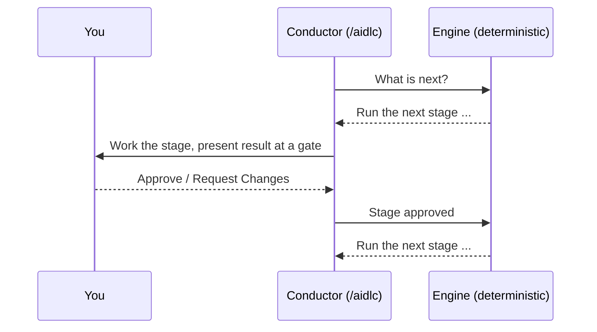

# Onboarding: A Guided First Week

AI-DLC v2 は初めてですか？ どのチームからも同じ声を聞きます: 決定論的なフェーズとステージの強制は強力だが、エンジンが*なぜ*そのように振る舞うのかがわかりにくく、そのせいで最初の数回の実行は、ツールを使っているというよりツールと戦っているように感じられる、というものです。

この章は、手取り足取りの道筋です。他のすべてが腑に落ちるようになる1つのメンタルモデルを説明し、使い捨ての Express 実行から本格的な機能開発まで、意図的に組み立てた 5 回の実行を順に案内します。順番どおりに進めてください。終わる頃には、強制が拘束衣ではなくシートベルトのように感じられるはずです。

> **インストール済みで、すぐに始めたいですか？** [Run 1](#run-1-a-throwaway-express-run-15-minutes) に進んでください。まだインストールしていない場合は、先に [はじめに](01-getting-started.md) を済ませてから、ここに戻ってきてください。

---

## The one idea that makes AI-DLC click

AI-DLC は、要件、判断、実装のつながりを保つために、ワークフローのルーティングと実行を分離しています。

**決定論的なエンジンがルーティングを担い**、**コンダクターが実行を担います**:

- **エンジン**（AI ではない普通のプログラム）は、*次に何が起きるか*を決めます: どのステージを実行するか、スコープがどのステージをスキップするか、ゲートがいつブロックすべきか、フェーズの境界をいつ検証するか。エンジンは決定論的です — 同じ状態を入れれば、同じ次の一手が出てきます。即興はしません。
- **コンダクター**（`/aidlc` のセッション）は、*作業をどれだけうまく行うか*を決めます: 適切なエージェントのペルソナを採用し、良い質問をし、判断すべきことを提示します。ルーティングを決めることは決してありません。エンジンに次の一手を尋ね、それを実行し、結果を報告して、また尋ねます。



<!-- Text fallback: The conductor asks the engine what is next. The engine returns a specific stage. The conductor runs that stage with you and stops at an approval gate. You approve or request changes. The conductor reports the outcome to the engine, which returns the next move. The loop repeats. -->

**初めて使う方にとってこれが重要な理由:** 「なぜ頼んだことをそのままやってくれないのか？」と感じる場面のほとんどは、コンダクターが自由に動くことを期待しているところから生じます。設計上、それはできません。ステージが止まっているように見える場合、それはエンジンが何かを待っているからです — たいていはゲートでのあなたの回答か、前のステージからの欠けている入力です。「ルーティングはエンジンが行い、自分はゲートのブロックを解除する」と腹落ちすれば、強制は謎めいたものではなくなります。

アーキテクチャの全体像は、後で [はじめに（概要）](00-introduction.md#how-the-orchestrator-works) を読んでください。今のところは、この1段落で十分です。

---

## Four rules of the road

次の4つの事実が、初めて使う方が最も驚く振る舞いを説明します。最初の1週間は、これらを念頭に置いてください。

### 1. Stages run in order, and never before their inputs exist

ライフサイクルは5つのフェーズ — **Initialization → Ideation → Inception → Construction → Operation** — からなり、その中のステージは決まった順序で実行されます。ステージが、必要な入力がそろう前に実行されることは決してありません。Construction は、スコープに含まれる前のステージが必要な成果物を作り終えるまで、コードを書けません。これは、利用者が最初に感じる強制です。これは官僚主義ではありません: まだ存在しない入力の上に構築することを、エンジンが拒否しているのです。

儀式を*減らし*たい場合は、エンジンを迂回するのではなく、より小さな**スコープ**を選びます。スコープは、ステージ全体（ときにはフェーズ全体）を最初からルートから取り除きます。ルール 3 を参照してください。

### 2. Approval gates block on purpose

ほとんどのステージの後、ワークフローは**承認ゲート**で止まり、あなたが **Approve** または **Request Changes** を選ぶのを待ちます。これは本当にブロックされています — 自分から先へ進むことはありません（自動の初期化ステージと、オプトインした場合の通常の Construction のチェックポイントを除く）。

ゲートはあなたのコントロールポイントです。完了サマリーには、作成されたものと未解決の指摘が表示されます。各指摘には安定した ID が付いているので、後の再チェックで、同じ懸念が解決したのか、まだ未解決なのか、リスクとして受け入れられたのかがわかります。未解決の指摘があるまま承認すると、それらは受け入れたものとして記録されます — それで問題なく、ごく普通のことです。

ゲートでは、次に何が起きるかをあなたが選びます: 承認する、変更を依頼する、対話モードを切り替える、別のステージにジャンプする。[インタラクションモード](07-interaction-modes.md) を参照してください。作業はゲートの外で止まることもあります。フックが動かない場合や、チェックがエージェントのコマンドを拒否し続ける場合です。これは障害であり、あなたが何か間違えたわけではありません: [When something looks stuck](#when-something-looks-stuck) を参照してください。

### 3. Scope controls how much runs — pick a small one first

フルの `feature` は、セットアップ後に 30 のステージすべてを実行します。これは本番の機能には適切な量の儀式ですが、最初に試すには多すぎます。**スコープ**（*ワークフロープロファイル*とも呼びます）は、儀式を増減させるためのダイヤルです:

| やりたいこと | 使うもの | ステージ |
|---|---|---|
| 全体を最初から最後まで素早く見る | `express` | 7 / 30 |
| 既知のバグを1つ直す | `bugfix` | 6 / 30 |
| アイデアがそもそも実現可能か試す | `poc` | 5 / 30 |
| 本番の機能を本格的に作る | `feature` | 30 / 30 |

小さく始めてください。`poc` や `express` の実行なら、ゲートに埋もれることなく、数分でループを学べます。全体の一覧は [ワークフロープロファイル](workflow-profiles.md) を、深さとテスト戦略が各スコープをどう調整するかは [スコープ、深さ、テスト戦略](05-scopes-and-depth.md) を参照してください。

### 4. Everything is written down — the record dir is your memory

すべてのステージは、インテントの**記録ディレクトリ**にバージョン管理された Markdown を書きます:

```text
aidlc/spaces/<space>/intents/<YYMMDD>-<label>/
```

要件、判断、設計、コードのサマリー、完全な `audit/` の証跡はすべてそこにあります。これが、プロジェクトが大きくなっても AI-DLC が脈絡を見失わない理由であり、何かが*なぜ*作られたのかを知りたいときに見る場所です。まだレイアウト全体を理解する必要はありません — 何が起きたのかわからなくなったときは、その答えがそのフォルダのディスク上にある、とだけ覚えておいてください。[スペースとインテント](03-spaces-and-intents.md) と [成果物リファレンス](14-artifacts-reference.md) を参照してください。

---

## The guided progression

次の5回の実行を順番に行ってください。それぞれが新しい考え方をちょうど1つ加えます。Runs 1–3 には、捨ててもかまわないスクラッチのプロジェクトを使ってください。

> 以下の例では Claude Code を使います。他のハーネスもまったく同じワークフローを実行し、違うのはウェルカムバナーとステータスラインだけです。各ハーネスの違いは [Running on other harnesses](harnesses/README.md) にあるそのハーネスの章に、完全な注釈付きの実行例は [最初のワークフロー](02-your-first-workflow.md) にあります。

### Run 1: A throwaway Express run (15 minutes)

**目標:** 尋ねる → ステージ → ゲート → 次へ、のループを、最小の儀式で一度体験します。

```bash
mkdir /tmp/aidlc-hello && cd /tmp/aidlc-hello
aidlc config --harness claude   # use your harness
aidlc doctor
```

ハーネスを開き、最も軽いプロファイルを実行します:

```text
/aidlc express Build a CLI that converts between Celsius and Fahrenheit
```

何が起きるかを見てください:

1. **Initialization が自動的に実行されます。** 3つのステージが、ゲートなしで1秒もかからずに完了します。あなたは何もしていません — これがライフサイクルの始まりです。
2. **ルートが告知されます。** `express` を指定したので、ワークフローはすぐに始まり、実行するステージと承認ゲートの数を表示します。
3. **最初のゲートに到達します。** ステージが何かを作り、サマリーを表示して止まります。これがルール 2 です。サマリーを読み、**Approve** を選びます。
4. **ループが繰り返されます**。実行が完了するまで続きます。

**注目すべき点:** 「次は要件、次は設計」と指示したことは一度もありません。すべてのステップはエンジンがルーティングし、あなたはゲートに答えただけです。1回の実行に、モデルの全体が表れています。

### Run 2: The same idea as a `poc` — see scope change the route

**目標:** 儀式を制御するのはスキップではなくスコープであることを、自分で確かめます。

新しいスクラッチフォルダで（Run 1 と同様に、まずそこで `aidlc config --harness <your harness>` を実行します）、同じ種類の依頼を概念実証として実行します:

```text
/aidlc poc Build a CLI that converts between Celsius and Fahrenheit
```

Run 1 と比べてみてください。`poc` は異なるスコープのルートを持つので、異なるステージの組が実行されます。あなたはプロファイルを変えることで、何が*どれだけ*起きるかを変えました — 手で何かをスキップしたのではなく、エンジンが異なるルートを計画したのです。これがルール 3 の具体例です。各プロファイルにどのステージが含まれるかは、[スコープ別ステージ表](05-scopes-and-depth.md#stage-by-scope-matrix) をざっと見ると正確にわかります。

### Run 3: Request changes at a gate — feel your control point

**目標:** ゲートは単なる形式的な承認ではなく、双方向の扉であることを学びます。

もう一度小さな `poc` の実行を始めます（`poc` はレビュアーのいる Intent Capture を実行しますが、`express` はレビュアーを無効にします）。最初のステージゲートで、承認する代わりに **Request Changes** を選び、具体的な指示を1つ与えます（たとえば「成功基準には目標日が必要」）。コンダクターがその成果物に戻って修正し、もう一度ゲートを提示する様子を見てください。

**注目すべき点:** レビュアーが指摘を挙げた場合、その ID は再チェックをまたいで変わらないので、同じ項目が未解決から解決済みに移るのを確認できます。いずれにしても、コンダクターは成果物を修正してゲートを再提示します。これが、自分でファイルを編集せずに舵を取る方法です。試し終えたら、承認して最後まで実行させてください。ステージの途中で切り替えられる Guide Me / Edit File / Chat の各モードについては、[インタラクションモード](07-interaction-modes.md) を参照してください。

### Run 4: Inspect the record dir — find the "why" on disk

**目標:** ワークフローと、それが残す成果物を結び付けます。

Run 3 が完了したら、インテントの記録ディレクトリを開きます:

```bash
ls aidlc/spaces/default/intents/
# open the newest <YYMMDD>-<label>/ folder
```

`aidlc-state.md` を読み（実行したステージには `[x]`、スコープで除外されたステージには `[S]` が付いています）、スコープが実行したフェーズのフォルダ（たとえば `inception/`）の下にある成果物にざっと目を通します。`audit/` のシャードを1つ開き、判断がタイムスタンプ付きで記録されていることを確認します。これがルール 4 です: 記録ディレクトリは、成長するプロジェクトの一貫性を保つ永続的な記憶です。[状態と監査](10-state-and-audit.md) と [成果物リファレンス](14-artifacts-reference.md) を参照してください。

### Run 5: A real `feature` on real code

**目標:** 本当に大事な作業で、すべてを組み合わせます。

実際のプロジェクトで、次を実行します:

```text
/aidlc feature <describe the feature you want>
```

これはライフサイクル全体を実行します。最初は多く感じるでしょう — それが本番の機能に見合った儀式です。しかし、今のあなたは全体の形を知っています: エンジンがルーティングし、フェーズは順番に実行され、ゲートはあなたのコントロールポイントであり、スコープが規模を決め、すべての判断は記録ディレクトリに残ります。ゲートごとの解説として [最初のワークフロー](02-your-first-workflow.md) をこの実行と並べて読み、何かが止まっているように見えたらすぐに [トラブルシューティング](15-troubleshooting.md) を頼ってください。

---

## When something looks stuck

初めて使う方は、たいてい次のいずれかに出会います。ほとんどは設計どおりにワークフローが動いているだけですが、最後の行は障害です:

| 症状 | 実際に起きていること | すべきこと |
|---|---|---|
| 「止まったまま先に進まない。」 | 承認ゲートにいます（ルール 2）。 | サマリーを読み、**Approve** または **Request Changes** で答えます。 |
| 「すぐにコードを書いてくれない。」 | Construction には前のフェーズからの入力が必要です（ルール 1）。 | 前のステージを実行させるか、より小さなスコープを選びます。 |
| 「ステップが多すぎる。」 | スコープがタスクに必要な規模より大きいです（ルール 3）。 | `express`、`poc`、`bugfix` のいずれかでやり直します。 |
| 「質問が多すぎる。」 | 深さが各ステージの質問数を決め、スコープが既定値を選びます。 | `/aidlc --depth minimal` と入力します（ステージあたり約 2〜4 問）。 |
| 「今どのステージにいるのか？」 | ステータスライン / 進捗行が教えてくれます。 | Claude Code では、AI-DLC のステータスラインをオンにしていればそれを見ます（`/aidlc --statusline on`）。それ以外では `/aidlc --status` を実行します（Codex では `$aidlc --status`）。 |
| 「あの判断はどこへ行った？」 | 記録ディレクトリにあります（ルール 4）。 | `aidlc/spaces/<space>/intents/<...>/` とその `audit/` のシャードを開きます。 |
| 「エージェントが実行するコマンドがすべて拒否される」、または同じステップが繰り返され続ける。 | ワークフローの下で何かが失敗しています: フックが動いていないか、チェックが誤って拒否しています。 | エージェントを止め、自分のターミナルで `aidlc doctor --export` を実行し、[復旧手順](facilitator-guide.md#recovery-playbook) に従います。 |

セットアップ、フック、プロバイダー、信頼、古い状態に関する問題は、プロジェクトのルートから `aidlc doctor` を実行してください — 修復のコマンドを示してくれます。その後、[トラブルシューティング](15-troubleshooting.md) を参照してください。

---

## Onboarding checklist

- [ ] エンジンとコンダクターの役割分担を1文で説明できる。
- [ ] `express` の実行を完了し、ゲートに答えただけだった。
- [ ] 同じアイデアを別のスコープで実行し、ルートが変わるのを確認した。
- [ ] ゲートで **Request Changes** を使い、コンダクターが修正して再提示するのを見た。
- [ ] 記録ディレクトリで、要件、判断、監査のシャードを見つけた。
- [ ] 本物の `feature` を最初から最後まで実行した。

すべてのボックスにチェックが付けば、決定論的な強制は摩擦ではなく予測可能性として感じられるはずです — それこそが狙いです。

---

## Next Steps

- [最初のワークフロー](02-your-first-workflow.md) — 完全な注釈付きの機能開発の実行例
- [ワークフロープロファイル](workflow-profiles.md) — すべてのスコープと、それぞれの使いどころ
- [フェーズとステージ](04-phases-and-stages.md) — 5 フェーズ、33 ステージの全体マップ
- [インタラクションモード](07-interaction-modes.md) — Guide Me、Edit File、Chat、そしてゲート
- [スペースとインテント](03-spaces-and-intents.md) — ワークスペースが多くの実行をどのように保持するか
- [用語集](glossary.md) — すべての用語の定義
